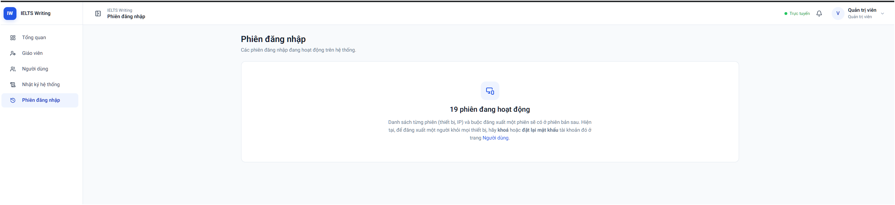
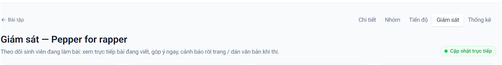
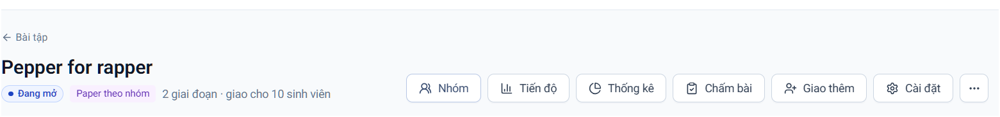
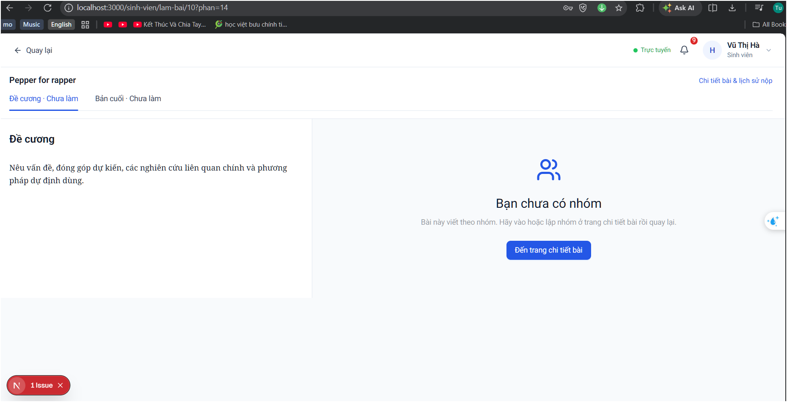
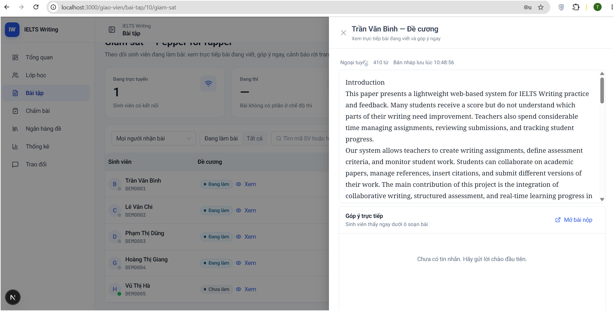
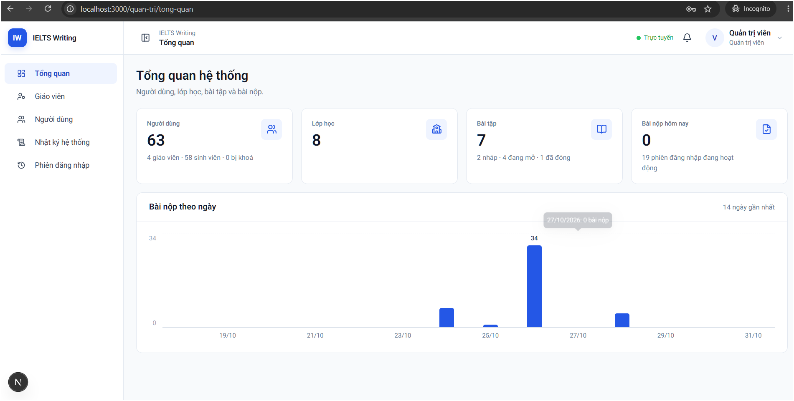

# Prompt hoàn thiện hệ thống IELTS Writing

Bạn là senior full-stack developer tiếp tục phát triển repo `D:\Desktop\Ielts-system`.

## Mục tiêu

Hoàn thiện hệ thống IELTS Writing với navigation thống nhất, quản lý phiên đăng nhập đầy đủ, giao diện viết Paper cân đối, giáo viên nhận xét/chỉ lỗi realtime khi sinh viên đang viết và màn thống kê có chiều sâu hơn.

Trước khi sửa, đọc `AGENTS.md`, `CLAUDE.md`, `backend/AI-CODING-RULES.md`, `frontend/AI-CODING-RULES.md`, `PROGRESS.md` và các tài liệu liên quan trong `docs/`. Không commit/push, không xoá thay đổi của người dùng, không ghi password/token vào code hoặc tài liệu. Mọi chuỗi hiển thị phải bằng tiếng Việt.

## Ảnh tham chiếu

## 1. Đồng bộ menu, chỉ dùng một hệ thống điều hướng

- Rà soát toàn bộ route admin, giáo viên và sinh viên; tìm các menu/nút trùng chức năng.
- Menu trái là điều hướng cấp hệ thống.
- Header trang chi tiết bài chỉ giữ breadcrumb, tên bài và các tab thuộc bài: `Chi tiết`, `Nhóm`, `Tiến độ`, `Giám sát`, `Thống kê`.
- Các thao tác `Giao thêm`, `Cài đặt`, `Đóng bài`, `Nhân bản` đưa vào nhóm hành động hoặc menu `...`, không lặp lại ở sidebar.
- Giữ route cũ nếu có thể; active state phải đúng cả route con.
- Responsive: desktop dùng tab, mobile dùng tab cuộn ngang hoặc dropdown; không tràn ngang.
- Không tạo thêm layout/sidebar mới nếu đã có layout dùng chung.

Tiêu chí nghiệm thu: mỗi chức năng chỉ có một vị trí điều hướng rõ ràng; quyền hiển thị đúng vai trò; breadcrumb và active state đúng.

## 2. Hoàn thiện màn Phiên đăng nhập

### Backend

- Kiểm tra `user_sessions`, repository, service và cơ chế single-login hiện có.
- Bổ sung API admin xem phiên đang hoạt động, lọc username/họ tên/vai trò/trạng thái/thời gian, phân trang và sắp xếp.
- Có API thu hồi một phiên, thu hồi toàn bộ phiên của tài khoản và dọn phiên hết hạn.
- Response an toàn gồm `sessionId`, người dùng, thời điểm tạo/hoạt động/hết hạn, IP che một phần, user-agent rút gọn, trạng thái và cờ `current`.
- Tuyệt đối không trả access token/refresh token và không log token.
- Phiên bị thu hồi phải bị từ chối khi refresh hoặc gọi API tiếp theo.
- Phát thông báo realtime khi phiên bị thu hồi hoặc bị đăng nhập ở nơi khác.
- Ghi audit log thao tác thu hồi nhưng không ghi dữ liệu bí mật.
- Viết test quyền, phân trang, thu hồi một/tất cả, refresh phiên bị thu hồi và phiên hết hạn.

### Frontend

- Thay card số lượng bằng bảng danh sách phiên.
- Có bộ lọc, phân trang, loading, empty state, error state và refresh.
- Hiển thị thiết bị/trình duyệt, IP che, hoạt động lần cuối, hết hạn, trạng thái `Đang hoạt động`/`Đã hết hạn`/`Đã thu hồi`.
- Có modal xác nhận và toast khi thu hồi; cập nhật bảng không reload toàn trang.

## 3. Sửa giao diện trang sinh viên làm Paper

- Rà soát `PaperEditMode`, `PaperOutline`, editor và layout liên quan.
- Dùng một grid chung: cột mục lục có chiều rộng ổn định, editor chiếm phần còn lại, hai cột thẳng hàng và có chiều cao/scroll hợp lý.
- Không đặt phần `Đề cương` trong một card lệch container so với editor.
- Khi chưa có nhóm: vẫn hiển thị đề cương bên trái; bên phải hiển thị empty state `Bạn chưa có nhóm` và nút tới trang chi tiết bài.
- Khi đã có nhóm: hiển thị tài liệu chung, trạng thái đồng bộ, người đang online và lần lưu gần nhất.
- Template Paper phải dùng tiếng Việt thống nhất, không trộn tên section tiếng Anh/Vietnamese ngoài chủ ý.
- Chuẩn hóa heading, line-height, margin, border, divider và màu chữ.
- Responsive: desktop hai cột, tablet thu gọn mục lục, mobile mục lục nằm trên editor hoặc mở drawer.
- Kiểm tra hydration, Yjs, đổi tab, refresh, autosave và không mất nội dung.

Tiêu chí nghiệm thu: đề cương/editor thẳng hàng; chưa có nhóm vẫn nhìn thấy đề cương; không tràn ngang; nội dung không mất.

## 4. Giáo viên nhận xét và chỉ lỗi Paper realtime

Đây là phản hồi hướng dẫn trong lúc viết, không phải chấm chính thức. Không hiển thị rubric/checklist trong viewer realtime và không cho giáo viên sửa trực tiếp nội dung sinh viên ở mức này.

### Trải nghiệm

- Từ màn `Giám sát`, giáo viên mở sinh viên/nhóm đang làm và xem Paper mới nhất.
- Hiển thị section hiện tại, online/offline, người đang chỉnh sửa, lần snapshot gần nhất và số từ.
- Khi bôi đen đoạn văn, hiện toolbar `Nhận xét`, `Chỉ lỗi`, `Gợi ý sửa`, `Bỏ chọn`.
- Form có quote chỉ đọc, loại phản hồi (`Nhận xét`, `Lỗi ngữ pháp`, `Từ vựng`, `Mạch lạc`, `Trích dẫn`, `Định dạng`) và nội dung.
- Giáo viên được gửi/sửa/xoá phản hồi của mình.
- Sinh viên thấy highlight/comment realtime dưới editor; thông báo không làm mất focus.
- Nếu nội dung thay đổi làm quote/offset không khớp, giữ quote gốc và hiện `Đoạn văn đã thay đổi`, không gắn nhầm sang đoạn khác.

### Backend/API/DB

- Tách live comment khỏi `inline_comments` của submission.
- Dữ liệu gồm document, section nếu có, author, start/end offset, quote, loại lỗi, comment, created/updated và trạng thái mở/đã xử lý.
- Chỉ giáo viên chủ bài được tạo/sửa/xoá; thành viên nhóm và giáo viên chủ bài được đọc.
- Kiểm tra quyền ở REST và STOMP.
- REST: lấy danh sách, tạo, sửa, xoá, đánh dấu đã xử lý nếu cần.
- STOMP topic Paper phát `CREATED`, `UPDATED`, `DELETED`, `RESOLVED` sau commit.
- Giới hạn độ dài quote/comment và tần suất để tránh spam.
- Viết test quyền, validation, document không tồn tại và event realtime.

### Frontend kỹ thuật

- API client riêng cho live comments; lấy danh sách ban đầu bằng REST rồi subscribe STOMP.
- Dùng decoration/mark hoặc lớp highlight để đánh dấu đoạn có nhận xét.
- Click highlight mở comment card; click card cuộn tới đoạn tương ứng.
- Có loading, retry, lỗi kết nối và trạng thái đã gửi.
- Comment không được làm thay đổi nội dung Paper.

## 5. Mở rộng màn Thống kê

Không tải toàn bộ submission về frontend. Tạo API aggregate/pagination riêng, xác định rõ mẫu số và timezone.

### Tổng quan hệ thống

- Người dùng theo vai trò, người dùng mới, người hoạt động 7/30 ngày.
- Lớp đang hoạt động/đã đóng.
- Bài tập theo `ESSAY`/`PAPER`, trạng thái nháp/đang mở/đã đóng.
- Bài được giao, đang làm, đã nộp, quá hạn; tỷ lệ đúng hạn/quá hạn.
- Session active, đăng nhập thất bại nếu audit hỗ trợ.
- Số nhóm Paper và sinh viên chưa có nhóm.

### Theo bài tập

- Phân bố `Chưa làm`, `Đang làm`, `Đã nộp`, `Cần sửa`, `Đã trả`.
- Tỷ lệ hoàn thành theo lớp/nhóm; thời gian tới lần lưu đầu/lần nộp.
- Số lần nộp trung bình; tỷ lệ đúng hạn.
- Điểm trung bình, trung vị, min/max, phân bố band IELTS hoặc điểm Paper thang 10.
- Điểm theo tiêu chí, mức đạt rubric, điều chỉnh thành viên.
- Lỗi/feedback dùng nhiều; số comment trực tiếp Paper.
- Số người online, document mở, update/comment theo thời gian.

### Theo lớp

- So sánh hoàn thành giữa các bài.
- Bảng sinh viên: bài được giao, đã nộp, quá hạn, điểm/band gần nhất, tiến bộ.
- Sinh viên không hoạt động 7 ngày hoặc nhiều lần cần sửa.
- Phân bố lỗi grammar, vocabulary, coherence, task response, citation.
- Paper: số đóng góp/update, section hoàn thành, comment đã xem/chưa xem.

### UI, bộ lọc và xuất dữ liệu

- KPI cards có so sánh kỳ trước.
- Line chart bài nộp theo ngày/tuần.
- Stacked bar trạng thái.
- Histogram điểm/band.
- Bar chart điểm theo tiêu chí.
- Heatmap hoạt động theo ngày/giờ.
- Bảng cảnh báo có phân trang.
- Bộ lọc thời gian, lớp, giáo viên, bài, loại bài, trạng thái; chip bộ lọc và nút xoá.
- Xuất CSV/XLSX đúng bộ lọc, tên cột tiếng Việt, timezone rõ.
- Admin xem toàn hệ thống; giáo viên chỉ xem lớp/bài của mình.

### Quy tắc dữ liệu

- Không tính bản nháp là đã nộp.
- Không đếm trùng thành viên Paper theo nhóm.
- Không đếm một sinh viên hai lần do nhiều session.
- Tỷ lệ phải ghi rõ tử số/mẫu số.
- Có empty state khi không đủ dữ liệu, không dùng biểu đồ giả.
- Viết test cho aggregate và trường hợp không có dữ liệu.

## 6. Thứ tự triển khai

1. Đồng bộ menu và layout dùng chung.
2. Hoàn thiện phiên đăng nhập.
3. Sửa layout Paper và empty state nhóm.
4. Hoàn thiện live feedback Paper.
5. Mở rộng backend/frontend thống kê và export.
6. Chạy test backend, frontend lint/typecheck/unit test và production build; kiểm thử bằng tài khoản giáo viên + sinh viên.

Sau mỗi bước: cập nhật API/DB/docs/`PROGRESS.md` tương ứng, báo rõ file thay đổi, test đã chạy, lỗi còn lại và dừng chờ xác nhận. Không tự ý commit hoặc push.
