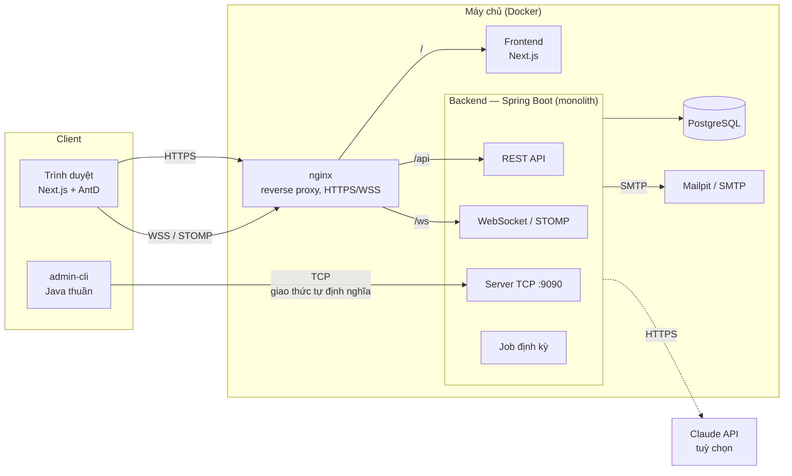

# 01. Tổng quan hệ thống

> Thuộc bộ tài liệu phân tích thiết kế. Các file sau (use case, sequence, ERD, API) tham chiếu mã chức năng `FR-xx`, mã yêu cầu `NFR-xx` và mã quy tắc `BR-xx` định nghĩa ở đây.

---

## 1. Giới thiệu đề tài

### 1.1 Bối cảnh
Giáo viên dạy IELTS Writing thường giao bài qua email hoặc nhóm chat, sinh viên nộp file Word, giáo viên chấm bằng tay rồi gửi lại. Cách làm này có nhiều vấn đề:
- khó theo dõi ai đã nộp, ai chưa;
- dễ thất lạc bài;
- không có lịch sử các lần sửa;
- chấm không đồng đều vì thiếu tiêu chí cụ thể;
- không thống kê được sự tiến bộ của sinh viên.

### 1.2 Mục tiêu
Xây dựng website giúp giáo viên **giao bài và chấm bài IELTS Writing trực tuyến**:
- Server **tự tạo tài khoản sinh viên theo mã sinh viên** từ file danh sách giáo viên cung cấp.
- Giáo viên tạo bài tập gồm **nhiều phần** (ví dụ Task 1 và Task 2), giao cho **lớp** hoặc **từng sinh viên**, đặt **hạn nộp** và **tiêu chí chấm**.
- Sinh viên làm bài ngay trên web: **tự lưu nháp**, **nộp riêng từng phần**.
- Giáo viên chấm theo **checklist** của từng tiêu chí, **nhận xét từng phần**, **trả bài** hoặc **yêu cầu sửa**.
- Hệ thống **nhắc hạn nộp**, cho xem **tiến độ realtime**, lưu **lịch sử nộp**, và **thống kê** kết quả học tập.

### 1.3 Trọng tâm môn Lập trình mạng
Ngoài nghiệp vụ, đề tài dùng để minh hoạ các kỹ thuật lập trình mạng:
- **Giao thức**: HTTP/REST, **WebSocket (STOMP)** cho realtime, **SMTP** cho email, và **giao thức TCP tự định nghĩa** cho module import.
- **Lập trình socket**: server `ServerSocket` có thread pool, client Java thuần.
- **Đồng thời và chịu tải**: nhiều sinh viên nộp bài cùng lúc trước hạn, nhiều kết nối WebSocket đồng thời, thread pool cho server TCP.
- **Chịu lỗi mạng**: tự kết nối lại, lưu nháp khi mất mạng, đồng bộ giờ với server.
- **Bảo mật khi truyền**: HTTPS/WSS, JWT, giới hạn tần suất request.

---

## 2. Phạm vi

### 2.1 Trong phạm vi
- Kỹ năng **IELTS Writing** (Task 1 Academic, Task 2) và bài viết tự do do giáo viên định nghĩa.
- 3 vai trò: Quản trị viên, Giáo viên, Sinh viên.
- Giao diện web tiếng Việt, dùng được trên máy tính và điện thoại.
- Triển khai bằng Docker trên một máy chủ hoặc trong mạng LAN.

### 2.2 Ngoài phạm vi
- Các kỹ năng Listening, Reading, Speaking: không chấm tự động, không thu âm.
- Thanh toán, đăng ký khoá học, quản lý học phí.
- Sinh viên tự đăng ký tài khoản. Tài khoản chỉ được tạo từ file của giáo viên.
- Tích hợp hệ thống đào tạo của trường (SSO, LMS).
- Gợi ý chấm bằng AI **không thay thế** giáo viên. Đây chỉ là tính năng tuỳ chọn để tham khảo.

---

## 3. Tác nhân

| Tác nhân | Loại | Mô tả |
|---|---|---|
| **Quản trị viên (Admin)** | Người | Quản lý tài khoản giáo viên và người dùng, xem nhật ký hệ thống, quản lý phiên đăng nhập. Tài khoản admin đầu tiên được tạo sẵn khi cài đặt. |
| **Giáo viên** | Người | Quản lý lớp, import sinh viên, tạo và giao bài, chấm bài, xem tiến độ và thống kê. Chỉ thao tác trên lớp và bài của chính mình. |
| **Sinh viên** | Người | Đăng nhập bằng mã sinh viên, làm bài và nộp bài, xem kết quả, nộp lại khi được yêu cầu sửa. |
| **Bộ lập lịch** | Hệ thống | Job chạy định kỳ: nhắc hạn nộp, tự nộp bài khi hết giờ thi. |
| **Máy chủ email (SMTP)** | Hệ thống ngoài | Nhận email do hệ thống gửi: tài khoản mới, thông báo, nhắc hạn. |
| **admin-cli** | Phần mềm client | Chương trình dòng lệnh gửi file danh sách sinh viên lên server qua TCP socket. |
| **Dịch vụ AI** (tuỳ chọn) | Hệ thống ngoài | Claude API, gợi ý điểm và lỗi cho giáo viên tham khảo. |

---

## 4. Yêu cầu chức năng

Cột **Mức** khớp với thứ tự triển khai trong [PLAN.md](../PLAN.md): Mức 1 là lõi nghiệp vụ, Mức 2 là trọng tâm mạng, Mức 3 là mở rộng.

### 4.1 Tài khoản và xác thực
| Mã | Chức năng | Tác nhân | Mức |
|---|---|---|---|
| FR-01 | Đăng nhập bằng tên đăng nhập (sinh viên dùng mã sinh viên) và mật khẩu | Tất cả | 1 |
| FR-02 | Bắt buộc đổi mật khẩu ở lần đăng nhập đầu tiên | Tất cả | 1 |
| FR-03 | Đổi mật khẩu, đăng xuất | Tất cả | 1 |
| FR-04 | Quản lý tài khoản giáo viên: tạo, sửa, khoá/mở, đặt lại mật khẩu | Admin | 1 |
| FR-05 | Tra cứu người dùng, khoá/mở tài khoản | Admin | 1 |
| FR-06 | Một tài khoản chỉ có một phiên: đăng nhập nơi mới thì phiên cũ bị đăng xuất | Hệ thống | 2 |
| FR-07 | Xem danh sách phiên đăng nhập và buộc đăng xuất | Admin | 3 |
| FR-08 | Xem nhật ký thao tác (audit log) | Admin | 2 |

### 4.2 Lớp học và tạo tài khoản sinh viên
| Mã | Chức năng | Tác nhân | Mức |
|---|---|---|---|
| FR-10 | Tạo, sửa, xoá lớp học | Giáo viên | 1 |
| FR-11 | **Import danh sách sinh viên từ file `.xlsx` / `.csv`**: tự tạo tài khoản theo mã sinh viên, thêm vào lớp | Giáo viên | 1 |
| FR-12 | Xem báo cáo import: số tạo mới, số bỏ qua, số lỗi (kèm số dòng và lý do) | Giáo viên | 1 |
| FR-13 | Tải file danh sách tài khoản và mật khẩu tạm vừa tạo (chỉ tải được một lần) | Giáo viên | 1 |
| FR-14 | Gửi thông tin đăng nhập qua email cho sinh viên | Hệ thống | 1 |
| FR-15 | Tải file mẫu để import | Giáo viên | 1 |
| FR-16 | Thêm hoặc xoá sinh viên khỏi lớp thủ công | Giáo viên | 1 |
| FR-17 | Import sinh viên qua **TCP socket** bằng `admin-cli`, có tiến trình theo từng dòng | Giáo viên / Admin | 2 |

### 4.3 Bài tập
| Mã | Chức năng | Tác nhân | Mức |
|---|---|---|---|
| FR-20 | Tạo bài tập: tiêu đề, mô tả, thời điểm mở, hạn nộp, có cho nộp muộn hay không, số lần sửa tối đa | Giáo viên | 1 |
| FR-21 | Chia bài thành **nhiều phần**. Mỗi phần có đề bài, ảnh biểu đồ, số từ tối thiểu, thời gian gợi ý, hạn riêng (nếu có) | Giáo viên | 1 |
| FR-22 | Đặt **tiêu chí chấm** và **checklist** cho từng phần, có thể nạp từ mẫu IELTS rồi chỉnh sửa | Giáo viên | 1 |
| FR-23 | **Giao bài** cho một hoặc nhiều lớp và/hoặc từng sinh viên | Giáo viên | 1 |
| FR-24 | Phát hành (publish), đóng bài, nhân bản bài | Giáo viên | 1 |
| FR-25 | Ngân hàng đề: lưu đề và rubric để dùng lại, gắn tag dạng đề | Giáo viên | 3 |
| FR-26 | Chế độ thi tính giờ: hết giờ server tự nộp; ghi nhận chuyển tab, dán văn bản, mất kết nối | Giáo viên / Hệ thống | 3 |

### 4.4 Làm bài và nộp bài
| Mã | Chức năng | Tác nhân | Mức |
|---|---|---|---|
| FR-30 | Xem danh sách bài được giao theo tab: Cần làm / Sắp hết hạn / Quá hạn / Đã nộp / Cần sửa | Sinh viên | 1 |
| FR-31 | Soạn bài từng phần: đếm số từ realtime, đồng hồ gợi ý thời gian | Sinh viên | 1 |
| FR-32 | **Tự lưu nháp** sau 3 giây ngừng gõ và khi rời trang | Sinh viên | 1 |
| FR-33 | **Nộp riêng từng phần**. Mỗi lần nộp tạo một version mới | Sinh viên | 1 |
| FR-34 | Xem kết quả chấm: điểm từng tiêu chí, checklist, nhận xét chung, nhận xét gắn vào đoạn văn | Sinh viên | 1 |
| FR-35 | Sửa và nộp lại khi được yêu cầu, xem lịch sử version và so sánh 2 version | Sinh viên | 1 |
| FR-36 | Lưu nháp khi mất mạng, tự đồng bộ khi có mạng lại, giải quyết xung đột khi mở nhiều tab | Sinh viên | 2 |

### 4.5 Chấm bài
| Mã | Chức năng | Tác nhân | Mức |
|---|---|---|---|
| FR-40 | Hàng đợi bài cần chấm, lọc theo bài / phần / lớp / trạng thái | Giáo viên | 1 |
| FR-41 | Chấm theo checklist: tick các mục **Đạt** / **Giới hạn điểm**, cho điểm từng tiêu chí (mặc định nguyên band), nhận xét từng tiêu chí; xem **bảng mô tả band** thu gọn cạnh từng tiêu chí | Giáo viên | 1 |
| FR-42 | Bôi đen đoạn văn để thêm nhận xét inline, gắn **mã lỗi** (SP, WW, VT…), tiêu chí và **gợi ý sửa** | Giáo viên | 1 |
| FR-43 | Tự tính band của phần và band của cả bài (Task 2 trọng số gấp đôi); tự áp giới hạn band theo checklist và theo số từ | Hệ thống | 1 |
| FR-47 | **Ngân hàng nhận xét**: lưu và chèn nhanh các lời nhận xét hay dùng | Giáo viên | 1 |
| FR-48 | Quản lý **bộ mã lỗi** riêng (ngoài bộ mã của hệ thống) | Giáo viên | 1 |
| FR-49 | **Hồ sơ lỗi** của sinh viên: thống kê mã lỗi qua các bài | GV / SV | 1 |
| FR-44 | Lưu nháp kết quả chấm, **trả bài**, **yêu cầu sửa** (kèm hạn sửa và lời nhắn) | Giáo viên | 1 |
| FR-45 | Cảnh báo bài có độ giống nhau cao với bài khác (kiểm tra đạo văn nội bộ) | Hệ thống | 3 |
| FR-46 | Gợi ý điểm và lỗi bằng AI (tuỳ chọn) | Hệ thống | 3 |

### 4.6 Thông báo và realtime
| Mã | Chức năng | Tác nhân | Mức |
|---|---|---|---|
| FR-50 | Thông báo trong ứng dụng, đẩy realtime qua WebSocket: chuông có số chưa đọc, toast | Tất cả | 1 |
| FR-51 | Email thông báo: giao bài mới, đã trả bài, yêu cầu sửa, nhắc hạn | Hệ thống | 1 |
| FR-52 | Nhắc hạn nộp tự động khi còn 24 giờ và còn 2 giờ, áp dụng cả hạn sửa bài; không gửi trùng | Bộ lập lịch | 1 |
| FR-53 | Giáo viên nhận thông báo realtime khi sinh viên nộp bài | Giáo viên | 1 |
| FR-54 | Trạng thái online: giáo viên thấy sinh viên nào đang online, đang làm bài nào | Giáo viên | 2 |
| FR-55 | Chat theo bài nộp (giữa giáo viên và sinh viên) và theo lớp, có "đang gõ…" và "đã xem" | GV / SV | 2 |
| FR-56 | Đồng hồ đếm ngược hạn nộp chạy theo giờ server | Sinh viên | 2 |

### 4.7 Tiến độ và thống kê
| Mã | Chức năng | Tác nhân | Mức |
|---|---|---|---|
| FR-60 | Ma trận tiến độ sinh viên × phần, mỗi ô có màu theo trạng thái, kèm phần trăm hoàn thành | Giáo viên | 1 |
| FR-61 | Tiến độ cập nhật **live** khi sinh viên lưu nháp hoặc nộp bài | Giáo viên | 2 |
| FR-62 | Nút "Nhắc nhở" gửi thông báo cho sinh viên chưa nộp | Giáo viên | 1 |
| FR-63 | Thống kê một bài: điểm trung bình mỗi tiêu chí, phân bố band, tỉ lệ nộp đúng hạn | Giáo viên | 1 |
| FR-64 | Thống kê sinh viên: điểm theo thời gian, điểm trung bình theo tiêu chí, số bài nộp muộn | GV / SV | 1 |
| FR-65 | Thống kê lớp, bảng xếp hạng | Giáo viên | 1 |
| FR-66 | Xuất bảng điểm ra Excel | Giáo viên | 1 |
| FR-67 | Thống kê toàn hệ thống | Admin | 1 |

---

## 5. Yêu cầu phi chức năng

| Mã | Nhóm | Yêu cầu | Cách kiểm chứng |
|---|---|---|---|
| NFR-01 | Hiệu năng | 200 sinh viên nộp bài trong 5 phút cuối trước hạn: **p95 < 500 ms**, tỉ lệ lỗi < 1% | Script k6 `loadtest/submit-rush.js` — đạt, p95 9,9 ms, 0% lỗi ([09](09-kiem-thu-tai.md)) |
| NFR-02 | Hiệu năng | Giữ được **500 kết nối WebSocket** đồng thời | Script k6 `loadtest/ws-connections.js` — đạt, 500 / 500 ([09](09-kiem-thu-tai.md)) |
| NFR-03 | Realtime | Thông báo tới người nhận **dưới 1 giây** sau khi sự kiện xảy ra | `ws-connections.js` đo giờ nhận − `createdAt` — đạt, p95 228 ms ([09](09-kiem-thu-tai.md)) |
| NFR-04 | Sẵn sàng | Backend khởi động lại thì client tự kết nối lại và lấy đủ các thông báo phát ra trong lúc mất kết nối | `docker compose restart backend` |
| NFR-05 | Chịu lỗi | Mất mạng khi đang gõ bài thì không mất nội dung; có mạng lại tự đồng bộ | DevTools → Offline |
| NFR-06 | Chịu lỗi | Client tự kết nối lại WebSocket theo exponential backoff (1s, 2s, 4s… tối đa 30s) | Ngắt mạng thủ công |
| NFR-07 | Bảo mật | Mật khẩu mã hoá bằng BCrypt. JWT: access token 30 phút, refresh token 7 ngày có xoay vòng | Unit test, kiểm tra DB |
| NFR-08 | Bảo mật | Toàn bộ truyền tải qua HTTPS/WSS khi triển khai | Ảnh chụp Wireshark |
| NFR-09 | Bảo mật | Tối đa 5 lần đăng nhập sai trong 5 phút cho mỗi IP và mỗi tài khoản; vượt quá trả 429 | Test thủ công |
| NFR-10 | Phân quyền | Giáo viên chỉ truy cập lớp và bài của mình. Sinh viên chỉ thấy bài được giao và đã mở, chỉ thấy điểm sau khi được trả bài | Test tích hợp |
| NFR-11 | Toàn vẹn dữ liệu | Mỗi lần nộp là một version **bất biến**. Không bao giờ sửa hoặc xoá lịch sử nộp | Ràng buộc DB + test |
| NFR-12 | Thời gian | Hạn nộp và trạng thái nộp muộn **luôn tính theo giờ server**. Thời gian lưu ở dạng UTC | Test nộp sát hạn |
| NFR-13 | Khả dụng | Giao diện tiếng Việt, responsive, dùng được trên điện thoại | Demo trên điện thoại qua LAN |
| NFR-14 | Bảo trì | Schema quản lý bằng Flyway. Code theo coding rules của dự án. Có API docs (Swagger) | Review |
| NFR-15 | Triển khai | Chạy toàn bộ bằng một lệnh `docker compose up` | README |

---

## 6. Quy tắc nghiệp vụ

| Mã | Quy tắc |
|---|---|
| BR-01 | Mã sinh viên là duy nhất và chính là **tên đăng nhập** của sinh viên. |
| BR-02 | Import gặp mã sinh viên **đã tồn tại** thì không tạo tài khoản mới, chỉ thêm vào lớp. Gặp mã mới thì tạo tài khoản với **mật khẩu ngẫu nhiên 8 ký tự** và bắt đổi ở lần đăng nhập đầu. |
| BR-03 | Một dòng lỗi trong file import **không làm hỏng** các dòng khác. Báo cáo ghi rõ số dòng và lý do lỗi. |
| BR-04 | Sinh viên được giao một bài khi bài đó được giao **trực tiếp cho sinh viên**, hoặc giao cho **lớp có sinh viên đó**. |
| BR-05 | Sinh viên chỉ thấy bài có trạng thái **Đã phát hành** và đã tới **thời điểm mở**. |
| BR-06 | Bài ở trạng thái **Nháp** thì sửa được tự do. Đã phát hành thì không xoá được phần hoặc tiêu chí đã có bài nộp. |
| BR-07 | Hạn nộp của một phần là `hạn riêng của phần`; nếu không có thì lấy `hạn của bài tập`. Khi được yêu cầu sửa, hạn áp dụng là `hạn sửa`. |
| BR-08 | Nộp sau hạn: nếu bài **cho phép nộp muộn** thì ghi nhận và đánh dấu "muộn"; nếu không thì **từ chối**. |
| BR-09 | Mỗi phần được nộp độc lập. Mỗi lần nộp tạo version mới với số thứ tự tăng dần. |
| BR-10 | Sinh viên chỉ nộp lại được khi bài ở trạng thái **Yêu cầu sửa**, và tổng số lần sửa không vượt **số lần sửa tối đa** của bài. |
| BR-11 | Điểm mỗi tiêu chí từ 0 tới 9, **mặc định nguyên band (bước 1)** như IELTS chính thức. Giáo viên được đổi sang bước 0.5 cho bài luyện tập. Chi tiết: [08-nghiep-vu-cham-ielts.md](08-nghiep-vu-cham-ielts.md) mục 3.1. |
| BR-12 | Band của phần = trung bình có trọng số các tiêu chí. Band của bài = trung bình có trọng số band các phần, **Task 2 trọng số 2, Task 1 trọng số 1** (IELTS: "Task 2 carries more weight"). **Chỉ làm tròn khi hiển thị**: lẻ dưới .25 làm tròn xuống, từ .25 tới dưới .75 thành .5, từ .75 trở lên làm tròn lên. Band bài chỉ có khi mọi phần đã được trả bài. Chi tiết: tài liệu 08 mục 3.2. |
| BR-13 | Sinh viên chỉ thấy điểm và nhận xét khi kết quả chấm ở trạng thái **Đã trả bài**. |
| BR-14 | Nhắc hạn: mỗi sinh viên chỉ nhận **một lần** cho mỗi mốc (24 giờ, 2 giờ) của mỗi phần, và chỉ khi chưa nộp. |
| BR-15 | Giáo viên chỉ xem và chấm bài thuộc bài tập do chính mình tạo. |
| BR-16 | Checklist của tiêu chí có hai loại mục: **Đạt** (đặc điểm cần có) và **Giới hạn điểm** (đặc điểm tiêu cực, kèm band tối đa), theo bảng mô tả IELTS. |
| BR-17 | Điểm tiêu chí không vượt quá band tối đa nhỏ nhất của các mục **Giới hạn điểm** đang được tick. Server kiểm tra lại. |
| BR-18 | Bài từ 20 từ trở xuống: mọi tiêu chí tối đa Band 1. |
| BR-19 | "Chấm 0" bắt buộc có lý do: không làm bài, không viết bằng tiếng Anh, hoặc học thuộc hoàn toàn. |
| BR-20 | Đếm từ theo quy ước IELTS (gạch ngang, viết tắt, số = 1 từ; dấu câu đứng riêng không tính), cùng một thuật toán ở client và server. |
| BR-21 | Nhận xét inline cần ít nhất một trong: mã lỗi, lời nhận xét, gợi ý sửa. Gợi ý sửa mặc định ẩn với sinh viên khi bài đang "Cần sửa", để sinh viên tự sửa theo mã lỗi. |
| BR-22 | Mỗi giáo viên có ngân hàng nhận xét và mã lỗi riêng; bộ mã lỗi của hệ thống không sửa được. |

---

## 7. Kiến trúc tổng thể

**Kiến trúc nguyên khối (monolith):** toàn bộ nghiệp vụ nằm trong **một** ứng dụng Spring Boot, chia module theo package (lớp học, bài tập, bài nộp, chấm bài, thông báo, realtime, TCP…). Không chia microservice, không chạy nhiều instance.

**Luồng chính:**
- nginx là cổng vào duy nhất: bật HTTPS/WSS, chuyển `/` sang frontend, `/api` và `/ws` sang backend.
- Backend lưu mọi thông báo vào PostgreSQL **trước**, rồi mới đẩy qua WebSocket. Client rớt kết nối thì khi kết nối lại sẽ lấy phần thông báo bị lỡ từ DB.
- Trạng thái tạm (ai đang online, đếm số lần đăng nhập sai) lưu trong bộ nhớ của backend.
- `admin-cli` kết nối thẳng tới server TCP ở cổng 9090, server này chạy ngay trong backend.
- Giám sát bằng Spring Actuator + Prometheus + Grafana là tuỳ chọn.

**Triển khai (đã cài ở bước 13):** `docker-compose.yml` ở thư mục gốc dựng 5 container — `postgres` (18), `mailpit`, `backend` (profile `docker`), `frontend`, `nginx` (1.27). Chỉ mở ra máy chủ: 80 / 443 (nginx), 9090 (TCP cho `admin-cli`), 8025 (giao diện Mailpit); backend 8080 và PostgreSQL chỉ nằm trong mạng nội bộ của Docker, nên header `X-Forwarded-For` chỉ nginx đặt được và backend tin header này để lấy IP thật (nhật ký, giới hạn đăng nhập sai). Dữ liệu nằm trong volume `pgdata`, `uploads`. Hướng dẫn chạy: [`deploy/README.md`](../deploy/README.md). Thêm profile `demo` (`SPRING_PROFILES_ACTIVE=docker,demo`) thì backend nạp sẵn dữ liệu mẫu cho buổi demo (bước 20, [`README`](../README.md)); ghép thêm `loadtest/compose.loadtest.yml` để kiểm thử tải bằng k6 (bước 14, [09-kiem-thu-tai.md](09-kiem-thu-tai.md)).

---

## 8. Công nghệ sử dụng

| Tầng | Công nghệ |
|---|---|
| Frontend | Next.js 16 (App Router), React 19, TypeScript, Ant Design 6, Tailwind CSS 4, Zustand 5, axios, dayjs, `@stomp/stompjs` |
| Backend | Java 21, Spring Boot 4 (Web MVC, Security, Data JPA, WebSocket/STOMP, Mail, Actuator, Validation), Flyway, jjwt, Apache POI, Commons CSV, springdoc-openapi |
| Mạng tự viết | `java.net.ServerSocket` / `Socket`, `ExecutorService`, `java.nio` (Selector), `SSLServerSocket` |
| Dữ liệu | PostgreSQL 18 |
| Hạ tầng | Docker Compose, nginx (reverse proxy), Mailpit; tuỳ chọn Prometheus + Grafana |
| Kiểm thử | JUnit 5, Mockito, Testcontainers, k6, Wireshark |

---

## 9. Thuật ngữ

| Thuật ngữ | Giải thích |
|---|---|
| **Band** | Thang điểm IELTS từ 0 tới 9, bước 0.5. |
| **Task 1 / Task 2** | Hai phần của bài IELTS Writing. Task 1 mô tả biểu đồ, quy trình hoặc bản đồ, tối thiểu 150 từ. Task 2 là bài luận, tối thiểu 250 từ. |
| **Bài tập** | Một đợt giao bài của giáo viên, gồm một hoặc nhiều phần và có hạn nộp. |
| **Phần** | Một đề viết trong bài tập (ví dụ Task 1). Sinh viên nộp riêng từng phần. |
| **Tiêu chí (criterion)** | Một khía cạnh để chấm, ví dụ Task Achievement, Coherence and Cohesion, Lexical Resource, Grammatical Range and Accuracy. |
| **Checklist** | Danh sách các mục cụ thể trong một tiêu chí để giáo viên tick khi chấm, ví dụ "Có đoạn tổng quan". |
| **Rubric** | Bộ tiêu chí và checklist của một phần. **Rubric mẫu** là bộ có sẵn để nạp nhanh. |
| **Bản nháp** | Nội dung sinh viên đang soạn, được tự lưu, chưa nộp. |
| **Version** | Một lần nộp của sinh viên cho một phần. Đã nộp thì không sửa được. |
| **Trả bài** | Giáo viên công bố kết quả chấm cho sinh viên xem. |
| **Yêu cầu sửa** | Giáo viên yêu cầu sinh viên viết lại và nộp version mới trước hạn sửa. |
| **Nộp muộn** | Nộp sau hạn khi bài cho phép nộp muộn. |
| **Giao bài (target)** | Chỉ định lớp hoặc sinh viên được làm một bài tập. |
| **STOMP** | Giao thức nhắn tin dạng text chạy trên WebSocket, có khái niệm topic và hàng đợi riêng cho từng người dùng. |
