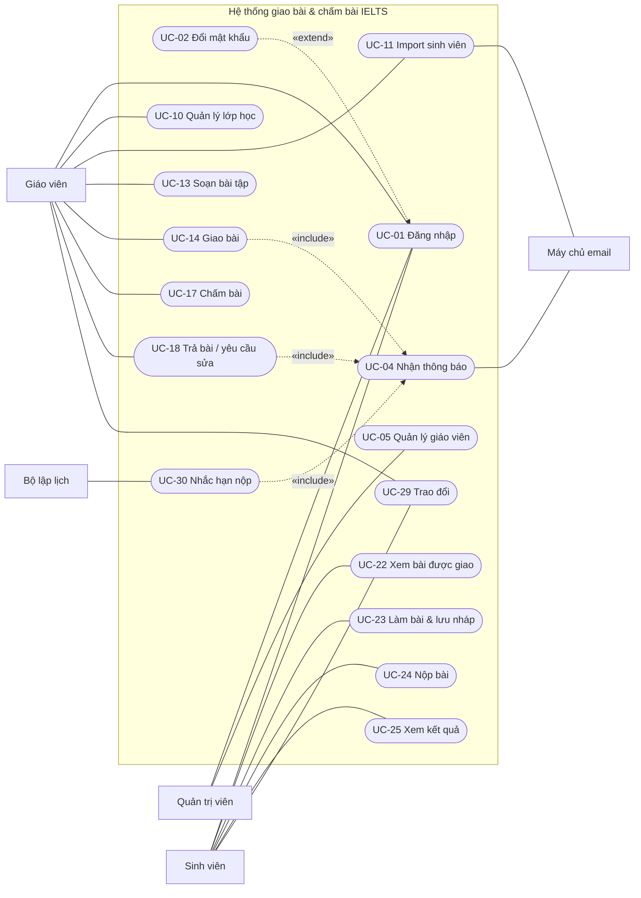
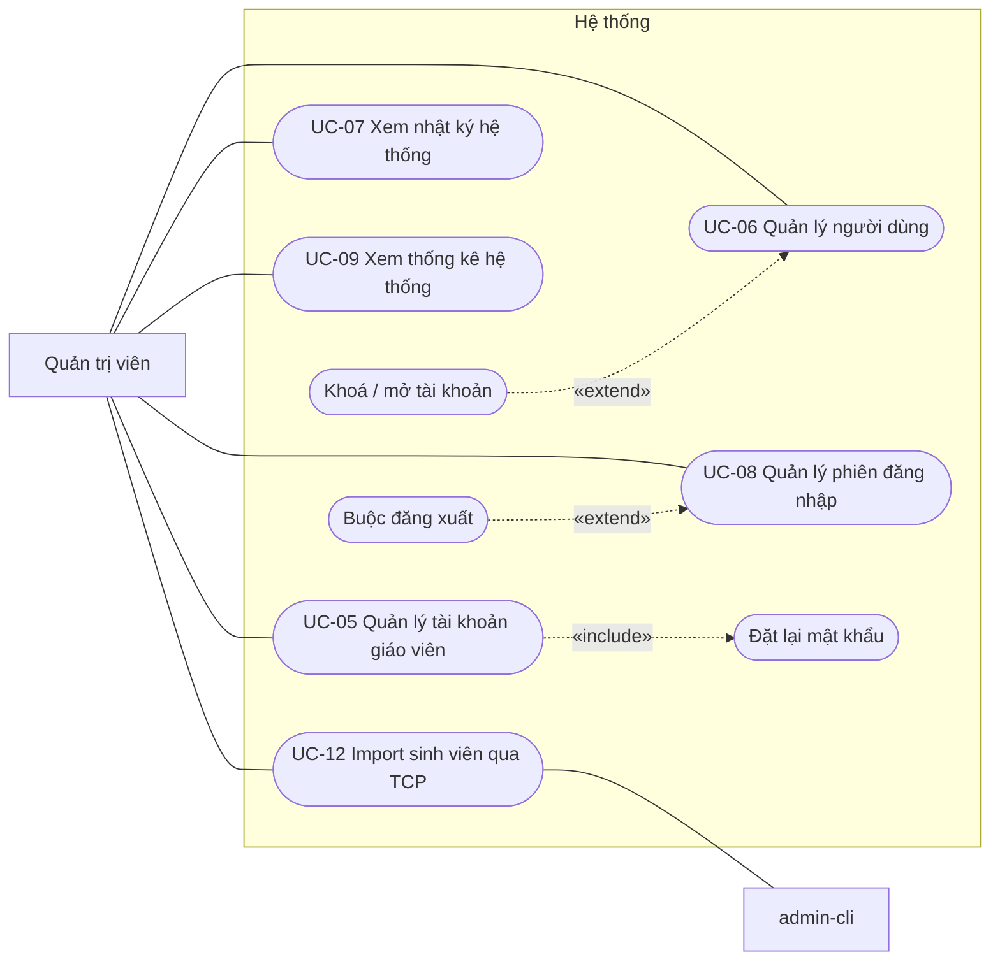
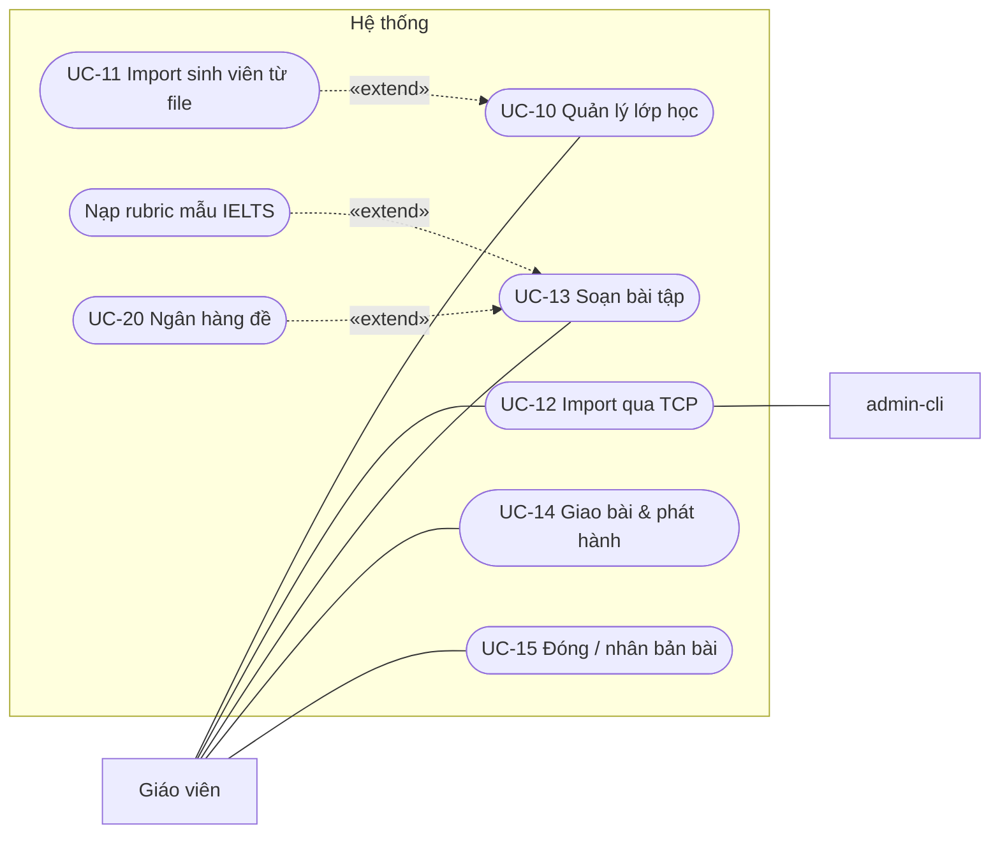
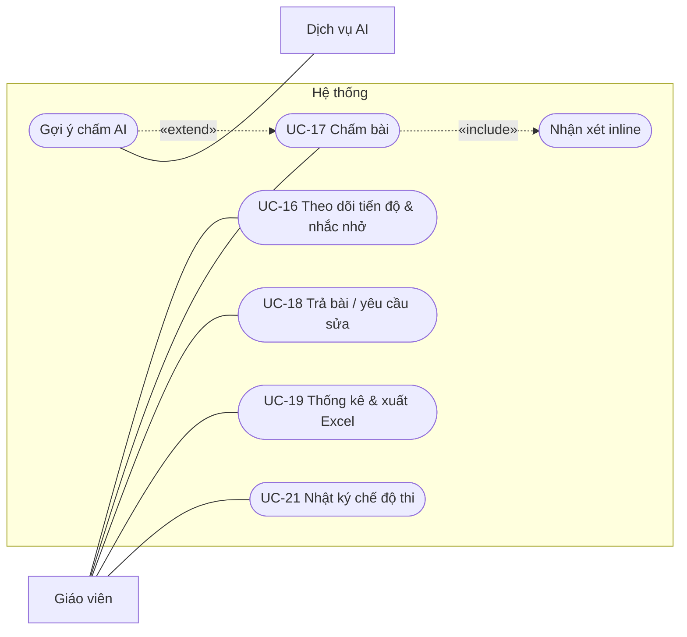
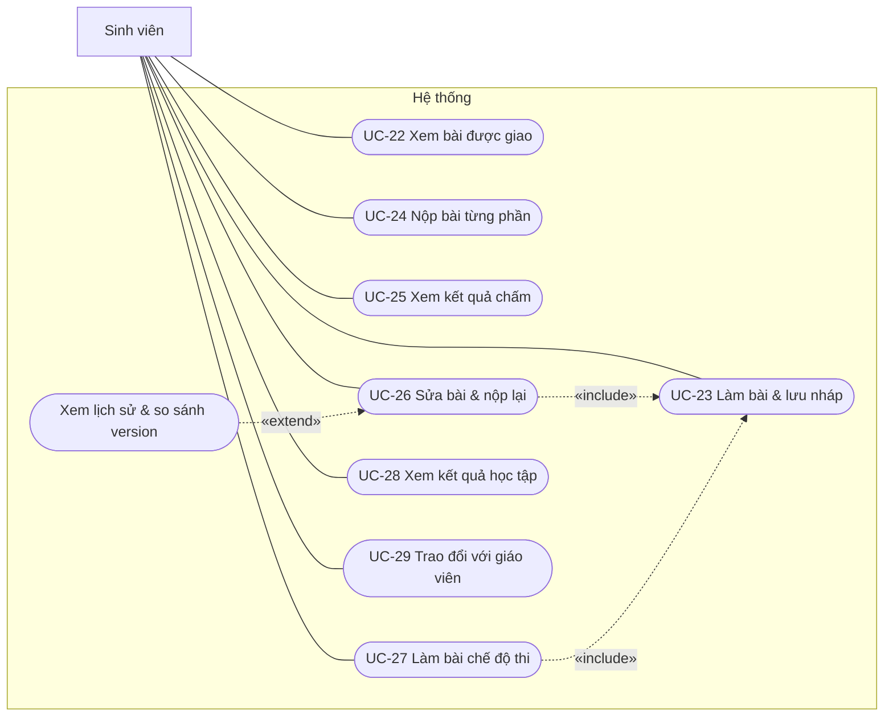

# 02. Use case

> Tham chiếu: mã chức năng `FR-xx`, quy tắc `BR-xx`, yêu cầu phi chức năng `NFR-xx` trong [01-tong-quan.md](01-tong-quan.md).
> Sơ đồ vẽ bằng Mermaid: hình chữ nhật là **tác nhân**, hình bo tròn là **use case**. Mũi tên nét đứt theo quy ước UML:
> - `A «include» → B`: A luôn gọi tới B.
> - `A «extend» → B`: A là phần mở rộng tuỳ chọn của B (mũi tên chỉ về use case gốc).

---

## 1. Danh sách use case

| Mã | Tên use case | Tác nhân chính | Chức năng | Mức |
|---|---|---|---|---|
| **Chung** |||||
| UC-01 | Đăng nhập | Admin, Giáo viên, Sinh viên | FR-01, FR-06 | 1 |
| UC-02 | Đổi mật khẩu | Admin, Giáo viên, Sinh viên | FR-02, FR-03 | 1 |
| UC-03 | Đăng xuất | Admin, Giáo viên, Sinh viên | FR-03 | 1 |
| UC-04 | Nhận và xem thông báo | Admin, Giáo viên, Sinh viên | FR-50, FR-51 | 1 |
| **Quản trị viên** |||||
| UC-05 | Quản lý tài khoản giáo viên | Admin | FR-04 | 1 |
| UC-06 | Quản lý người dùng | Admin | FR-05 | 1 |
| UC-07 | Xem nhật ký hệ thống | Admin | FR-08 | 2 |
| UC-08 | Quản lý phiên đăng nhập | Admin | FR-07 | 3 |
| UC-09 | Xem thống kê toàn hệ thống | Admin | FR-67 | 1 |
| **Giáo viên** |||||
| UC-10 | Quản lý lớp học | Giáo viên | FR-10, FR-16 | 1 |
| UC-11 | Import sinh viên từ file | Giáo viên | FR-11 – FR-15 | 1 |
| UC-12 | Import sinh viên qua TCP (admin-cli) | Giáo viên, Admin | FR-17 | 2 |
| UC-13 | Soạn bài tập (các phần, tiêu chí, checklist) | Giáo viên | FR-20 – FR-22 | 1 |
| UC-14 | Giao bài và phát hành | Giáo viên | FR-23, FR-24 | 1 |
| UC-15 | Đóng bài, nhân bản bài | Giáo viên | FR-24 | 1 |
| UC-16 | Theo dõi tiến độ và nhắc nhở | Giáo viên | FR-54, FR-60 – FR-62 | 1 (live: 2) |
| UC-17 | Chấm bài | Giáo viên | FR-40 – FR-43, FR-45, FR-46 | 1 |
| UC-18 | Trả bài / yêu cầu sửa | Giáo viên | FR-44 | 1 |
| UC-19 | Xem thống kê, xuất bảng điểm | Giáo viên | FR-63 – FR-66 | 1 |
| UC-20 | Quản lý ngân hàng đề | Giáo viên | FR-25 | 3 |
| UC-21 | Xem nhật ký làm bài chế độ thi | Giáo viên | FR-26 | 3 |
| **Sinh viên** |||||
| UC-22 | Xem bài được giao | Sinh viên | FR-30 | 1 |
| UC-23 | Làm bài và lưu nháp | Sinh viên | FR-31, FR-32, FR-36, FR-56 | 1 (offline: 2) |
| UC-24 | Nộp bài từng phần | Sinh viên | FR-33, FR-53 | 1 |
| UC-25 | Xem kết quả chấm | Sinh viên | FR-34 | 1 |
| UC-26 | Sửa bài và nộp lại | Sinh viên | FR-35 | 1 |
| UC-27 | Làm bài ở chế độ thi | Sinh viên | FR-26 | 3 |
| UC-28 | Xem kết quả học tập | Sinh viên | FR-64 | 1 |
| **Giáo viên và Sinh viên** |||||
| UC-29 | Trao đổi (chat) | Giáo viên, Sinh viên | FR-55 | 2 |
| **Hệ thống** |||||
| UC-30 | Nhắc hạn nộp tự động | Bộ lập lịch | FR-52 | 1 |
| UC-31 | Tự nộp bài khi hết giờ thi | Bộ lập lịch | FR-26 | 3 |
| UC-32 | Kiểm tra đạo văn | Hệ thống | FR-45 | 3 |

---

## 2. Sơ đồ use case

### 2.1 Tổng quát

### 2.2 Quản trị viên

### 2.3 Giáo viên — lớp học và bài tập

### 2.4 Giáo viên — theo dõi và chấm bài

### 2.5 Sinh viên

---

## 3. Đặc tả use case

Mỗi đặc tả gồm: tác nhân, mô tả, tiền điều kiện, hậu điều kiện, luồng chính, luồng thay thế (A), ngoại lệ (E), quy tắc liên quan.
Các use case quản lý đơn giản (thêm, sửa, xoá, xem danh sách) chỉ mô tả ngắn ở mục 3.13.

### UC-01 · Đăng nhập
| Mục | Nội dung |
|---|---|
| Tác nhân | Admin, Giáo viên, Sinh viên |
| Mô tả | Người dùng đăng nhập để vào hệ thống theo đúng vai trò. |
| Tiền điều kiện | Tài khoản đã tồn tại và đang hoạt động. |
| Hậu điều kiện | Người dùng nhận access token và refresh token, được chuyển tới trang chủ của vai trò. Kết nối WebSocket được mở. |

**Luồng chính**
1. Người dùng mở trang Đăng nhập, nhập tên đăng nhập (sinh viên dùng mã sinh viên) và mật khẩu.
2. Hệ thống kiểm tra tài khoản tồn tại, đang hoạt động, và mật khẩu khớp (BCrypt).
3. Hệ thống tạo access token (30 phút) và refresh token (7 ngày), cập nhật thời điểm đăng nhập gần nhất.
4. *(Mức 2, đã cài ở bước 9a)* Hệ thống thu hồi phiên cũ của tài khoản và gửi lệnh `FORCE_LOGOUT` tới thiết bị cũ qua WebSocket rồi ngắt kết nối của thiết bị đó (FR-06).
5. Hệ thống chuyển người dùng tới trang chủ theo vai trò. Nếu có `returnUrl` hợp lệ và người dùng được phép vào thì chuyển tới đó.

**Luồng thay thế**
- A1 (sau bước 3). Tài khoản đang bị bắt đổi mật khẩu → chuyển tới UC-02 thay vì trang chủ.

**Ngoại lệ**
- E1. Sai tên đăng nhập hoặc mật khẩu → báo "Tên đăng nhập hoặc mật khẩu không đúng". Không tiết lộ trường nào sai.
- E2. Tài khoản bị khoá → báo "Tài khoản đã bị khoá, vui lòng liên hệ quản trị viên".
- E3. *(Mức 2, đã cài ở bước 12)* Sai quá 5 lần trong 5 phút (tính riêng theo IP và theo tài khoản) → trả 429, báo "Bạn đã đăng nhập sai quá nhiều lần. Vui lòng thử lại sau N phút" (NFR-09).

---

### UC-02 · Đổi mật khẩu
| Mục | Nội dung |
|---|---|
| Tác nhân | Admin, Giáo viên, Sinh viên |
| Mô tả | Đổi mật khẩu. Bắt buộc ở lần đăng nhập đầu tiên (BR-02). |
| Tiền điều kiện | Đã đăng nhập. |
| Hậu điều kiện | Mật khẩu mới được lưu, cờ "phải đổi mật khẩu" bị xoá. Các refresh token cũ bị thu hồi. |

**Luồng chính**
1. Người dùng nhập mật khẩu hiện tại, mật khẩu mới và nhập lại mật khẩu mới.
2. Hệ thống kiểm tra mật khẩu hiện tại đúng, mật khẩu mới tối thiểu 8 ký tự, có cả chữ và số, và khác mật khẩu cũ.
3. Hệ thống lưu mật khẩu mới, báo thành công và chuyển về trang chủ của vai trò.

**Ngoại lệ**
- E1. Mật khẩu hiện tại sai → báo lỗi, giữ nguyên form.
- E2. Mật khẩu mới không đạt yêu cầu hoặc nhập lại không khớp → báo lỗi ngay tại ô nhập.

---

### UC-11 · Import sinh viên từ file
| Mục | Nội dung |
|---|---|
| Tác nhân | Giáo viên. Máy chủ email là tác nhân phụ. |
| Mô tả | Giáo viên tải lên file danh sách sinh viên. Hệ thống tự tạo tài khoản theo mã sinh viên và thêm vào lớp. Đây là **yêu cầu cốt lõi** của đề tài. |
| Tiền điều kiện | Giáo viên đã đăng nhập và là chủ của lớp. |
| Hậu điều kiện | Sinh viên trong file thuộc lớp. Tài khoản mới có mật khẩu tạm và bị bắt đổi mật khẩu. Giáo viên có báo cáo import và file tài khoản. |

**Luồng chính**
1. Giáo viên mở chi tiết lớp và chọn "Import sinh viên".
2. *(tuỳ chọn)* Giáo viên tải file mẫu (FR-15).
3. Giáo viên chọn file `.xlsx` hoặc `.csv` có các cột `ma_sv`, `ho_ten`, `email` (email không bắt buộc), có thể tick "Gửi email thông tin đăng nhập", rồi xác nhận.
4. Hệ thống đọc file và kiểm tra từng dòng: mã sinh viên không rỗng, đúng định dạng; họ tên không rỗng; email (nếu có) hợp lệ; không trùng mã trong cùng file.
5. Với mỗi dòng hợp lệ:
   - mã sinh viên **chưa có** → tạo tài khoản: tên đăng nhập = mã sinh viên, mật khẩu ngẫu nhiên 8 ký tự, bắt đổi mật khẩu, rồi thêm vào lớp (BR-01, BR-02);
   - mã sinh viên **đã có** → không tạo mới, chỉ thêm vào lớp nếu chưa là thành viên.
6. Hệ thống hiển thị báo cáo: số tạo mới, số đã có (chỉ thêm vào lớp), số đã là thành viên (bỏ qua), số lỗi kèm số dòng và lý do (FR-12).
7. Giáo viên tải file `.xlsx` gồm mã sinh viên, họ tên và **mật khẩu tạm** của các tài khoản vừa tạo (FR-13).
8. Nếu đã tick gửi email, hệ thống gửi thông tin đăng nhập tới email của từng sinh viên mới, chạy nền (FR-14).

**Luồng thay thế**
- A1 (bước 7). Giáo viên đóng màn hình mà không tải file → file tài khoản bị huỷ. Muốn có lại thì phải đặt lại mật khẩu cho từng sinh viên.

**Ngoại lệ**
- E1. File sai định dạng, thiếu cột bắt buộc hoặc vượt 10 MB → từ chối toàn bộ, báo lý do.
- E2. Một số dòng lỗi → các dòng còn lại **vẫn được xử lý** (BR-03).
- E3. Gửi email thất bại → không ảnh hưởng kết quả import; ghi log, giáo viên vẫn có file tài khoản.

**Quy tắc:** BR-01, BR-02, BR-03.

---

### UC-12 · Import sinh viên qua TCP (admin-cli)
| Mục | Nội dung |
|---|---|
| Tác nhân | Giáo viên hoặc Admin, dùng chương trình `admin-cli` |
| Mô tả | Cùng nghiệp vụ với UC-11, nhưng gửi file qua **giao thức TCP tự định nghĩa** và nhận tiến trình theo từng dòng. Use case này minh hoạ lập trình socket. |
| Tiền điều kiện | Server TCP đang bật (cổng 9090). Người dùng có access token hợp lệ. |
| Hậu điều kiện | Giống UC-11. Server ghi audit log có IP của client. |

**Luồng chính**
1. Người dùng chạy `java -jar admin-cli.jar import --class <mã lớp> --file students.csv --user <tên đăng nhập>` (client đăng nhập qua HTTP để lấy access token, hoặc dùng `--token`).
2. Client mở kết nối TCP và gửi `AUTH <token>`. Server kiểm tra token rồi trả `OK`.
3. Client gửi `IMPORT <mã lớp> <số byte> [EMAIL]`; server kiểm tra lớp và quyền rồi client gửi nội dung CSV.
4. Server xử lý từng dòng như UC-11 bước 4–5. Sau mỗi dòng, server gửi `PROGRESS n/tổng`; client vẽ thanh tiến trình.
5. Server gửi `DONE created=.. skipped=.. errors=..` kèm các dòng lỗi, rồi đóng kết nối.
6. Client in báo cáo và lưu file tài khoản ra đĩa.

**Ngoại lệ**
- E1. Token sai hoặc hết hạn → server trả `ERR 401` và đóng kết nối.
- E2. Không có quyền với lớp → `ERR 403`; không có lớp → `ERR 404`; dữ liệu quá 5 MB → `ERR 413`; CSV thiếu cột → `ERR 415`.
- E5. Server đang đủ số phiên đồng thời → `ERR 503` ngay khi kết nối; client im lặng quá 30 giây → `ERR 408`.
- E3. Khung tin sai cú pháp hoặc số byte không khớp → `ERR 400 <mô tả>`.
- E4. Client mất kết nối giữa chừng → server huỷ phần chưa xử lý; các dòng đã xử lý vẫn được giữ. Mỗi dòng là một giao dịch riêng.

---

### UC-13 · Soạn bài tập
| Mục | Nội dung |
|---|---|
| Tác nhân | Giáo viên |
| Mô tả | Tạo hoặc sửa bài tập gồm nhiều phần. Mỗi phần có đề bài, tiêu chí chấm và checklist riêng. |
| Tiền điều kiện | Giáo viên đã đăng nhập. |
| Hậu điều kiện | Bài tập được lưu ở trạng thái **Nháp**, chưa ai nhìn thấy. |

**Luồng chính**
1. Giáo viên chọn "Tạo bài tập". Trình soạn có 4 bước.
2. **Bước 1, thông tin chung**: tiêu đề, mô tả, thời điểm mở, hạn nộp, có cho nộp muộn không, số lần sửa tối đa.
3. **Bước 2, các phần**: thêm một hoặc nhiều phần. Mỗi phần gồm tiêu đề, loại (Task 1 / Task 2 / Tự do), đề bài, ảnh biểu đồ (Task 1), số từ tối thiểu, thời gian gợi ý, hạn riêng nếu có. Giáo viên sắp xếp thứ tự các phần bằng kéo thả.
4. **Bước 3, tiêu chí và checklist**: với mỗi phần, giáo viên nạp rubric mẫu IELTS theo loại phần, rồi thêm, sửa hoặc xoá tiêu chí (tên, mô tả, điểm tối đa, bước điểm, trọng số) và các mục checklist.
5. **Bước 4, giao bài**: chuyển sang UC-14, hoặc lưu nháp để giao sau.
6. Hệ thống kiểm tra dữ liệu và lưu.

**Luồng thay thế**
- A1. Sửa bài đã phát hành → chỉ sửa được thông tin không làm sai lệch bài đã nộp, ví dụ gia hạn hoặc sửa mô tả (BR-06).
- A2. *(Mức 3)* Lấy đề từ ngân hàng đề thay cho bước 2–3 (UC-20).

**Ngoại lệ**
- E1. Thời điểm mở không trước hạn nộp → báo lỗi.
- E2. Chưa có phần nào, hoặc có phần chưa có tiêu chí → không cho phát hành, nhưng vẫn lưu nháp được.
- E3. Ảnh vượt dung lượng hoặc sai định dạng → báo lỗi.

---

### UC-14 · Giao bài và phát hành
| Mục | Nội dung |
|---|---|
| Tác nhân | Giáo viên. Tác nhân phụ: Sinh viên (nhận thông báo), máy chủ email. |
| Mô tả | Chọn người nhận bài và phát hành để sinh viên nhìn thấy. |
| Tiền điều kiện | Bài ở trạng thái Nháp, có ít nhất một phần, mỗi phần có ít nhất một tiêu chí. |
| Hậu điều kiện | Bài chuyển sang **Đã phát hành**. Mọi sinh viên được giao nhận thông báo. |

**Luồng chính**
1. Giáo viên chọn một hoặc nhiều lớp và/hoặc tìm và chọn từng sinh viên.
2. Hệ thống hiển thị tổng số sinh viên sẽ nhận bài (đã loại trùng giữa lớp và cá nhân).
3. Giáo viên bấm "Phát hành".
4. Hệ thống lưu danh sách giao bài, chuyển trạng thái, ghi thời điểm phát hành.
5. Hệ thống gửi thông báo "Bài tập mới" tới từng sinh viên: lưu DB, đẩy qua WebSocket, gửi email (UC-04).

**Luồng thay thế**
- A1. Thời điểm mở ở tương lai → bài phát hành nhưng sinh viên chỉ thấy từ thời điểm mở (BR-05). Thông báo gửi vào thời điểm mở.
- A2. Giao thêm người sau khi đã phát hành → chỉ những người mới nhận thông báo.

**Ngoại lệ**
- E1. Chưa chọn người nhận → không cho phát hành.

**Quy tắc:** BR-04, BR-05.

---

### UC-16 · Theo dõi tiến độ và nhắc nhở
| Mục | Nội dung |
|---|---|
| Tác nhân | Giáo viên |
| Mô tả | Xem trạng thái làm bài của từng sinh viên theo từng phần, và nhắc những người chưa nộp. |
| Tiền điều kiện | Bài đã phát hành. |
| Hậu điều kiện | Không đổi dữ liệu, trừ khi gửi nhắc nhở. |

**Luồng chính**
1. Giáo viên mở "Tiến độ" của một bài.
2. Hệ thống hiển thị ma trận: mỗi hàng là một sinh viên, mỗi cột là một phần. Mỗi ô có màu theo trạng thái: chưa làm / nháp / đã nộp / nộp muộn / đã chấm / cần sửa; có dấu **quá hạn** khi chưa nộp mà đã qua hạn áp dụng (BR-07), và band của phần khi đã trả bài. Kèm phần trăm hoàn thành, số sinh viên nộp muộn, số sinh viên đang quá hạn.
3. *(Mức 2, đã cài ở bước 9a)* Ma trận cập nhật **ngay lập tức** khi sinh viên bắt đầu làm (lưu nháp lần đầu), nộp bài, hoặc khi giáo viên trả bài / yêu cầu sửa. Có chấm xanh cho sinh viên đang online và cho biết đang mở phần nào (FR-54, FR-61).
4. Giáo viên lọc theo lớp hoặc trạng thái, chọn những sinh viên chưa nộp, bấm "Nhắc nhở".
5. Hệ thống gửi thông báo nhắc nhở tới những sinh viên đó.

**Luồng thay thế**
- A1. Giáo viên bấm vào một ô → mở bài nộp đó để chấm (UC-17).

---

### UC-17 · Chấm bài
| Mục | Nội dung |
|---|---|
| Tác nhân | Giáo viên. Tác nhân phụ: Dịch vụ AI (tuỳ chọn). |
| Mô tả | Chấm một bài nộp theo checklist và tiêu chí của phần đó. |
| Tiền điều kiện | Bài nộp có ít nhất một version. Giáo viên là người tạo bài tập (BR-15). |
| Hậu điều kiện | Kết quả chấm được lưu ở trạng thái **Nháp chấm**. Sinh viên chưa thấy. |

**Luồng chính**
1. Giáo viên mở hàng đợi chấm, lọc theo bài, phần, lớp, trạng thái, rồi chọn một bài nộp.
2. Hệ thống mở màn hình chấm:
   - **bên trái**: bài làm của version mới nhất, số từ, thời điểm nộp, nhãn "muộn" nếu có;
   - **bên phải**: danh sách tiêu chí, mỗi tiêu chí có checklist, ô chọn điểm và ô nhận xét.
3. Giáo viên tick các mục checklist, chọn điểm cho từng tiêu chí (0–9; mặc định nguyên band, giáo viên có thể đặt bước 0.5 cho tiêu chí, BR-11) và viết nhận xét. Có thể chèn nhận xét từ **ngân hàng nhận xét** (BR-22).
   - Tick một mục **Giới hạn điểm** → ô điểm khoá các mức cao hơn `max_band` và hiện lý do (BR-17).
   - Bài ≤ 20 từ → hệ thống cảnh báo và giới hạn mọi tiêu chí tối đa 1 (BR-18). Bài dưới số từ tối thiểu → chỉ cảnh báo, không tự trừ điểm.
4. Giáo viên bôi đen một đoạn trong bài để thêm **nhận xét inline**: chọn **mã lỗi** (SP, VT, ART…), tiêu chí tự điền theo mã, kèm lời nhận xét và / hoặc **gợi ý sửa** (BR-21). Đoạn đó được tô màu.
5. Hệ thống **tự tính band** của phần theo trung bình có trọng số và quy tắc làm tròn IELTS (BR-12), cập nhật mỗi khi điểm thay đổi.
6. Giáo viên viết nhận xét chung và bấm "Lưu nháp". Hệ thống cũng tự lưu định kỳ.
7. Giáo viên chuyển sang UC-18 (trả bài / yêu cầu sửa), hoặc sang bài tiếp theo trong hàng đợi.

**Luồng thay thế**
- A1. *(Mức 3)* Giáo viên bấm "Gợi ý AI" → hệ thống gửi bài tới dịch vụ AI và hiện band gợi ý cho từng tiêu chí cùng danh sách lỗi. Gợi ý **không tự điền** vào điểm; giáo viên tự quyết định (FR-46).
- A2. *(Mức 3)* Bài có cờ đạo văn → hiện cảnh báo và đường dẫn tới bài giống nhất (FR-45).
- A3. Bài có nhiều version → giáo viên xem được version trước và kết quả chấm của version đó.
- A4. Bài không làm / không viết bằng tiếng Anh / học thuộc hoàn toàn → giáo viên bấm **"Chấm 0"** và chọn lý do; mọi tiêu chí = 0 (BR-19).

**Ngoại lệ**
- E1. Chưa chấm đủ mọi tiêu chí → vẫn lưu nháp được, nhưng không trả bài được.
- E2. Điểm vượt giới hạn của checklist hoặc của bài quá ngắn → hệ thống từ chối và nêu lý do (`422 SCORE_LIMITED`). Server luôn kiểm tra lại, không tin giao diện.
- E3. Sinh viên đã nộp version mới trong lúc giáo viên đang mở version cũ → không lưu được, giáo viên tải lại để chấm version mới nhất.

**Quy tắc:** BR-11, BR-12, BR-15, BR-17, BR-18, BR-19, BR-21, BR-22.

---

### UC-18 · Trả bài / yêu cầu sửa
| Mục | Nội dung |
|---|---|
| Tác nhân | Giáo viên. Tác nhân phụ: Sinh viên (nhận thông báo). |
| Mô tả | Công bố kết quả cho sinh viên, có thể kèm yêu cầu viết lại. |
| Tiền điều kiện | Đã chấm đủ mọi tiêu chí của version đang chấm. |
| Hậu điều kiện | Kết quả chuyển sang **Đã trả bài**. Bài nộp chuyển sang **Đã trả** hoặc **Yêu cầu sửa**. Sinh viên nhận thông báo. |

**Luồng chính (trả bài)**
1. Giáo viên bấm "Trả bài".
2. Hệ thống chuyển kết quả sang Đã trả bài và ghi thời điểm. Từ lúc này sinh viên mới thấy điểm (BR-13).
3. Hệ thống thông báo cho sinh viên: lưu DB, WebSocket, email.

**Luồng thay thế (yêu cầu sửa)**
- A1. Giáo viên bấm "Yêu cầu sửa", nhập lời nhắn và **hạn sửa**.
- A2. Hệ thống trả kết quả như trên, đồng thời chuyển bài nộp sang **Yêu cầu sửa**, lưu hạn sửa và lời nhắn.
- A3. Hệ thống gửi thông báo "Cần sửa bài" kèm hạn sửa.

**Ngoại lệ**
- E1. Sinh viên đã dùng hết số lần sửa tối đa → nút "Yêu cầu sửa" bị khoá, chỉ trả bài được (BR-10).
- E2. Hạn sửa ở quá khứ → báo lỗi.
- E3. Bài tập đã đóng → không yêu cầu sửa được (sinh viên không nộp lại được vào bài đã đóng), chỉ trả bài. Muốn cho sửa thì mở lại bài tập trước.

**Quy tắc:** BR-10, BR-13. Gợi ý sửa trong nhận xét inline mặc định ẩn với sinh viên khi bài đang "Cần sửa" (BR-21).

---

### UC-23 · Làm bài và lưu nháp
| Mục | Nội dung |
|---|---|
| Tác nhân | Sinh viên |
| Mô tả | Soạn bài cho từng phần. Hệ thống tự lưu nháp để không mất nội dung. |
| Tiền điều kiện | Bài đã phát hành, đã tới thời điểm mở, sinh viên được giao bài (BR-04, BR-05). Phần đó chưa nộp, hoặc đang ở trạng thái Yêu cầu sửa. |
| Hậu điều kiện | Bản nháp mới nhất được lưu trên server. |

**Luồng chính**
1. Sinh viên mở bài và chọn một phần. Mỗi phần là một tab.
2. Hệ thống hiển thị đề bài, ảnh biểu đồ, số từ tối thiểu, thời gian gợi ý và **đồng hồ đếm ngược tới hạn nộp** theo giờ server (FR-56). Nếu đã có bản nháp thì nạp lại nội dung.
3. Sinh viên gõ bài. Hệ thống đếm số từ ngay khi gõ và cảnh báo nếu chưa đủ số từ tối thiểu.
4. Sau **3 giây ngừng gõ**, và khi chuyển tab hoặc rời trang, hệ thống lưu nháp lên server rồi hiển thị "Đã lưu lúc hh:mm".
5. Sinh viên chuyển sang UC-24 để nộp, hoặc rời trang và quay lại sau.

**Luồng thay thế**
- A1. *(Mức 2)* **Mất mạng**: nháp vẫn được lưu vào bộ nhớ trình duyệt (IndexedDB), giao diện hiện "Đang ngoại tuyến – đã lưu trên máy". Khi có mạng lại, hệ thống tự đồng bộ lên server (FR-36, NFR-05).
- A2. *(Mức 2)* **Xung đột**: sinh viên mở cùng phần ở 2 tab hoặc 2 máy, và bản trên server mới hơn bản đang sửa → hệ thống hiện hộp thoại cho sinh viên chọn giữ bản nào.

**Ngoại lệ**
- E1. Đã quá hạn và bài không cho nộp muộn → chỉ xem, không soạn được.
- E2. Bài đã bị giáo viên đóng → chỉ xem.

---

### UC-24 · Nộp bài từng phần
| Mục | Nội dung |
|---|---|
| Tác nhân | Sinh viên. Tác nhân phụ: Giáo viên (nhận thông báo). |
| Mô tả | Nộp nội dung của **một phần**. Mỗi phần nộp độc lập (BR-09). |
| Tiền điều kiện | Như UC-23. Nội dung không rỗng. |
| Hậu điều kiện | Có một version mới bất biến (NFR-11). Bài nộp chuyển sang **Đã nộp**. Giáo viên nhận thông báo. |

**Luồng chính**
1. Sinh viên bấm "Nộp phần này".
2. Nếu chưa đủ số từ tối thiểu, hệ thống hỏi lại để xác nhận.
3. Hệ thống xác định hạn áp dụng (BR-07) và so với **giờ server** (NFR-12).
4. Hệ thống tạo version mới với số thứ tự tăng dần, lưu nội dung, số từ, thời điểm nộp và cờ "muộn".
5. Hệ thống xoá bản nháp và chuyển trạng thái bài nộp sang Đã nộp.
6. Hệ thống thông báo cho giáo viên, và *(Mức 2)* cập nhật ma trận tiến độ live.
7. Sinh viên thấy xác nhận "Đã nộp lúc hh:mm".

**Luồng thay thế**
- A1. Nộp sau hạn và bài **cho phép nộp muộn** → vẫn nhận, đánh dấu "muộn" (BR-08).

**Ngoại lệ**
- E1. Nộp sau hạn và bài **không cho nộp muộn** → từ chối, báo "Đã quá hạn nộp" (BR-08).
- E2. Phần đã nộp và không ở trạng thái Yêu cầu sửa → từ chối nộp lại.
- E3. Mất mạng khi đang nộp → client báo lỗi và giữ nguyên nội dung. Sinh viên nộp lại khi có mạng. Server chống tạo trùng version cho cùng một lần bấm.

---

### UC-26 · Sửa bài và nộp lại
| Mục | Nội dung |
|---|---|
| Tác nhân | Sinh viên |
| Mô tả | Viết lại theo nhận xét của giáo viên và nộp version mới. |
| Tiền điều kiện | Bài nộp đang ở trạng thái **Yêu cầu sửa**, chưa vượt số lần sửa tối đa (BR-10). |
| Hậu điều kiện | Có version mới. Bài nộp quay lại trạng thái Đã nộp. |

**Luồng chính**
1. Sinh viên mở bài có nhãn "Cần sửa" và đọc lời nhắn, hạn sửa, nhận xét của giáo viên.
2. Hệ thống nạp nội dung version mới nhất vào ô soạn để sinh viên sửa tiếp.
3. Sinh viên sửa bài. Hệ thống tự lưu nháp như UC-23.
4. Sinh viên nộp như UC-24. Hạn áp dụng là **hạn sửa** (BR-07).

**Luồng thay thế**
- A1. Sinh viên mở "Lịch sử" → xem danh sách các version kèm điểm và chọn 2 version để **so sánh**: phần thêm tô xanh, phần bỏ gạch đỏ.

---

### UC-29 · Trao đổi (chat)
| Mục | Nội dung |
|---|---|
| Tác nhân | Giáo viên, Sinh viên |
| Mô tả | Nhắn tin realtime qua WebSocket. Có hai loại kênh: kênh riêng của một **bài nộp** (giữa giáo viên và sinh viên đó) và kênh chung của **lớp**. |
| Tiền điều kiện | Người dùng thuộc kênh: là chủ bài nộp hoặc giáo viên của bài; hoặc là thành viên hoặc giáo viên của lớp. |
| Hậu điều kiện | Tin nhắn được lưu DB và tới mọi người đang mở kênh. *(Đã cài ở bước 9b.)* |

**Luồng chính**
1. Người dùng mở kênh. Hệ thống tải 50 tin gần nhất; kéo lên để tải thêm.
2. Khi người dùng gõ, những người khác thấy "… đang gõ".
3. Người dùng gửi tin. Hệ thống lưu DB rồi phát tới mọi người trong kênh.
4. Khi người nhận mở xem, hệ thống cập nhật trạng thái "đã xem".

**Ngoại lệ**
- E1. Người dùng không thuộc kênh → server từ chối đăng ký kênh.
- E2. Mất kết nối → tin chưa gửi được đánh dấu "chưa gửi", có nút gửi lại. Gửi lại cùng mã tin (`clientMsgId`) thì server không lưu trùng.
- E3. Tin rỗng hoặc dài quá 4000 ký tự → báo lỗi riêng người gửi, không lưu.

---

### UC-30 · Nhắc hạn nộp tự động
| Mục | Nội dung |
|---|---|
| Tác nhân | Bộ lập lịch. Tác nhân phụ: Sinh viên, máy chủ email. |
| Mô tả | Định kỳ nhắc sinh viên chưa nộp khi sắp tới hạn. |
| Tiền điều kiện | Job đang bật. |
| Hậu điều kiện | Sinh viên đủ điều kiện nhận đúng một thông báo cho mỗi mốc (BR-14). Mỗi lần nhắc được ghi lại. |

**Luồng chính**
1. Cứ 15 phút, job chạy một lần.
2. Job tìm các phần của bài đã phát hành có hạn áp dụng rơi vào mốc **còn ≤ 24 giờ** hoặc **còn ≤ 2 giờ**, bao gồm cả hạn sửa bài.
3. Với mỗi phần, job lấy những sinh viên được giao mà **chưa nộp** (hoặc chưa nộp lại khi đang bị yêu cầu sửa), và **chưa được nhắc** ở mốc đó.
4. Job gửi thông báo "Còn X giờ đến hạn nộp …" (UC-04) và ghi nhận đã nhắc.

**Ngoại lệ**
- E1. Server tắt đúng lúc tới mốc → lần chạy kế tiếp vẫn bắt được, vì job tìm theo khoảng thời gian chứ không theo thời điểm chính xác. Việc ghi nhận đã nhắc đảm bảo không gửi trùng.

---

### UC-27 / UC-31 · Làm bài ở chế độ thi (Mức 3)
| Mục | Nội dung |
|---|---|
| Tác nhân | Sinh viên; Bộ lập lịch (tự nộp) |
| Mô tả | Phần bài được bật "Chế độ thi" thì có giới hạn thời gian cứng tính từ lúc bấm Bắt đầu. |
| Tiền điều kiện | Như UC-23. Sinh viên chưa bắt đầu phiên thi của phần này. |
| Hậu điều kiện | Bài được nộp bởi sinh viên, hoặc tự nộp khi hết giờ. Nhật ký sự kiện được lưu để giáo viên xem (UC-21). |

**Luồng chính**
1. Sinh viên bấm "Bắt đầu". Server tạo phiên thi với thời điểm kết thúc cố định, ví dụ 40 phút cho Task 2.
2. Sinh viên làm bài như UC-23. Đồng hồ chạy theo giờ server.
3. Trong lúc làm, client gửi các sự kiện qua WebSocket: rời tab, quay lại tab, dán văn bản, mất kết nối, kết nối lại.
4. Sinh viên nộp trước giờ → như UC-24.
5. Hết giờ mà chưa nộp → **server tự nộp** bản nháp mới nhất (UC-31).

**Ngoại lệ**
- E1. Tải lại trang hoặc mất mạng → phiên vẫn chạy theo giờ server; vào lại thì tiếp tục với thời gian còn lại.

---

### 3.13 Các use case quản lý đơn giản

| Mã | Mô tả ngắn |
|---|---|
| UC-03 Đăng xuất | Thu hồi refresh token, đóng WebSocket, xoá token ở trình duyệt, chuyển về trang đăng nhập. |
| UC-04 Nhận và xem thông báo | Thông báo lưu DB rồi đẩy qua WebSocket tới đúng người. Chuông hiện số chưa đọc, toast hiện ngay. Có trang danh sách, đánh dấu một hoặc tất cả là đã đọc. Kết nối lại thì lấy các thông báo bị lỡ. Một số loại thông báo gửi kèm email. |
| UC-05 Quản lý tài khoản giáo viên | Admin tạo giáo viên (tên đăng nhập, họ tên, email, mật khẩu tạm), sửa thông tin, khoá/mở, đặt lại mật khẩu. Giáo viên mới bị bắt đổi mật khẩu. |
| UC-06 Quản lý người dùng | Admin tìm theo tên, mã sinh viên, vai trò, trạng thái; xem chi tiết; khoá/mở tài khoản. Tài khoản bị khoá bị đăng xuất ngay. |
| UC-07 Xem nhật ký hệ thống | Lọc audit log theo người thực hiện, hành động, thời gian, IP. |
| UC-08 Quản lý phiên đăng nhập | Xem các phiên đang hoạt động (thiết bị, IP, thời gian) và buộc đăng xuất một phiên. |
| UC-09 Thống kê toàn hệ thống | Số người dùng theo vai trò, số lớp, số bài tập, số bài nộp theo ngày. |
| UC-10 Quản lý lớp học | Giáo viên tạo, sửa, xoá lớp (mã lớp duy nhất), xem thành viên, thêm sinh viên đã có tài khoản, xoá sinh viên khỏi lớp. Xoá lớp không xoá tài khoản sinh viên. |
| UC-15 Đóng, nhân bản bài | Đóng thì sinh viên không nộp được nữa nhưng vẫn xem được kết quả. Nhân bản tạo bản Nháp mới gồm đủ phần và rubric, chưa có người nhận. |
| UC-19 Thống kê và xuất bảng điểm | Thống kê một bài (điểm trung bình mỗi tiêu chí, phân bố band, tỉ lệ đúng hạn), theo sinh viên, theo lớp. Xuất `.xlsx` bảng điểm. |
| UC-20 Ngân hàng đề | Lưu một phần (đề + rubric) vào ngân hàng, gắn tag dạng đề, tìm và dùng lại khi soạn bài. |
| UC-21 Nhật ký chế độ thi | Giáo viên xem dòng thời gian sự kiện của từng sinh viên trong phiên thi. |
| UC-22 Xem bài được giao | Danh sách theo tab Cần làm / Sắp hết hạn (dưới 24 giờ) / Quá hạn / Đã nộp / Cần sửa. Mỗi bài có tiến độ từng phần và hạn nộp. |
| UC-25 Xem kết quả chấm | Chỉ khi đã trả bài: band từng phần và cả bài, điểm và nhận xét từng tiêu chí, checklist, nhận xét chung, nhận xét inline tô màu trên bài. |
| UC-28 Kết quả học tập | Biểu đồ band theo thời gian, điểm trung bình theo tiêu chí, số bài nộp muộn. |
| UC-32 Kiểm tra đạo văn | Sau mỗi lần nộp, chạy nền: so độ giống nhau với các bài cùng phần; vượt ngưỡng thì gắn cờ cho giáo viên. |

---

## 4. Ma trận truy vết: use case ↔ chức năng

| Nhóm chức năng | Use case |
|---|---|
| Tài khoản & xác thực (FR-01 – FR-08) | UC-01, UC-02, UC-03, UC-05, UC-06, UC-07, UC-08 |
| Lớp học & tạo tài khoản (FR-10 – FR-17) | UC-10, UC-11, UC-12 |
| Bài tập (FR-20 – FR-26) | UC-13, UC-14, UC-15, UC-20, UC-21, UC-27, UC-31 |
| Làm bài & nộp bài (FR-30 – FR-36) | UC-22, UC-23, UC-24, UC-25, UC-26 |
| Chấm bài (FR-40 – FR-46) | UC-17, UC-18, UC-32 |
| Thông báo & realtime (FR-50 – FR-56) | UC-04, UC-16, UC-23, UC-24, UC-29, UC-30 |
| Tiến độ & thống kê (FR-60 – FR-67) | UC-09, UC-16, UC-19, UC-28 |
