# 03. Sơ đồ tuần tự

> Mô tả cách các thành phần trao đổi với nhau trong những luồng chính. Tham chiếu use case `UC-xx` trong [02-use-case.md](02-use-case.md), quy tắc `BR-xx` và yêu cầu `NFR-xx` trong [01-tong-quan.md](01-tong-quan.md).
> Endpoint và kênh WebSocket ở đây khớp với đặc tả API (file 05).

**Quy ước tên thành phần**

| Tên trong sơ đồ | Là gì |
|---|---|
| Trình duyệt / Frontend | Ứng dụng Next.js chạy trên trình duyệt của người dùng |
| Backend | Ứng dụng Spring Boot (monolith). Khi cần, sơ đồ tách ra từng lớp bên trong: `Controller`, `Service`, `JwtService`… |
| STOMP broker | Simple broker của Spring nằm **trong** backend, quản lý các kết nối WebSocket |
| DB | PostgreSQL |
| SMTP | Máy chủ email (Mailpit khi phát triển) |

---

## Danh sách sơ đồ

| Mã | Luồng | Use case | Mức |
|---|---|---|---|
| SD-01 | Đăng nhập và mở kết nối WebSocket | UC-01 | 1 (một phiên: 2) |
| SD-02 | Tự làm mới access token khi hết hạn | UC-01 | 1 |
| SD-03 | Import sinh viên từ file (HTTP) | UC-11 | 1 |
| SD-04 | Import sinh viên qua TCP (admin-cli) | UC-12 | 2 |
| SD-05 | Phát hành bài và gửi thông báo | UC-14, UC-04 | 1 |
| SD-06 | Tự lưu nháp, mất mạng và xung đột | UC-23 | 1 (offline: 2) |
| SD-07 | Nộp bài một phần | UC-24 | 1 |
| SD-08 | Chấm bài, trả bài / yêu cầu sửa | UC-17, UC-18 | 1 |
| SD-09 | Vòng đời WebSocket: rớt kết nối, kết nối lại, lấy thông báo bị lỡ | UC-04 | 1 |
| SD-10 | Job nhắc hạn nộp | UC-30 | 1 |
| SD-11 | Đồng bộ giờ với server | UC-23 | 2 |
| SD-12 | Chat realtime | UC-29 | 2 |
| SD-13 | Chế độ thi và tự nộp khi hết giờ | UC-27, UC-31 | 3 |

---

## SD-01 · Đăng nhập và mở kết nối WebSocket

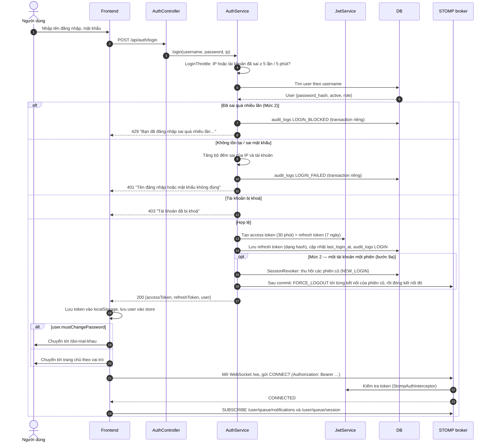

**Ghi chú**
- Refresh token được lưu dưới dạng **hash** trong DB, để có thể thu hồi (đăng xuất, đổi mật khẩu, buộc đăng xuất).
- Ở bước xác thực STOMP, token gửi trong header của khung `CONNECT`. Trình duyệt không gửi được header tuỳ ý trong lúc bắt tay WebSocket (HTTP Upgrade), nên token không đi qua bước đó.

---

## SD-02 · Tự làm mới access token khi hết hạn

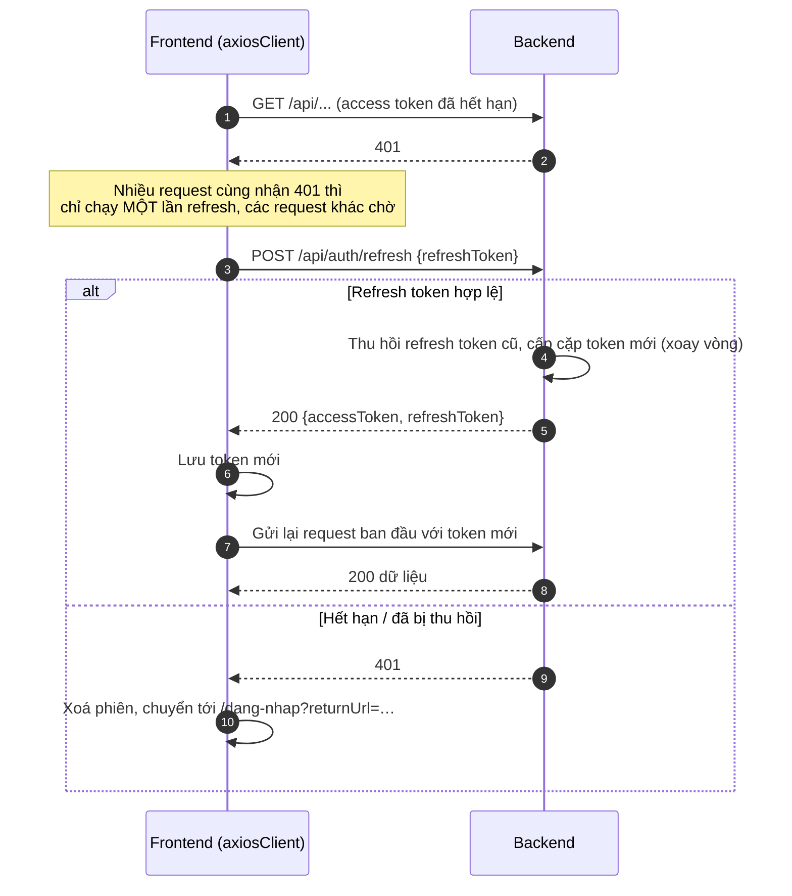

**Ghi chú:** refresh token **xoay vòng**: mỗi lần dùng thì bị thu hồi và đổi sang token mới. Khi một refresh token **đã bị xoay vòng** lại được gửi lên:
- **trong 30 giây** sau lần xoay vòng: thường là 2 tab của cùng trình duyệt refresh cùng lúc. Server trả `401 REFRESH_TOKEN_ROTATED` và **không thu hồi gì**. Client đọc token mới mà tab kia đã lưu trong localStorage rồi thử lại.
- **sau 30 giây**: có thể token đã bị đánh cắp. Backend thu hồi **toàn bộ** phiên của user đó (`revoke_reason = TOKEN_REUSE`).

---

## SD-03 · Import sinh viên từ file (HTTP)

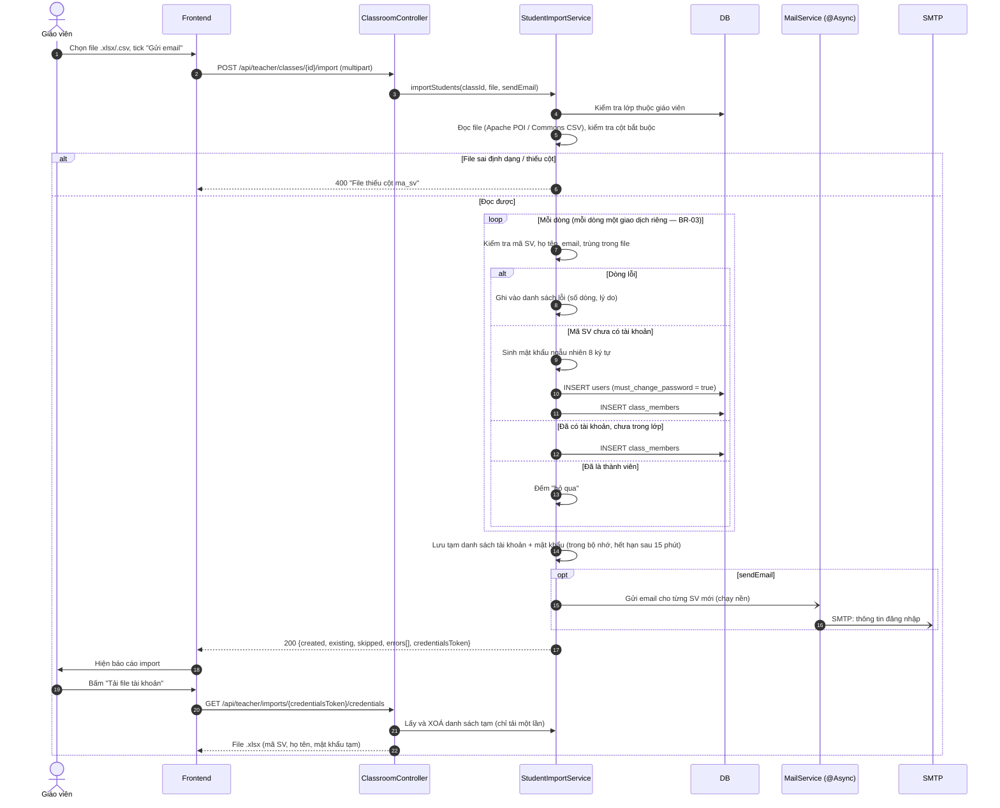

**Ghi chú:** mật khẩu tạm **không bao giờ lưu dạng rõ trong DB**, chỉ có bản hash. Danh sách rõ chỉ nằm trong bộ nhớ của backend cho tới khi giáo viên tải file, hoặc sau 15 phút thì tự huỷ.

---

## SD-04 · Import sinh viên qua TCP (admin-cli)

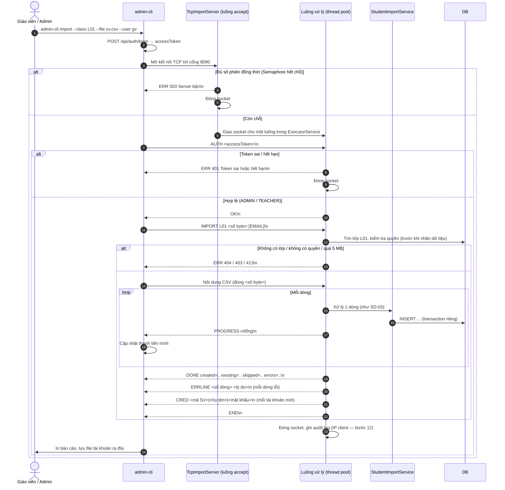

**Ghi chú**
- Giao thức dạng text. Mỗi khung tin kết thúc bằng `\n`. Riêng phần nội dung CSV gửi đúng số byte đã khai báo, nên server biết chính xác chỗ dừng.
- Server có **timeout đọc** (ví dụ 30 giây). Client im lặng quá lâu thì server đóng kết nối, giải phóng luồng.
- Mỗi kết nối được một luồng trong thread pool xử lý. Số phiên đồng thời giới hạn bằng `Semaphore` (bằng số luồng, `app.tcp.threads`): hết chỗ thì trả ngay `ERR 503` thay vì để client chờ trong hàng đợi.
- Lớp và quyền được kiểm tra **ngay khi nhận dòng `IMPORT`**, trước khi đọc phần CSV, để từ chối sớm mà không phải nhận cả file.
- Đặc tả đầy đủ của giao thức nằm trong file 05.

---

## SD-05 · Phát hành bài và gửi thông báo

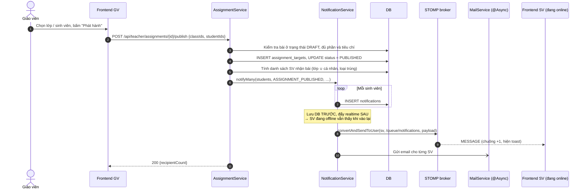

**Ghi chú**
- Nếu `open_at` ở tương lai (BR-05), thông báo chưa gửi ngay. Job định kỳ sẽ gửi khi tới thời điểm mở.
- Cài đặt: `PublishService` chỉ phát sự kiện `AssignmentEvents.Published`. `NotificationEventListener` nghe ở pha `BEFORE_COMMIT`, nên các dòng `notifications` được INSERT **trong cùng transaction** với việc phát hành; bước đẩy WebSocket và gửi email chạy sau khi commit.

---

## SD-06 · Tự lưu nháp, mất mạng và xung đột

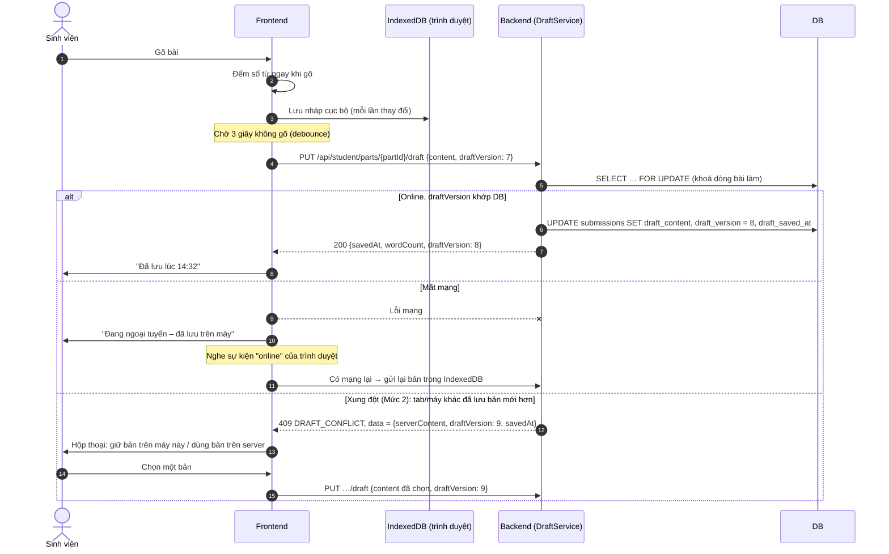

**Ghi chú**
- `draftVersion` là **optimistic locking**. Mỗi lần lưu thành công, server tăng số này. Client gửi số mình đang có; lệch với DB nghĩa là có nơi khác đã lưu, nên server trả 409 thay vì ghi đè.
- Cột `draft_version` thêm ở migration V8 (bước 10). Server khoá dòng rồi mới so số, nên 2 lần lưu đồng thời cùng số chỉ 1 lần thành công. Client không gửi `draftVersion` thì server lưu đè như Mức 1.

---

## SD-07 · Nộp bài một phần

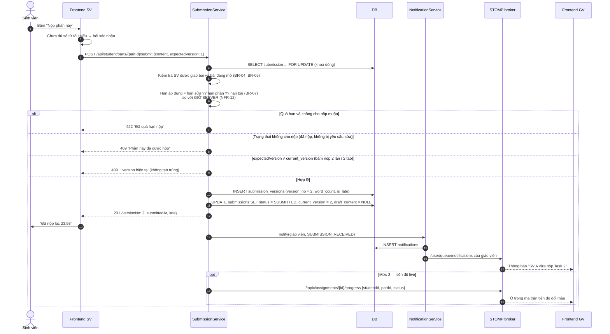

**Ghi chú:** `SELECT … FOR UPDATE` cùng với `expectedVersion` đảm bảo hai request nộp đồng thời (bấm đúp, hai tab, mạng gửi lại) chỉ tạo đúng **một** version. Đây là chỗ xử lý đồng thời quan trọng khi nhiều sinh viên nộp sát hạn (NFR-01).

---

## SD-08 · Chấm bài, trả bài / yêu cầu sửa

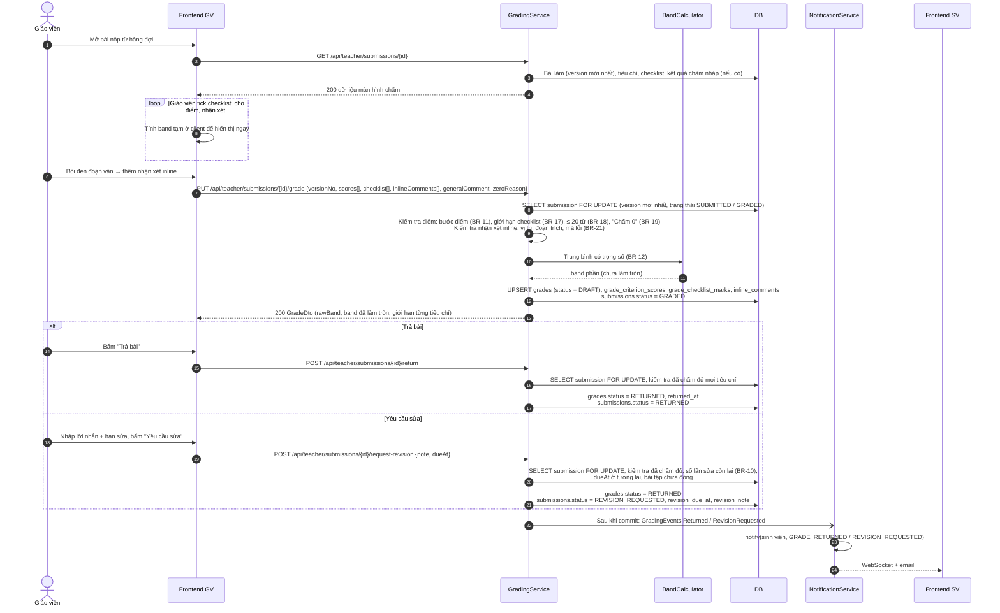

**Ghi chú**
- Band hiển thị ở client chỉ để xem trước. **Giá trị chính thức do server tính** bằng `BandCalculator`, để không phụ thuộc vào client. Server lưu band chưa làm tròn, chỉ làm tròn .25 / .75 khi trả ra để hiển thị.
- Mọi thao tác ghi đều khoá dòng `submissions`, nên hai lần bấm "Trả bài" cùng lúc chỉ có một lần thành công, và không đua được với việc sinh viên nộp lại.

---

## SD-09 · Vòng đời WebSocket: rớt kết nối, kết nối lại, lấy thông báo bị lỡ

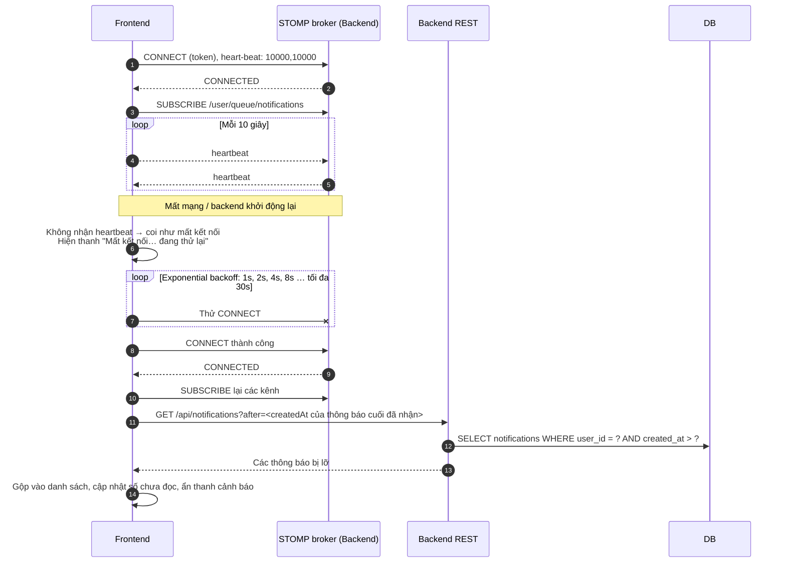

**Ghi chú:** vì thông báo luôn được **lưu DB trước khi đẩy** (SD-05), client mất kết nối bao lâu cũng không mất thông báo. Đây là kịch bản kiểm chứng NFR-04 và NFR-06.

---

## SD-10 · Job nhắc hạn nộp

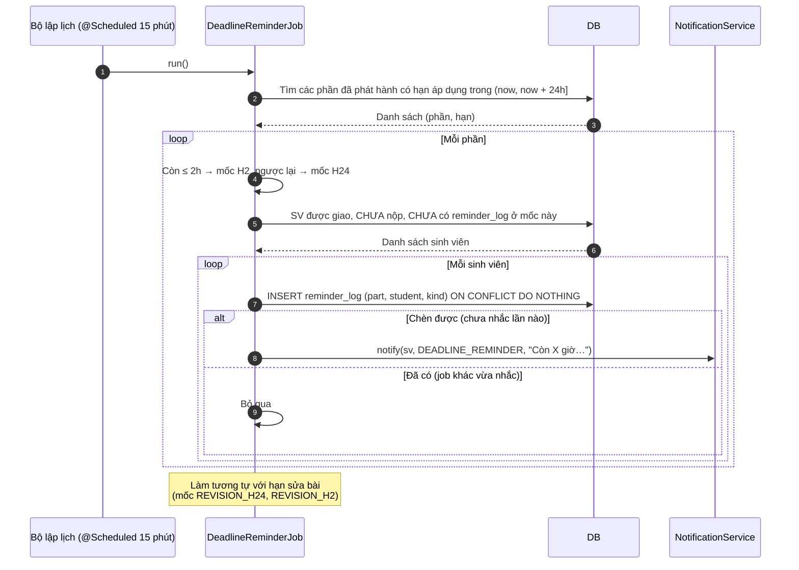

**Ghi chú**
- Dùng khoá chính của `reminder_log` cùng `ON CONFLICT DO NOTHING` để chống gửi trùng (BR-14), kể cả khi job chạy chồng nhau hoặc server khởi động lại giữa chừng.
- Cài đặt (B7b): `ReminderLogRepository.findCandidates` tìm mọi cặp (phần, sinh viên) cần nhắc bằng **một câu SQL** (hạn nộp + hạn sửa, đã loại người có `reminder_log` ở mốc đó). Mỗi nhóm (phần, mốc) chạy trong một transaction: chèn `reminder_log` cho từng người, rồi gọi `NotificationService.notify` cho những ai chèn được. Tạo thông báo lỗi thì bản ghi "đã nhắc" cũng bị huỷ, lượt sau nhắc lại.
- Hạn áp dụng giống BR-07: hạn riêng của phần, không có thì hạn bài; bài làm đang "Cần sửa" thì dùng hạn sửa. "Chưa nộp" = chưa có bài làm hoặc mới có nháp.
- Mỗi lần giáo viên **yêu cầu sửa**, các mốc `REVISION_H24` / `REVISION_H2` cũ của (phần, sinh viên) bị xoá, để vòng sửa mới vẫn được nhắc.
- Cùng bộ lập lịch còn chạy job **thông báo bài tới giờ mở**: mỗi bài được "giành" bằng `UPDATE … SET open_notified_at = now WHERE open_notified_at IS NULL`, nên chỉ thông báo một lần.
- Chu kỳ và hai mốc cấu hình trong `app.reminders` (`interval: PT15M`, `soon: PT24H`, `urgent: PT2H`).

---

## SD-11 · Đồng bộ giờ với server (Mức 2)

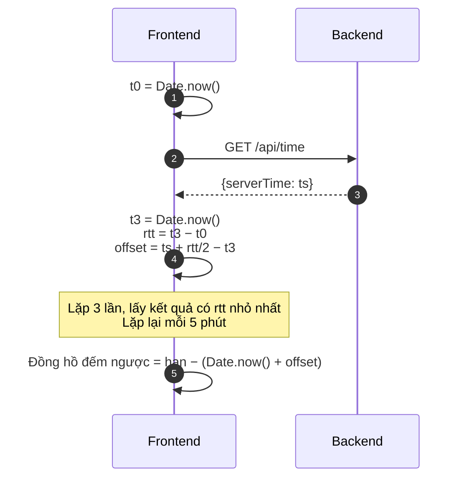

**Ghi chú:** cách làm giống NTP thu gọn. Kết quả chỉ dùng để **hiển thị** cho đúng; **quyết định nộp muộn luôn ở server** (SD-07). Nhờ vậy sinh viên chỉnh giờ máy cũng không có tác dụng.

---

## SD-12 · Chat realtime (Mức 2)

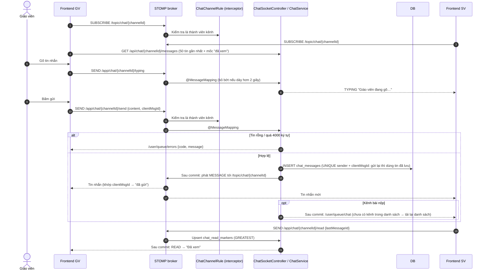

---

## SD-13 · Chế độ thi và tự nộp khi hết giờ (Mức 3)

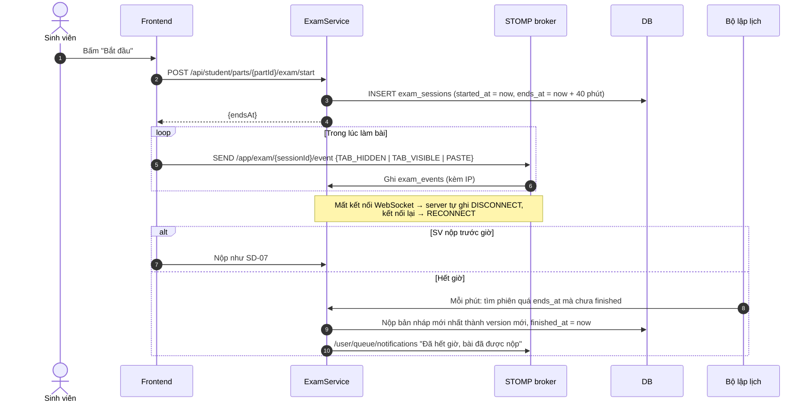
