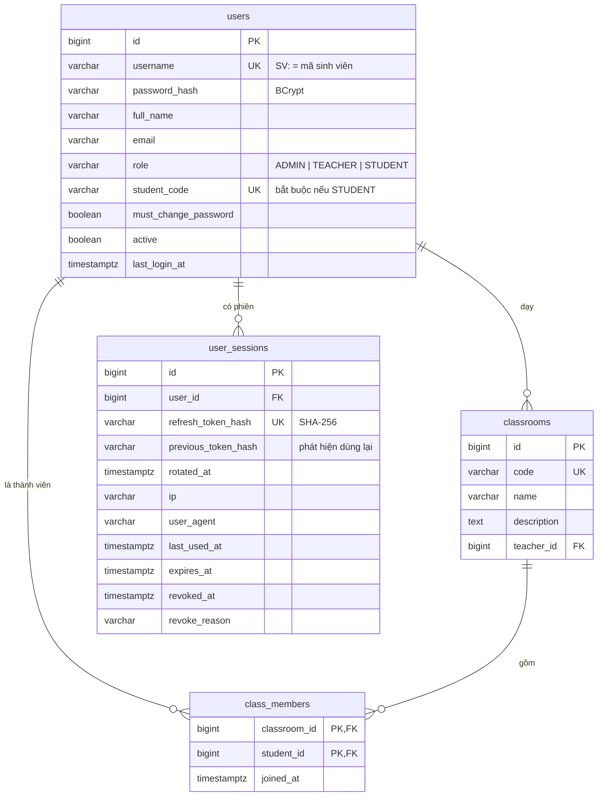
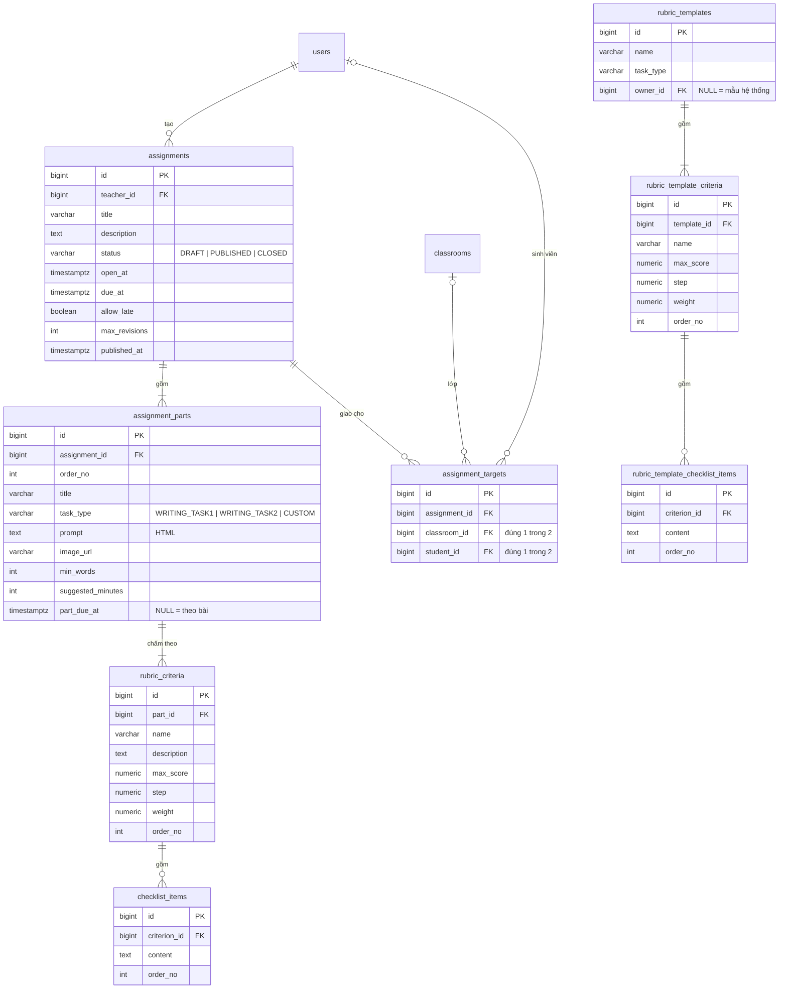
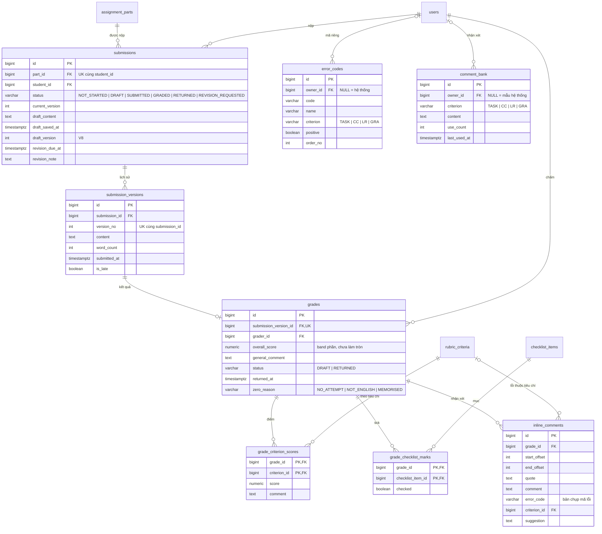
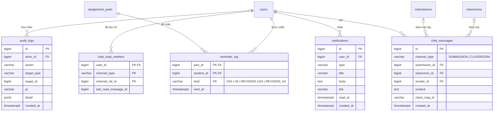
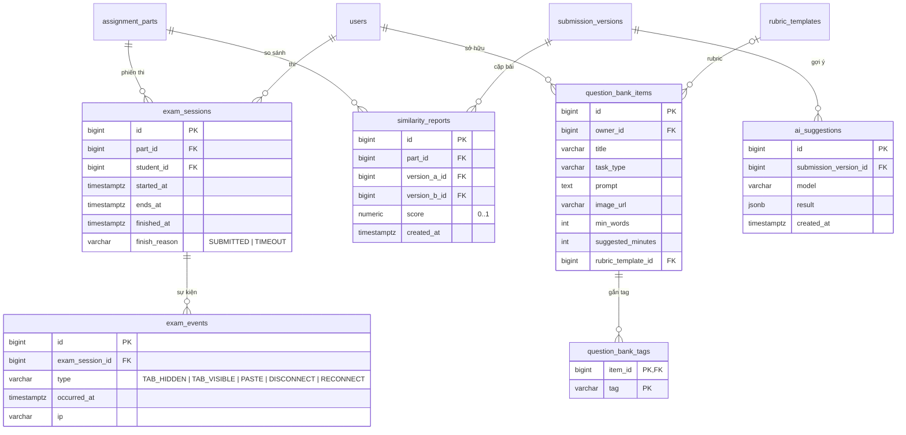

# 04. Thiết kế cơ sở dữ liệu (ERD)

> Hệ quản trị: **PostgreSQL 16**. Schema quản lý bằng **Flyway** (`backend/src/main/resources/db/migration`).
> Tham chiếu quy tắc `BR-xx` trong [01-tong-quan.md](01-tong-quan.md), sơ đồ tuần tự `SD-xx` trong [03-sequence.md](03-sequence.md).

---

## 1. Quy ước chung

| Quy ước | Nội dung |
|---|---|
| Khoá chính | `id BIGINT GENERATED BY DEFAULT AS IDENTITY`. Bảng nối dùng khoá chính kép. |
| Thời gian | Kiểu `TIMESTAMPTZ`, luôn lưu **UTC**. Java dùng `Instant`. API trả chuỗi ISO 8601 có hậu tố `Z`. |
| Audit | Bảng chính có `created_at`, `updated_at`, do JPA auditing tự điền. |
| Enum | Lưu `VARCHAR` kèm ràng buộc `CHECK (... IN (...))`, Java dùng `@Enumerated(STRING)`. Không dùng kiểu enum của PostgreSQL, để thêm giá trị mới dễ hơn. |
| Điểm | `NUMERIC(3,1)` cho band (0.0 – 9.0). `NUMERIC(4,1)` cho điểm tối đa. `NUMERIC(5,2)` cho trọng số. |
| Xoá | Dữ liệu con xoá theo cha (`ON DELETE CASCADE`), trừ các tham chiếu tới người tạo / người chấm. Những tham chiếu đó được giữ lại để không mất lịch sử. |
| Tên | `snake_case`, tên bảng số nhiều tiếng Anh. |

---

## 2. Lộ trình migration

| File | Bước (PLAN.md) | Nội dung | Trạng thái |
|---|---|---|---|
| `V1__core_schema.sql` | Mức 1 / bước 1 | 19 bảng lõi (mục 3.1 – 3.4) | ✅ đã viết |
| `V2__seed_rubric_ielts.sql` | Mức 1 / bước 1 | Rubric mẫu IELTS Task 1, Task 2 | ✅ đã viết |
| `V3__user_sessions.sql` | Mức 1 / bước 2 | Bảng `user_sessions` (refresh token + phiên đăng nhập) | ✅ đã viết |
| `V4__assignment_rubric.sql` | Mức 1 / bước 4 | `assignments.open_notified_at`, `show_suggestions_on_revision`; `assignment_parts.weight`; mã tiêu chí `code`; checklist `kind` + `max_band` (CHECK: LIMIT ⇔ có max_band); rubric mẫu chuyển `step = 1` và thêm 16 mục **Giới hạn điểm** (xem [08](08-nghiep-vu-cham-ielts.md) mục 2, 5.2) | ✅ đã viết |
| `V5__grading_feedback.sql` | Mức 1 / bước 6 | `error_codes` (seed 22 mã hệ thống), `comment_bank` (seed 20 nhận xét mẫu); `inline_comments` thêm `error_code`, `criterion_id`, `suggestion`, bỏ NOT NULL ở `comment`; `grades.zero_reason`, `grades.overall_score` đổi sang `NUMERIC(8,6)` | ✅ đã viết |
| `V6__audit_logs.sql` | Mức 2 / bước 12 | Bảng `audit_logs` (nhật ký hệ thống) | ✅ đã viết |
| `V7__chat.sql` | Mức 2 / bước 9b | `chat_messages`, `chat_read_markers` | ✅ đã viết |
| `V8__draft_version.sql` | Mức 2 / bước 10 | `submissions.draft_version` | ✅ đã viết |
| `V9__…` trở đi | Mức 3 | Chế độ thi (`assignment_parts.exam_mode`, `exam_sessions`…), ngân hàng đề, đạo văn, gợi ý AI | ⬜ |

> Lộ trình đã đánh số lại sau khi nghiên cứu nghiệp vụ chấm IELTS (tài liệu 08). Ở bước 12, migration Mức 2 (trước gộp trong V6) được tách theo từng bước — V6 audit, V7 chat, V8 bản nháp — để mỗi bước tự chứa bảng và entity của mình; Mức 3 dời sang V9 trở đi. Mô tả cột chi tiết ở mục 4 sẽ được bổ sung khi viết từng migration.

---

## 3. Sơ đồ ERD

Sơ đồ chia theo nhóm cho dễ đọc. Bảng xuất hiện ở nhiều nhóm thì chỉ ghi đủ cột ở nhóm chính.

### 3.1 Tài khoản và lớp học



### 3.2 Bài tập, tiêu chí chấm và rubric mẫu



### 3.3 Bài nộp và chấm bài



### 3.4 Thông báo, nhắc hạn, chat và nhật ký



### 3.5 Mở rộng (Mức 3)



---

## 4. Mô tả chi tiết các bảng

Ký hiệu cột "Ràng buộc": **PK** khoá chính · **FK** khoá ngoại · **UK** duy nhất · **NN** not null · **CK** check · **DF** giá trị mặc định.

### 4.1 Nhóm tài khoản

#### `users` — người dùng (V1)
| Cột | Kiểu | Ràng buộc | Ý nghĩa |
|---|---|---|---|
| id | BIGINT | PK | |
| username | VARCHAR(50) | NN, UK | Tên đăng nhập. Với sinh viên, đây là **mã sinh viên** (BR-01) |
| password_hash | VARCHAR(100) | NN | Hash BCrypt |
| full_name | VARCHAR(150) | NN | Họ tên |
| email | VARCHAR(150) | | Dùng để gửi thông báo; có thể trống |
| role | VARCHAR(20) | NN, CK | `ADMIN`, `TEACHER`, `STUDENT` |
| student_code | VARCHAR(30) | UK, CK | Bắt buộc khi `role = STUDENT` |
| must_change_password | BOOLEAN | NN, DF false | Bắt đổi mật khẩu ở lần đăng nhập sau |
| active | BOOLEAN | NN, DF true | `false` = bị khoá |
| last_login_at | TIMESTAMPTZ | | |
| created_at, updated_at | TIMESTAMPTZ | NN | |

Index: `role`.

#### `user_sessions` — phiên đăng nhập và refresh token (V3)
| Cột | Kiểu | Ràng buộc | Ý nghĩa |
|---|---|---|---|
| id | BIGINT | PK | Mã phiên; cũng nằm trong access token (claim `sid`) |
| user_id | BIGINT | FK → users, NN | |
| refresh_token_hash | VARCHAR(64) | NN, UK | SHA-256 của refresh token đang dùng. **Không lưu token gốc** |
| previous_token_hash | VARCHAR(64) | | Hash của token trước khi xoay vòng. Gửi lại token này sau thời gian ân hạn là dấu hiệu bị đánh cắp → thu hồi mọi phiên của user (SD-02) |
| rotated_at | TIMESTAMPTZ | | Thời điểm xoay vòng gần nhất. Dùng để tính thời gian ân hạn 30 giây |
| ip, user_agent | VARCHAR | | Hiển thị ở màn hình quản lý phiên (UC-08) |
| created_at, last_used_at | TIMESTAMPTZ | NN | |
| expires_at | TIMESTAMPTZ | NN | Hết hạn sau 7 ngày kể từ lần xoay vòng gần nhất |
| revoked_at | TIMESTAMPTZ | | Khác NULL = phiên đã bị thu hồi |
| revoke_reason | VARCHAR(30) | CK | `LOGOUT`, `NEW_LOGIN` (một phiên), `PASSWORD_CHANGED`, `ADMIN_FORCED`, `TOKEN_REUSE`, `ACCOUNT_LOCKED` |

Index: `(user_id) WHERE revoked_at IS NULL`.
**Lý do gộp:** một bảng đáp ứng cả ba nhu cầu là refresh token, chính sách một phiên (FR-06) và quản lý phiên (FR-07). Mỗi phiên luôn có đúng một refresh token hợp lệ.

### 4.2 Nhóm lớp học

#### `classrooms` — lớp học (V1)
| Cột | Kiểu | Ràng buộc | Ý nghĩa |
|---|---|---|---|
| id | BIGINT | PK | |
| code | VARCHAR(30) | NN, UK | Mã lớp, dùng trong lệnh TCP `IMPORT <mã lớp>` |
| name | VARCHAR(150) | NN | |
| description | TEXT | | |
| teacher_id | BIGINT | FK → users, NN | Giáo viên phụ trách; chỉ người này thao tác được với lớp |
| created_at, updated_at | TIMESTAMPTZ | NN | |

#### `class_members` — thành viên lớp (V1)
| Cột | Kiểu | Ràng buộc | Ý nghĩa |
|---|---|---|---|
| classroom_id | BIGINT | PK, FK → classrooms (cascade) | |
| student_id | BIGINT | PK, FK → users (cascade) | |
| joined_at | TIMESTAMPTZ | NN | |

Một sinh viên có thể thuộc nhiều lớp. Xoá lớp không xoá tài khoản sinh viên.

### 4.3 Nhóm bài tập

#### `assignments` — bài tập (V1, V4)
| Cột | Kiểu | Ràng buộc | Ý nghĩa |
|---|---|---|---|
| id | BIGINT | PK | |
| teacher_id | BIGINT | FK → users, NN | Người tạo (BR-15) |
| title | VARCHAR(200) | NN | |
| description | TEXT | | |
| status | VARCHAR(20) | NN, CK, DF `DRAFT` | `DRAFT`, `PUBLISHED`, `CLOSED`. Xem sơ đồ trạng thái (file 06) |
| open_at | TIMESTAMPTZ | CK `open_at < due_at` | Trước thời điểm này sinh viên không thấy bài (BR-05) |
| due_at | TIMESTAMPTZ | | Hạn nộp chung |
| allow_late | BOOLEAN | NN, DF false | BR-08 |
| max_revisions | INT | NN, DF 2, CK ≥ 0 | Số lần tối đa được yêu cầu sửa (BR-10) |
| published_at | TIMESTAMPTZ | | |
| open_notified_at | TIMESTAMPTZ | (V4) | Đã gửi thông báo "bài mới" cho trường hợp `open_at` ở tương lai (SD-05) |
| created_at, updated_at | TIMESTAMPTZ | NN | |

Index: `teacher_id`, `(status, due_at)`.

#### `assignment_parts` — các phần của bài (V1, V4, V9+)
| Cột | Kiểu | Ràng buộc | Ý nghĩa |
|---|---|---|---|
| id | BIGINT | PK | |
| assignment_id | BIGINT | FK (cascade), NN | |
| order_no | INT | NN, UK cùng assignment_id | Thứ tự hiển thị |
| title | VARCHAR(200) | NN | Ví dụ "Task 1 – Line graph" |
| task_type | VARCHAR(30) | NN, CK | `WRITING_TASK1`, `WRITING_TASK2`, `CUSTOM`. Dùng để gợi ý rubric mẫu |
| prompt | TEXT | NN | Đề bài, định dạng HTML (đã lọc mã độc) |
| image_url | VARCHAR(500) | | Ảnh biểu đồ |
| min_words | INT | CK ≥ 0 | 150 / 250 theo IELTS |
| suggested_minutes | INT | CK > 0 | 20 / 40 theo IELTS |
| part_due_at | TIMESTAMPTZ | | NULL = dùng `assignments.due_at` (BR-07) |
| exam_mode | BOOLEAN | (V9+, Mức 3) DF false | Bật chế độ thi |
| exam_duration_minutes | INT | (V9+, Mức 3) | Thời gian làm bài của chế độ thi |
| created_at, updated_at | TIMESTAMPTZ | NN | |

#### `rubric_criteria` — tiêu chí chấm của một phần (V1)
| Cột | Kiểu | Ràng buộc | Ý nghĩa |
|---|---|---|---|
| id | BIGINT | PK | |
| part_id | BIGINT | FK (cascade), NN | |
| name | VARCHAR(150) | NN | Ví dụ "Task Response" |
| description | TEXT | | |
| max_score | NUMERIC(4,1) | NN, DF 9 | |
| step | NUMERIC(3,1) | NN, DF 0.5 | Bước điểm |
| weight | NUMERIC(5,2) | NN, DF 1 | Trọng số khi tính band (BR-12) |
| order_no | INT | NN, UK cùng part_id | |

#### `checklist_items` — mục checklist của một tiêu chí (V1)
| Cột | Kiểu | Ràng buộc | Ý nghĩa |
|---|---|---|---|
| id | BIGINT | PK | |
| criterion_id | BIGINT | FK (cascade), NN | |
| content | TEXT | NN | Ví dụ "Có đoạn tổng quan (overview)" |
| order_no | INT | NN | |

#### `assignment_targets` — giao bài (V1)
| Cột | Kiểu | Ràng buộc | Ý nghĩa |
|---|---|---|---|
| id | BIGINT | PK | |
| assignment_id | BIGINT | FK (cascade), NN | |
| classroom_id | BIGINT | FK (cascade) | Giao cho cả lớp |
| student_id | BIGINT | FK (cascade) | Giao cho một sinh viên |
| created_at | TIMESTAMPTZ | NN | |

- Ràng buộc `CHECK (num_nonnulls(classroom_id, student_id) = 1)`: mỗi dòng trỏ tới **đúng một** lớp hoặc một sinh viên.
- Unique từng phần: `(assignment_id, classroom_id)` và `(assignment_id, student_id)`.

**Truy vấn "sinh viên được giao bài" (BR-04)** dùng chung ở mọi nơi qua `AssignmentRepository.findVisibleForStudent`:
```sql
SELECT a.* FROM assignments a
WHERE a.status IN ('PUBLISHED', 'CLOSED')
  AND (a.open_at IS NULL OR a.open_at <= now())
  AND EXISTS (
    SELECT 1 FROM assignment_targets t
    LEFT JOIN class_members m ON m.classroom_id = t.classroom_id
    WHERE t.assignment_id = a.id
      AND (t.student_id = :studentId OR m.student_id = :studentId))
```

#### `rubric_templates`, `rubric_template_criteria`, `rubric_template_checklist_items` — rubric mẫu (V1, dữ liệu V2)
Cấu trúc giống `rubric_criteria` / `checklist_items`, nhưng gắn với mẫu thay vì với phần bài.
- `owner_id` NULL = mẫu của hệ thống (IELTS Task 1, Task 2, seed ở V2). Khác NULL = mẫu riêng của giáo viên.
- "Nạp rubric mẫu" là **sao chép** tiêu chí và checklist của mẫu vào `rubric_criteria` / `checklist_items` của phần. Sửa mẫu về sau không ảnh hưởng bài đã tạo.

### 4.4 Nhóm bài nộp

#### `submissions` — bài nộp của một sinh viên cho một phần (V1, V8)
| Cột | Kiểu | Ràng buộc | Ý nghĩa |
|---|---|---|---|
| id | BIGINT | PK | |
| part_id | BIGINT | FK (cascade), NN | |
| student_id | BIGINT | FK (cascade), NN | **UK (part_id, student_id)**: mỗi sinh viên chỉ có một dòng cho mỗi phần |
| status | VARCHAR(30) | NN, CK, DF `NOT_STARTED` | Xem sơ đồ trạng thái (file 06) |
| current_version | INT | NN, DF 0 | Số version mới nhất đã nộp (0 = chưa nộp). Client gửi kèm `expectedVersion` để chống nộp trùng (SD-07) |
| draft_content | TEXT | | Bản nháp hiện tại; NULL sau khi nộp |
| draft_saved_at | TIMESTAMPTZ | | |
| draft_version | INT | (V8) NN, DF 0, CK ≥ 0 | Khoá lạc quan của bản nháp (SD-06): tăng 1 sau mỗi lần lưu nháp; lệch → 409 `DRAFT_CONFLICT` |
| revision_due_at | TIMESTAMPTZ | | Hạn sửa khi bị yêu cầu sửa (BR-07) |
| revision_note | TEXT | | Lời nhắn của giáo viên khi yêu cầu sửa |
| created_at, updated_at | TIMESTAMPTZ | NN | |

Dòng `submissions` được tạo khi sinh viên **lưu nháp lần đầu**. Ma trận tiến độ coi những sinh viên chưa có dòng là `NOT_STARTED`.

#### `submission_versions` — các lần nộp (V1)
| Cột | Kiểu | Ràng buộc | Ý nghĩa |
|---|---|---|---|
| id | BIGINT | PK | |
| submission_id | BIGINT | FK (cascade), NN | |
| version_no | INT | NN, CK ≥ 1, UK cùng submission_id | 1, 2, 3… |
| content | TEXT | NN | Nội dung đã nộp |
| word_count | INT | NN | Do **server** đếm |
| submitted_at | TIMESTAMPTZ | NN | Giờ server |
| is_late | BOOLEAN | NN | Nộp sau hạn áp dụng (BR-08) |

**Bất biến (NFR-11):** ứng dụng chỉ `INSERT`, không bao giờ `UPDATE` hay `DELETE` bảng này. Entity JPA đánh dấu `@Immutable`.

### 4.5 Nhóm chấm bài

#### `grades` — kết quả chấm một version (V1, V5)
| Cột | Kiểu | Ràng buộc | Ý nghĩa |
|---|---|---|---|
| id | BIGINT | PK | |
| submission_version_id | BIGINT | FK (cascade), NN, **UK** | Mỗi version có tối đa một kết quả chấm |
| grader_id | BIGINT | FK → users, NN | |
| overall_score | NUMERIC(8,6) | (V5 đổi kiểu) | Band của phần, do `BandCalculator` tính (BR-12). Lưu **chưa làm tròn**, chỉ làm tròn khi hiển thị. NULL khi chưa chấm đủ tiêu chí |
| general_comment | TEXT | | |
| status | VARCHAR(20) | NN, CK, DF `DRAFT` | `DRAFT` (sinh viên chưa thấy), `RETURNED` (BR-13) |
| returned_at | TIMESTAMPTZ | | |
| zero_reason | VARCHAR(20) | (V5) CK | Khác NULL khi "Chấm 0" (BR-19): `NO_ATTEMPT`, `NOT_ENGLISH`, `MEMORISED` |
| created_at, updated_at | TIMESTAMPTZ | NN | |

`overall_score` ở V1 là `NUMERIC(3,1)`, sẽ làm mất phần lẻ (6.25 thành 6.3), trái với quy tắc "chỉ làm tròn khi hiển thị". V5 đổi sang 6 chữ số thập phân.

#### `grade_criterion_scores` — điểm từng tiêu chí (V1)
PK `(grade_id, criterion_id)`; cột `score NUMERIC(3,1)`, `comment TEXT`. Ứng dụng kiểm tra `0 ≤ score ≤ max_score` và `score` chia hết cho `step`.

#### `grade_checklist_marks` — tick checklist (V1)
PK `(grade_id, checklist_item_id)`; cột `checked BOOLEAN`.

#### `inline_comments` — nhận xét gắn vào đoạn văn (V1, V5)
| Cột | Kiểu | Ràng buộc | Ý nghĩa |
|---|---|---|---|
| id | BIGINT | PK | |
| grade_id | BIGINT | FK (cascade), NN | |
| start_offset, end_offset | INT | NN, CK `end > start ≥ 0` | Vị trí ký tự trong `submission_versions.content` |
| quote | TEXT | | Đoạn văn được trích. Dùng để kiểm tra lại vị trí và hiển thị |
| comment | TEXT | (V5 bỏ NN) | Lời nhận xét |
| error_code | VARCHAR(20) | (V5) | Mã lỗi, lưu **dạng chữ** (bản chụp): giáo viên xoá mã riêng thì nhận xét cũ vẫn giữ |
| criterion_id | BIGINT | (V5) FK → rubric_criteria (SET NULL) | Tiêu chí mà lỗi ảnh hưởng tới |
| suggestion | TEXT | (V5) | Gợi ý sửa. Ẩn với sinh viên khi "Cần sửa" (BR-21) |
| created_at | TIMESTAMPTZ | NN | |

- Offset tính trên version đã nộp. Version không bao giờ đổi, nên offset luôn đúng.
- CK `chk_inline_has_content`: có ít nhất một trong `error_code`, `comment`, `suggestion` (BR-21).

#### `error_codes` — mã lỗi (V5)
| Cột | Kiểu | Ràng buộc | Ý nghĩa |
|---|---|---|---|
| id | BIGINT | PK | |
| owner_id | BIGINT | FK → users (cascade) | NULL = mã của hệ thống (không sửa / xoá được, BR-22) |
| code | VARCHAR(20) | NN | Lưu chữ hoa, vd `SP`, `SING/PL`, `^` |
| name | VARCHAR(100) | NN | |
| criterion | VARCHAR(10) | CK | Nhóm tiêu chí `TASK` (= TA hoặc TR), `CC`, `LR`, `GRA`; NULL = không gắn |
| description | TEXT | | |
| positive | BOOLEAN | NN, DF false | Mã khen (`GOOD`), không tính là lỗi khi tổng hợp |
| order_no | INT | NN | Thứ tự hiển thị của mã hệ thống |
| created_at, updated_at | TIMESTAMPTZ | NN | |

UK một phần: `upper(code)` duy nhất trong nhóm mã hệ thống, và `(owner_id, upper(code))` duy nhất trong mã của một giáo viên. Mã riêng trùng mã hệ thống do service chặn (`409 DUPLICATE`). Seed 22 mã theo [08](08-nghiep-vu-cham-ielts.md) mục 4.3.

#### `comment_bank` — ngân hàng nhận xét (V5)
| Cột | Kiểu | Ràng buộc | Ý nghĩa |
|---|---|---|---|
| id | BIGINT | PK | |
| owner_id | BIGINT | FK → users (cascade) | NULL = nhận xét mẫu của hệ thống (chỉ đọc) |
| criterion | VARCHAR(10) | CK | `TASK` / `CC` / `LR` / `GRA`; NULL = dùng chung |
| content | TEXT | NN, CK 1–2000 ký tự | |
| use_count | INT | NN, DF 0 | Số lần chèn, để xếp mục hay dùng lên đầu. Mẫu hệ thống không đếm |
| last_used_at | TIMESTAMPTZ | | |
| created_at, updated_at | TIMESTAMPTZ | NN | |

Index `(owner_id, use_count DESC)`. Seed 20 nhận xét mẫu (5 cho mỗi nhóm tiêu chí), do nhóm tự viết, không chép từ bảng mô tả.

### 4.6 Nhóm thông báo và hệ thống

#### `notifications` (V1)
| Cột | Kiểu | Ràng buộc | Ý nghĩa |
|---|---|---|---|
| id | BIGINT | PK | |
| user_id | BIGINT | FK (cascade), NN | Người nhận |
| type | VARCHAR(50) | NN | `ASSIGNMENT_PUBLISHED`, `SUBMISSION_RECEIVED`, `GRADE_RETURNED`, `REVISION_REQUESTED`, `DEADLINE_REMINDER`, `MANUAL_REMINDER`, `ACCOUNT_CREATED`… |
| title | VARCHAR(200) | NN | |
| body | TEXT | | |
| link | VARCHAR(500) | | Đường dẫn trong frontend để mở khi bấm vào thông báo |
| read_at | TIMESTAMPTZ | | NULL = chưa đọc |
| created_at | TIMESTAMPTZ | NN | Dùng cho `?after=` khi kết nối lại (SD-09) |

Index: `(user_id, created_at DESC)`, và `(user_id) WHERE read_at IS NULL` để đếm số chưa đọc.

#### `reminder_log` (V1)
PK `(part_id, student_id, kind)`; `kind ∈ {H24, H2, REVISION_H24, REVISION_H2}`; `sent_at`. Chống nhắc trùng bằng `INSERT … ON CONFLICT DO NOTHING` (BR-14, SD-10). Khi giáo viên yêu cầu sửa lần mới, các dòng `REVISION_*` của (phần, sinh viên) bị xoá để vòng sửa mới được nhắc lại.

#### `chat_messages` (V7, đã cài ở bước 9b)
| Cột | Kiểu | Ràng buộc | Ý nghĩa |
|---|---|---|---|
| id | BIGINT | PK | |
| channel_type | VARCHAR(20) | NN, CK | `SUBMISSION` hoặc `CLASSROOM` |
| submission_id | BIGINT | FK (cascade) | Khác NULL khi `channel_type = SUBMISSION` |
| classroom_id | BIGINT | FK (cascade) | Khác NULL khi `channel_type = CLASSROOM` |
| sender_id | BIGINT | FK → users (cascade), NN | |
| content | TEXT | NN, CK độ dài ≤ 4000 | |
| client_msg_id | VARCHAR(40) | UK cùng sender_id | Client tự sinh, để khớp "đã gửi" và chống gửi trùng khi gửi lại |
| created_at | TIMESTAMPTZ | NN | |

CK: `channel_type` phải khớp đúng một cột khoá ngoại (`chk_chat_channel`). UK `(sender_id, client_msg_id)` chống lưu trùng khi gửi lại. Index một phần: `(submission_id, id DESC) WHERE submission_id IS NOT NULL`, `(classroom_id, id DESC) WHERE classroom_id IS NOT NULL`. Entity `ChatMessage` giữ id dạng số (không quan hệ entity) để module chat không gắn chặt module khác.

#### `chat_read_markers` (V7, đã cài ở bước 9b)
PK `(user_id, channel_type, channel_ref_id)`; `channel_ref_id` = id bài nộp hoặc id lớp; `last_read_message_id BIGINT NN`; `updated_at`. Dùng cho "đã xem" và đếm tin chưa đọc. Ghi bằng upsert `ON CONFLICT … DO UPDATE SET last_read_message_id = GREATEST(…)` — mốc chỉ tăng.

#### `audit_logs` (V6, đã cài ở bước 12)
| Cột | Kiểu | Ràng buộc | Ý nghĩa |
|---|---|---|---|
| id | BIGINT | PK | |
| actor_id | BIGINT | FK → users (SET NULL) | Người thực hiện. NULL = hệ thống, hoặc lần đăng nhập bị chặn / sai tên |
| action | VARCHAR(50) | NN | Theo enum `AuditAction`: `LOGIN`, `LOGIN_FAILED`, `LOGIN_BLOCKED`, `CREATE_TEACHER`, `LOCK_USER`, `UNLOCK_USER`, `RESET_PASSWORD`, `IMPORT_STUDENTS`, `TCP_IMPORT`, `PUBLISH_ASSIGNMENT`, `RETURN_GRADE`, `REQUEST_REVISION`. Không đặt CHECK vì danh sách mở |
| target_type, target_id | VARCHAR(30), BIGINT | | Đối tượng bị tác động: `USER`, `CLASSROOM`, `ASSIGNMENT`, `SUBMISSION` |
| ip | VARCHAR(45) | | IPv4 hoặc IPv6 của client (HTTP: qua nginx lấy từ `X-Forwarded-For`; TCP: địa chỉ socket) |
| detail | JSONB | | Số liệu tóm tắt (vd số dòng import, tên đăng nhập đã gõ, lý do). **Không** chứa mật khẩu, token, mã SV / tên trong file import |
| created_at | TIMESTAMPTZ | NN | Giờ server (bean `Clock`) |

Index: `(created_at DESC)`, `(actor_id, created_at DESC)`. Ghi cùng transaction với thao tác (rollback thì không có dòng "ma"); riêng đăng nhập sai / bị chặn và import TCP ghi transaction riêng để không mất khi request lỗi.

### 4.7 Nhóm mở rộng (V9 trở đi, Mức 3)
| Bảng | Mô tả |
|---|---|
| `exam_sessions` | Phiên thi của một sinh viên cho một phần. UK `(part_id, student_id)`: mỗi người thi một lần. `ends_at` cố định từ lúc bắt đầu. `finish_reason` là `SUBMITTED` hoặc `TIMEOUT`. |
| `exam_events` | Các sự kiện trong phiên thi: chuyển tab, dán, mất kết nối, kết nối lại, kèm IP. |
| `similarity_reports` | Cặp version cùng phần có độ giống cao, `score` từ 0 tới 1. Lưu `version_a_id < version_b_id` để không trùng cặp. |
| `question_bank_items`, `question_bank_tags` | Ngân hàng đề của giáo viên. Rubric tham chiếu tới `rubric_templates` (mẫu riêng của giáo viên). |
| `ai_suggestions` | Kết quả gợi ý của AI cho một version, dạng JSONB, chỉ giáo viên xem được. |

---

## 5. Dữ liệu không lưu trong DB

| Dữ liệu | Lưu ở đâu | Lý do |
|---|---|---|
| Mật khẩu tạm sau khi import | Bộ nhớ backend, tự huỷ sau 15 phút hoặc sau lần tải đầu tiên | Không bao giờ lưu mật khẩu dạng rõ (SD-03) |
| Ai đang online, đang mở bài nào | `ConcurrentHashMap` trong backend | Dữ liệu tạm, mất khi khởi động lại cũng không sao (monolith) |
| Số lần đăng nhập sai theo IP / tài khoản | Bộ nhớ backend, cửa sổ 5 phút | Rate limit (NFR-09) |
| Ảnh đề bài | Thư mục `uploads/` (volume Docker) | DB chỉ lưu đường dẫn |
| Bản nháp khi mất mạng | IndexedDB của trình duyệt | Đồng bộ lên `submissions.draft_content` khi có mạng (SD-06) |
