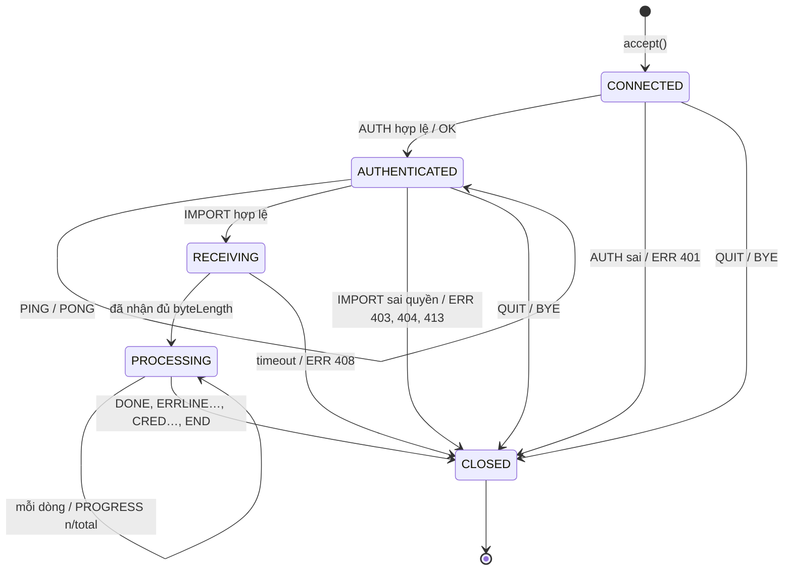

# 05. Đặc tả giao tiếp: REST API, WebSocket, giao thức TCP

> Ba kênh giao tiếp của hệ thống:
> 1. **REST API**: mọi thao tác nghiệp vụ.
> 2. **WebSocket (STOMP)**: đẩy realtime.
> 3. **Giao thức TCP tự định nghĩa**: import sinh viên bằng `admin-cli`.
>
> Luồng gọi chi tiết xem [03-sequence.md](03-sequence.md). Bảng và cột xem [04-erd.md](04-erd.md).
> Khi chạy backend, tài liệu tương tác (Swagger UI) có tại `/swagger-ui.html`.

---

## Phần A. REST API

### A.1 Quy ước chung

| Mục | Quy ước |
|---|---|
| Địa chỉ gốc | `/api`. Khi triển khai đi qua nginx: `https://<máy chủ>/api` |
| Định dạng | JSON, UTF-8. Upload file dùng `multipart/form-data` |
| Xác thực | Header `Authorization: Bearer <accessToken>`. Chỉ `/api/auth/login`, `/api/auth/refresh`, `/api/time` không cần token |
| Phân quyền theo đường dẫn | `/api/admin/**` → ADMIN · `/api/teacher/**` → TEACHER · `/api/student/**` → STUDENT. Các đường dẫn khác: mọi người đã đăng nhập |
| Thời gian | Chuỗi ISO 8601 UTC, ví dụ `"2026-11-05T16:59:00Z"` |
| Tên trường | `camelCase` |
| Phân trang | Query `page` (bắt đầu từ 0), `size` (mặc định 20, tối đa 100), `sort=field,asc\|desc`, `keyword` |

#### Response thành công
```json
{ "success": true, "data": { ... }, "message": null, "totalRecord": 125 }
```
`totalRecord` chỉ có ở API danh sách phân trang. Khi đó `data` là mảng của trang hiện tại.

#### Response lỗi
```json
{
  "success": false,
  "data": null,
  "errorCode": "DEADLINE_PASSED",
  "errorMessage": "Đã quá hạn nộp",
  "status": 422,
  "path": "/api/student/parts/12/submit",
  "timestamp": "2026-11-05T17:00:03Z",
  "fieldErrors": { "content": "Nội dung không được để trống" }
}
```
**HTTP status luôn là `200`** (kể cả khi lỗi, kể cả lỗi của Spring Security như chưa đăng nhập / không có quyền). Kết quả thật đọc trong body: `success`; khi lỗi thì `errorCode` (mã lỗi, bảng dưới), `errorMessage` (câu tiếng Việt hiển thị thẳng cho người dùng) và `status` (mã kiểu HTTP: 400, 401, 403, 404, 409, 422, 429, 500, 503 — để phân loại lỗi, vd `401` → client refresh token rồi gửi lại). `fieldErrors` chỉ có khi lỗi validate. Response thành công không có các trường này; `message` ở response thành công là câu thông báo (vd "Đã gửi email"). Trong tài liệu này, các chỗ ghi "→ `409`", "`429 RATE_LIMITED`"… là giá trị `status` trong body; endpoint tạo mới trước đây trả `201` nay trả `200`. Ngoại lệ ngoài ứng dụng: lỗi mạng, nginx (`502`/`504`) và `/actuator/health` (`503` khi hỏng) vẫn dùng HTTP status thật.

#### Mã lỗi
| `status` | `errorCode` | Khi nào |
|---|---|---|
| 400 | `VALIDATION_ERROR` | Dữ liệu gửi lên không hợp lệ |
| 400 | `BAD_FILE` | File import sai định dạng hoặc thiếu cột; ảnh không phải PNG / JPG / WEBP |
| 400 | `NOT_READY` | Bài tập chưa đủ điều kiện phát hành (message liệt kê các vấn đề) |
| 401 | `UNAUTHORIZED` | Thiếu token, token sai hoặc hết hạn (client sẽ tự refresh) |
| 400 | `WRONG_PASSWORD` | Đổi mật khẩu: mật khẩu hiện tại sai |
| 400 | `SAME_PASSWORD` | Đổi mật khẩu: mật khẩu mới trùng mật khẩu cũ |
| 401 | `BAD_CREDENTIALS` | Sai tên đăng nhập hoặc mật khẩu |
| 401 | `REFRESH_TOKEN_ROTATED` | Refresh token cũ được gửi lại trong 30 giây sau khi xoay vòng (vd 2 tab cùng refresh). Client lấy token mới mà tab kia đã lưu rồi thử lại |
| 403 | `FORBIDDEN` | Không đủ quyền, hoặc không phải chủ của tài nguyên |
| 403 | `ACCOUNT_LOCKED` | Tài khoản bị khoá |
| 403 | `PASSWORD_CHANGE_REQUIRED` | Tài khoản đang bị bắt đổi mật khẩu: chỉ được gọi `/api/auth/*` |
| 405 | `METHOD_NOT_ALLOWED` | Sai method HTTP |
| 415 | `UNSUPPORTED_MEDIA_TYPE` | Sai `Content-Type` |
| 404 | `NOT_FOUND` | Không tồn tại, hoặc người dùng không được phép biết là nó tồn tại |
| 409 | `ALREADY_SUBMITTED` | Phần này đã nộp và không ở trạng thái yêu cầu sửa |
| 409 | `VERSION_CONFLICT` | `expectedVersion` lệch: đã nộp ở tab hoặc máy khác |
| 409 | `DRAFT_CONFLICT` | `draftVersion` lệch: tab / máy khác vừa lưu nháp. `data` = `{serverContent, draftVersion, savedAt}` (bước 10) |
| 409 | `DUPLICATE` | Trùng mã lớp, tên đăng nhập… |
| 400 | `CURRENT_SESSION` | Admin thu hồi chính phiên đang dùng (hãy dùng Đăng xuất) |
| 409 | `INVALID_STATE` | Thao tác không hợp lệ với trạng thái hiện tại, ví dụ xoá bài đã phát hành |
| 409 | `GROUP_LOCKED` | Bài PAPER: đã qua hạn chốt nhóm, sinh viên không tự đổi nhóm được (BR-27) |
| 409 | `GROUP_FULL` | Bài PAPER: nhóm đã đủ người |
| 409 | `ALREADY_IN_GROUP` | Bài PAPER: sinh viên đã ở trong một nhóm của bài này |
| 409 | `NO_GROUP` | Bài PAPER: sinh viên chưa có nhóm nên chưa lưu nháp / nộp được (BR-28) |
| 409 | `SNAPSHOT_STALE` | Nộp bài PAPER khi snapshot tài liệu cũ hơn thay đổi cuối (thành viên vừa gõ): client lưu snapshot rồi nộp lại (B25a) |
| 409 | `EXAM_NOT_STARTED` | Phần ở chế độ thi mà chưa bấm "Bắt đầu": chưa lưu nháp / nộp được (BR-23, Mức 3) |
| 413 | `FILE_TOO_LARGE` | File vượt giới hạn |
| 422 | `DEADLINE_PASSED` | Quá hạn và bài không cho nộp muộn |
| 422 | `REQUIRED_SECTIONS_EMPTY` | Nộp bài PAPER khi mục bắt buộc còn trống (BR-29). Message liệt kê tên mục |
| 422 | `LEVEL_MISMATCH` | Chấm bài PAPER: điểm nằm ngoài khoảng của mức đạt đã chọn (BR-31) |
| 422 | `REVISION_LIMIT` | Đã hết số lần được yêu cầu sửa |
| 422 | `SCORE_LIMITED` | Điểm tiêu chí vượt giới hạn do mục checklist "Giới hạn điểm" đang tick (BR-17) hoặc bài ≤ 20 từ (BR-18). Message nêu lý do |
| 429 | `RATE_LIMITED` | Đăng nhập sai quá nhiều lần (5 lần / 5 phút theo IP hoặc theo tài khoản, NFR-09), hoặc nhắc thủ công quá 3 lần / 10 phút cho một bài, hoặc tra DOI quá 20 lần / phút. Message ghi thời gian phải chờ |
| 500 | `INTERNAL_ERROR` | Lỗi không mong muốn |
| 503 | `DOI_UNAVAILABLE` | Tra DOI: dịch vụ doi.org / Crossref lỗi, trả dữ liệu lạ hoặc quá thời gian chờ (B24) — nhập tay hoặc thử lại sau |

> Giáo viên truy cập lớp hoặc bài của người khác nhận **404** chứ không phải 403, để không lộ việc tài nguyên đó có tồn tại.

---

### A.2 Xác thực — `/api/auth`

| Method | Đường dẫn | Mô tả | Body → `data` |
|---|---|---|---|
| POST | `/api/auth/login` | Đăng nhập (UC-01, SD-01) | `{username, password}` → `LoginResponse` |
| POST | `/api/auth/refresh` | Làm mới token, có xoay vòng (SD-02) | `{refreshToken}` → `TokenPair` |
| POST | `/api/auth/logout` | Thu hồi phiên hiện tại | `{refreshToken}` → `null` |
| GET | `/api/auth/me` | Thông tin người dùng hiện tại | → `AccountInfo` |
| POST | `/api/auth/change-password` | Đổi mật khẩu (UC-02). Thu hồi các phiên khác, giữ phiên hiện tại | `{currentPassword, newPassword}` → `AccountInfo` |
| GET | `/api/time` | Giờ server, không cần token (SD-11) | → `{serverTime}` |

**Giới hạn đăng nhập sai (NFR-09, đã cài ở bước 12):** tối đa 5 lần sai trong 5 phút, đếm **riêng cho mỗi IP** và **mỗi tài khoản** (trong bộ nhớ, `app.rate-limit`). Vượt → `429 RATE_LIMITED` "Bạn đã đăng nhập sai quá nhiều lần. Vui lòng thử lại sau N phút", kể cả khi lần đó nhập đúng mật khẩu. Đăng nhập đúng xoá bộ đếm của tài khoản (không xoá của IP). Mọi lần thử đều ghi nhật ký (`LOGIN`, `LOGIN_FAILED`, `LOGIN_BLOCKED`).

**Kiểm tra mỗi request có access token:** ngoài chữ ký và hạn của JWT, server kiểm tra **phiên (`sid`) chưa bị thu hồi** và **tài khoản còn hoạt động**. Nhờ vậy đăng xuất, đổi mật khẩu, khoá tài khoản có tác dụng ngay, không phải chờ access token hết hạn.

```jsonc
// LoginResponse
{
  "accessToken": "eyJhbGciOi...",          // JWT, hết hạn sau 30 phút; claim: sub, role, sid
  "refreshToken": "q8Zr...",               // chuỗi ngẫu nhiên 256 bit, hết hạn sau 7 ngày
  "accessTokenExpiresAt": "2026-11-05T09:30:00Z",
  "user": {
    "id": 42, "username": "2151234567", "fullName": "Nguyễn Văn A",
    "email": "a@sv.edu.vn", "role": "STUDENT", "studentCode": "2151234567",
    "mustChangePassword": true
  }
}
```

---

### A.3 Quản trị viên — `/api/admin`

| Method | Đường dẫn | Mô tả | Mức |
|---|---|---|---|
| GET | `/api/admin/teachers?keyword&active&page&size` | Danh sách giáo viên | 1 |
| POST | `/api/admin/teachers` | Tạo giáo viên `{username, fullName, email}` → `{teacher, temporaryPassword}` | 1 |
| PUT | `/api/admin/teachers/{id}` | Sửa `{fullName, email}` | 1 |
| GET | `/api/admin/users?keyword&role&active&page&size` | Tra cứu người dùng | 1 |
| GET | `/api/admin/users/{id}` | Chi tiết người dùng | 1 |
| POST | `/api/admin/users/{id}/lock` | Khoá tài khoản. Thu hồi mọi phiên và gửi `FORCE_LOGOUT` | 1 |
| POST | `/api/admin/users/{id}/unlock` | Mở khoá | 1 |
| POST | `/api/admin/users/{id}/reset-password` | Đặt lại mật khẩu → `{temporaryPassword}`; bắt đổi lần sau | 1 |
| GET | `/api/admin/stats` | Thống kê toàn hệ thống (UC-09) → `{usersByRole, lockedUsers, classrooms, assignmentsByStatus, submissionsToday, submissionsByDay[14], activeSessions}`. "Ngày" tính theo giờ Việt Nam (`app.zone`) | 1 |
| GET | `/api/admin/audit-logs?actorId&action&ip&from&to&page&size` | Nhật ký hệ thống (UC-07, đã cài ở bước 12): mới nhất trước; `ip` lọc theo tiền tố (vd `192.168.`); `from` ≤ thời điểm < `to`, `from ≥ to` → `400`. Mỗi dòng `{id, actorId, actorUsername, actorName, action, targetType, targetId, ip, detail, createdAt}` | 2 |
| GET | `/api/admin/sessions?keyword&role&status&from&to&page&size&sort` | Danh sách phiên (UC-08): `keyword` khớp tên đăng nhập / họ tên; `status` ∈ `ACTIVE`, `EXPIRED`, `REVOKED`; `from` ≤ lúc đăng nhập < `to`; sắp xếp theo `lastUsedAt` (mặc định, giảm dần), `createdAt`, `expiresAt`, `username`. Mỗi dòng `SessionRow` = `{sessionId, userId, username, fullName, role, ipMasked, device, createdAt, lastUsedAt, expiresAt, revokedAt, revokeReason, status, current}` — **không có token**, IP che một phần (`192.168.1.*`, IPv6 giữ 3 nhóm đầu), `device` = "Trình duyệt · Hệ điều hành", `current` = phiên admin đang dùng | 3 ✅ |
| DELETE | `/api/admin/sessions/{id}` | Thu hồi một phiên (`ADMIN_FORCED`) → `SessionRow`. Phiên đang dùng → `400 CURRENT_SESSION`; đã hết hạn → `409 INVALID_STATE`; đã thu hồi → trả lại như cũ (không ghi nhật ký lần 2) | 3 ✅ |
| POST | `/api/admin/users/{id}/sessions/revoke` | Thu hồi mọi phiên còn hiệu lực của tài khoản (giữ phiên đang dùng nếu là chính mình) → `{count}` | 3 ✅ |
| POST | `/api/admin/sessions/cleanup` | Xoá các phiên đã hết hạn → `{count}` (phiên đã thu hồi nhưng chưa hết hạn được giữ để phát hiện dùng lại refresh token) | 3 ✅ |

**Quy tắc riêng:**
- Admin **không tự khoá được chính mình** → `409 INVALID_STATE`.
- Thu hồi phiên đi qua `SessionRevoker` như khoá / đặt lại mật khẩu: thiết bị đang mở WebSocket nhận `FORCE_LOGOUT` (`ADMIN_FORCED`) rồi bị ngắt; REST và refresh bằng phiên đó → `401`. Thu hồi / dọn ghi nhật ký `REVOKE_SESSION`, `REVOKE_USER_SESSIONS`, `CLEANUP_SESSIONS` (chỉ id + số lượng, không ghi token, IP hay user-agent).
- Đặt lại mật khẩu sẽ thu hồi mọi phiên của tài khoản đó (`ADMIN_FORCED`).
- Danh sách chỉ cho sắp xếp theo `username`, `fullName`, `createdAt`, `lastLoginAt` (mặc định `createdAt,desc`). Trường khác → `400`.
- Tên đăng nhập của giáo viên: 3–50 ký tự, chỉ gồm chữ không dấu, số và `. _ -`.
- `UserSummary` = `{id, username, fullName, email, role, studentCode, active, mustChangePassword, lastLoginAt, createdAt}`. Cột "Số lớp" của giáo viên được thêm ở bước lớp học.

---

### A.4 Giáo viên — lớp học và import — `/api/teacher`

| Method | Đường dẫn | Mô tả |
|---|---|---|
| GET | `/api/teacher/classes?keyword&page&size` | Lớp của tôi, kèm số thành viên |
| POST | `/api/teacher/classes` | Tạo lớp `{code, name, description}` |
| GET | `/api/teacher/classes/{id}` | Chi tiết lớp |
| PUT | `/api/teacher/classes/{id}` | Sửa lớp |
| DELETE | `/api/teacher/classes/{id}` | Xoá lớp. Không xoá tài khoản sinh viên |
| GET | `/api/teacher/classes/{id}/members?keyword&page&size` | Thành viên lớp |
| POST | `/api/teacher/classes/{id}/members` | Thêm sinh viên đã có tài khoản `{studentCodes: [...]}` |
| DELETE | `/api/teacher/classes/{id}/members/{studentId}` | Xoá khỏi lớp |
| POST | `/api/teacher/classes/{id}/import` | **Import file** (multipart: `file`, `sendEmail`) → `ImportReport` (UC-11, SD-03) |
| GET | `/api/teacher/imports/{credentialsToken}/credentials` | Tải `.xlsx` tài khoản vừa tạo. **Chỉ tải được một lần**, hết hạn sau 15 phút |
| GET | `/api/teacher/import-template?format=xlsx\|csv` | Tải file mẫu |
| GET | `/api/teacher/students/search?keyword` | Tìm sinh viên theo mã hoặc tên, để giao bài cho từng cá nhân (tối đa 20 kết quả) → `[{id, studentCode, fullName}]` |

**Ghi chú:**
- **Mã lớp** 2–30 ký tự, chỉ gồm chữ không dấu, số và `. _ -`. Server **lưu viết hoa**, nên trùng mã không phân biệt hoa thường → `409 DUPLICATE`.
- `ClassroomSummary` = `{id, code, name, description, memberCount, createdAt}`. Danh sách lớp sắp xếp được theo `name` (mặc định), `code`, `createdAt`.
- `MemberDto` = `{studentId, studentCode, fullName, email, active, mustChangePassword, joinedAt}`. Sắp xếp theo `studentCode` (mặc định), `fullName`, `joinedAt`.
- Thêm thành viên trả `{added, alreadyMember, notFound: [mã SV]}`. Mã không tồn tại, hoặc thuộc tài khoản không phải sinh viên, nằm trong `notFound`.
- Lớp của giáo viên khác → `404` ở mọi endpoint, kể cả danh sách thành viên.

```jsonc
// ImportReport
{
  "totalRows": 45,
  "created": 40,          // tài khoản mới
  "existing": 3,          // đã có tài khoản, được thêm vào lớp
  "skipped": 1,           // đã là thành viên
  "errors": [ { "row": 17, "studentCode": "21A", "reason": "Mã sinh viên không hợp lệ" } ],
  "emailQueued": true,
  "credentialsToken": "c2b1f0e4-...",   // null nếu không có tài khoản mới
  "credentialsExpiresAt": "2026-11-05T09:45:00Z"
}
```

**Định dạng file import:**
- Dòng đầu tiên có dữ liệu là tiêu đề. Tên cột không phân biệt hoa thường, dấu hay khoảng trắng: `ma_sv` / `MSSV` / `Mã SV` / `Mã sinh viên`; `ho_ten` / `Họ tên` / `Họ và tên`; `email`.
- CSV: UTF-8 (có hoặc không BOM), tự nhận dấu phân cách `,` `;` hoặc tab.
- Tối đa **2000 dòng** và 10 MB mỗi file.
- Số dòng trong báo cáo lỗi tính như Excel (dòng tiêu đề = 1).
- Mã SV được **lưu viết hoa**. Mọi so khớp mã SV và **đăng nhập đều không phân biệt hoa thường**.
- Lỗi cả file (sai đuôi, file hỏng, thiếu cột, rỗng, quá số dòng) → `400 BAD_FILE`, không ghi gì.
- Lỗi từng dòng (mã sai, thiếu tên, email sai, trùng mã trong file, **mã trùng tên đăng nhập của tài khoản khác**) nằm trong `errors[]`; các dòng còn lại vẫn được xử lý (BR-03).
- Tài khoản đã có thì **không bị ghi đè** họ tên / email, chỉ được thêm vào lớp.
- File tài khoản chỉ chứa tài khoản **mới tạo**. Email chỉ gửi tới sinh viên mới có email.
| Cột | Bắt buộc | Quy tắc |
|---|---|---|
| `ma_sv` | ✔ | 4–30 ký tự, chỉ chữ và số |
| `ho_ten` | ✔ | 2–150 ký tự |
| `email` | | Đúng định dạng email |

---

### A.5 Giáo viên — bài tập

| Method | Đường dẫn | Mô tả |
|---|---|---|
| GET | `/api/teacher/rubric-templates?taskType` | Rubric mẫu: của hệ thống và của tôi, kèm tiêu chí (`code`, `step`…) và checklist (`kind`, `maxBand`) |
| GET | `/api/teacher/rubric-templates/descriptors?taskType` | Bảng mô tả band thu gọn tiếng Việt cho từng tiêu chí (mức 0–9) + link bản chính thức ielts.org (docs/08) |
| POST | `/api/files` | Upload ảnh đề bài (multipart `file`, png/jpg/webp ≤ 5 MB) → `{url}` |
| GET | `/api/teacher/assignments?status&keyword&page&size` | Danh sách bài tập, kèm số phần `partCount`, số người nhận `recipientCount`, số người đã nộp đủ mọi phần `completedCount`, số bài (phần) chờ chấm `pendingGradingCount` |
| POST | `/api/teacher/assignments` | Tạo bài ở trạng thái DRAFT, gồm các phần và rubric → `AssignmentDetail` |
| GET | `/api/teacher/assignments/{id}` | Chi tiết bài |
| PUT | `/api/teacher/assignments/{id}` | **Chỉ bài DRAFT**: thay toàn bộ (thông tin + các phần + rubric). Bài đã phát hành → `409 INVALID_STATE` |
| PATCH | `/api/teacher/assignments/{id}/settings` | Mọi trạng thái (BR-06): đổi `title`, `description`, `dueAt`, `allowLate`, `maxRevisions`, `showSuggestionsOnRevision`, `partDueAts: {partId: hạn \| null}`. Trường bỏ trống = giữ nguyên |
| DELETE | `/api/teacher/assignments/{id}` | Chỉ xoá được bài DRAFT; còn lại → `409 INVALID_STATE` (hãy đóng bài) |
| POST | `/api/teacher/assignments/{id}/publish` | Giao bài và phát hành `{classIds, studentIds}` → `{recipientCount}` (UC-14, SD-05) |
| GET | `/api/teacher/assignments/{id}/targets` | Đã giao cho ai → `{classes: [{id, code, name, memberCount}], students: [{id, studentCode, fullName}], recipientCount}` |
| PUT | `/api/teacher/assignments/{id}/targets` | Giao thêm (chỉ bài PUBLISHED) `{classIds, studentIds}` → `{newRecipients, recipientCount}`. Chỉ thêm, không gỡ người đã giao |
| POST | `/api/teacher/assignments/{id}/close` | PUBLISHED → CLOSED |
| POST | `/api/teacher/assignments/{id}/reopen` | CLOSED → PUBLISHED |
| POST | `/api/teacher/assignments/{id}/duplicate` | Nhân bản → bài DRAFT mới "… (bản sao)": đủ phần và rubric; **không** chép người nhận, `openAt`, `dueAt`, hạn riêng |

**Phát hành (UC-14):**
- Điều kiện: bài nháp; có ≥ 1 phần; mỗi phần có ≥ 1 tiêu chí; có `dueAt` ở tương lai; hạn riêng (nếu có) ở tương lai; **có ≥ 1 người nhận**. Thiếu điều kiện → `400 NOT_READY`, message **liệt kê mọi vấn đề**. Phát hành lần 2 → `409 INVALID_STATE`.
- `classIds` phải là lớp của chính giáo viên; `studentIds` phải là tài khoản sinh viên. Sai → `400`.
- **Người nhận** = sinh viên giao trực tiếp ∪ thành viên các lớp được giao, đã loại trùng, **tính tại thời điểm truy vấn**. Sinh viên vào lớp sau khi phát hành vẫn thấy bài.
- Sau khi commit, backend phát sự kiện `AssignmentEvents.Published` / `RecipientsAdded` (có danh sách người nhận và cờ `opensNow`). Module thông báo (B7) dựa vào đó để gửi thông báo và email.
- `ClassroomSummary` có thêm `openAssignmentCount`: số bài đang mở được giao cho cả lớp.

**Upload ảnh đề:** `POST /api/files` (TEACHER, ADMIN), multipart `file`.
- Loại file nhận diện theo **chữ ký byte đầu file** (PNG / JPG / WEBP), không tin tên hay Content-Type. Tối đa 5 MB.
- Trả `{url: "/uploads/yyyy/MM/<uuid>.png"}`.
- `GET /uploads/**` **công khai** (thẻ `` không gửi được token), tên file là UUID nên không đoán được, cache 30 ngày.

```jsonc
// POST /api/teacher/assignments — body
{
  "title": "Tuần 5 – Writing practice",
  "description": "Làm đủ 2 phần, chú ý paraphrase.",
  "openAt": "2026-11-01T01:00:00Z",
  "dueAt": "2026-11-07T16:59:00Z",
  "allowLate": true,
  "maxRevisions": 2,
  "kind": "ESSAY",                 // Mức 4: ESSAY (mặc định) | PAPER
  "citationStyle": null,           // PAPER: IEEE (mặc định) | APA
  "maxGroupSize": null,            // PAPER: 1–10, mặc định 4
  "groupLockAt": null,             // PAPER: hạn chốt nhóm, phải trước dueAt; null = tới hạn nộp
  "parts": [
    {
      "title": "Task 1 – Line graph",
      "taskType": "WRITING_TASK1",
      "prompt": "<p>The graph below shows ...</p>",
      "imageUrl": "/uploads/2026/11/abc.png",
      "minWords": 150,
      "suggestedMinutes": 20,
      "partDueAt": null,
      "weight": null,               // null → mặc định theo loại: WRITING_TASK2 = 2, còn lại = 1 (BR-12)
      "examMode": false,            // Mức 3: bật chế độ thi tính giờ (BR-23)
      "examDurationMinutes": null,  // bắt buộc khi examMode (1–300); bỏ trống → lấy suggestedMinutes, cả hai trống → 400
      "sections": [],              // chỉ bài PAPER (Mức 4): [{sectionKey?, title, required?, minWords?, maxWords?}]
      "criteria": [
        {
          "code": "TA",             // TA | TR | CC | LR | GRA | null (tiêu chí tự định nghĩa); không lặp trong một phần
          "name": "Task Achievement", "description": "...",
          "maxScore": 9, "step": 1, "weight": 1,   // step: 1 (mặc định, đúng IELTS) hoặc 0.5
          "checklist": [
            { "content": "Câu mở bài diễn đạt lại (paraphrase) đề bài", "kind": "CHECK" },
            { "content": "Không có đoạn tổng quan (overview)", "kind": "LIMIT", "maxBand": 5 }
          ]
        }
      ]
    }
  ]
}
```

**Quy tắc kiểm tra khi lưu** (lỗi → `400 VALIDATION_ERROR`, message chỉ rõ phần / tiêu chí):
- `openAt` < `dueAt`.
- Ảnh đề chỉ nhận `/uploads/…` hoặc `http(s)://…`.
- Bước điểm chỉ là 1 hoặc 0.5; `maxScore` là bội số của bước.
- Mục `LIMIT` bắt buộc có `maxBand` trong `[0, maxScore]` và là bội số của bước. Mục `CHECK` thì `maxBand` bị bỏ qua.
- `prompt` được **lọc HTML** (chỉ giữ thẻ định dạng cơ bản); lọc xong mà rỗng → lỗi.
- Giới hạn: 10 phần / bài, 10 tiêu chí / phần, 30 mục checklist / tiêu chí.
- Bài nháp được phép chưa đủ phần hay tiêu chí. Điều kiện đủ chỉ kiểm tra khi **phát hành**.

**Ngân hàng đề (UC-20, FR-25):**

| Method | Đường dẫn | Mô tả |
|---|---|---|
| GET | `/api/teacher/question-bank?keyword&taskType&tag&page&size&sort` | Danh sách đề của tôi; `sort`: `title`, `taskType`, `createdAt`, `updatedAt` |
| POST | `/api/teacher/question-bank` | Lưu đề + rubric/checklist + tag → `QuestionBankDetail` |
| GET | `/api/teacher/question-bank/{id}` | Chi tiết đề của tôi |
| PUT | `/api/teacher/question-bank/{id}` | Thay toàn bộ đề + rubric + tag |
| DELETE | `/api/teacher/question-bank/{id}` | Xoá đề và rubric riêng đi kèm |

Request dùng các trường `title`, `taskType`, `prompt`, `imageUrl`, `minWords`, `suggestedMinutes`, `tags` và
`criteria` cùng dạng với một phần trong `AssignmentRequest`. Tag được bỏ khoảng trắng, chuyển chữ thường và loại
trùng; tối đa 20 tag, mỗi tag 50 ký tự. Giáo viên khác truy cập id của đề → `404`. Đề và rubric được sao chép khi
nạp vào bài tập, nên sửa ngân hàng không làm đổi bài đã tạo.

---

### A.6 Giáo viên — tiến độ, thống kê

| Method | Đường dẫn | Mô tả |
|---|---|---|
| GET | `/api/teacher/assignments/{id}/progress?classId&status` | Ma trận tiến độ (UC-16) |
| POST | `/api/teacher/assignments/{id}/remind` | Nhắc nhở `{studentIds, partId?}` → `{sent}` (đã cài ở B7b): chỉ bài đang mở (khác → `409`); mọi `studentIds` phải là người nhận bài, `partId` phải thuộc bài (sai → `400`); bài của người khác → `404`. Mỗi sinh viên nhận thông báo `MANUAL_REMINDER` kèm email. Mỗi (giáo viên, bài) tối đa 3 lần / 10 phút, vượt → `429 RATE_LIMITED` (bước 12) |
| GET | `/api/teacher/assignments/{id}/stats?classId` | Thống kê một bài (UC-19) |
| GET | `/api/teacher/assignments/{id}/export?classId` | Bảng điểm `.xlsx` (FR-66) |
| GET | `/api/teacher/stats/classes/{id}` | Thống kê lớp, bảng xếp hạng (FR-65) |
| GET | `/api/teacher/stats/students/{id}` | Thống kê một sinh viên trên các bài của tôi (FR-64) → `StudentStats` (xem A.8 "Kết quả học tập") |
| GET | `/api/teacher/assignments/{id}/exam-monitor?classId` | Màn giám sát chế độ thi (UC-21, Mức 3) → `ExamMonitor` |
| GET | `/api/teacher/parts/{partId}/students/{studentId}/live` | Xem trực tiếp bài đang gõ (BR-26, Mức 3) → `LiveSnapshot` |
| GET | `/api/teacher/assignments/{id}/exam-events?classId` | Bảng tin giám sát: 50 sự kiện thi mới nhất của bài → `[ExamPush]` (cùng dạng tin đẩy B.2), mới xảy ra trước |
| GET | `/api/teacher/exam-sessions/{id}/events` | Dòng thời gian một phiên thi (UC-21) → `{session: MonitorRow, events: [{id, type, pasteChars, occurredAt, reportedLate}]}`, cũ trước (xếp theo giờ xảy ra) |

**Giám sát chế độ thi (UC-21, Mức 3, đã cài ở B15a):**
- `ExamMonitor` = `{assignmentId, title, parts: [{id, title, durationMinutes}], rows: [MonitorRow], serverTime}`: `parts` là các phần bật chế độ thi; `rows` là mọi phiên **đã bắt đầu**, mới bắt đầu trước. Sinh viên chưa bắt đầu xem ở ma trận tiến độ.
- `MonitorRow` = `{sessionId, partId, partTitle, studentId, studentCode, studentName, startedAt, endsAt, finishedAt, status, online, tabHiddenCount, pasteCount, disconnectCount, lastEventAt}`; `tabHiddenCount` = số lần rời trang **hoặc** rời cửa sổ (`TAB_HIDDEN` + `WINDOW_BLUR`). `status` ∈ `IN_PROGRESS`, `OVERTIME` (hết giờ chưa nộp), `FINISHED`, `FINISHED_OVERTIME` (docs/06 mục 8).
- `classId`: chỉ thành viên hiện tại của lớp; lớp không phải của mình → `400`. Bài / phiên của giáo viên khác → `404` (BR-15).
- Trạng thái ban đầu lấy từ REST, sau đó cập nhật theo kênh `/topic/assignments/{id}/exam` (B.2).

**Xem trực tiếp và bình luận trực tiếp (BR-26, Mức 3, đã cài ở B15b):**
- Dùng cho **mọi phần đang làm** (không chỉ chế độ thi). `LiveSnapshot` = `{partId, studentId, submissionId, status, source, content, wordCount, updatedAt, online, viewingPartId}`. `source`: `LIVE` (bản đang gõ trong bộ nhớ), `DRAFT` (chưa gõ gì từ lúc server chạy → bản nháp đã lưu), `EMPTY`, `NOT_WORKING` (phần đã nộp / đang chấm → xem ở màn chấm, `content` rỗng).
- Phần của giáo viên khác → `404` (BR-15). Sau REST, client nghe `/topic/live/parts/{partId}/students/{studentId}` (B.2).
- **Bình luận trực tiếp** = tin chat ở kênh `submission-{submissionId}` (A.9, B.2), dùng được cả khi bài còn nháp; phía sinh viên lấy `submissionId` từ `GET` / `PUT …/draft` (A.8, có từ B15c, `null` khi chưa lưu lần nào); sinh viên nhận ngay qua `/user/queue/chat`. `submissionId = null` (sinh viên chưa lưu lần nào) thì chưa bình luận được — màn làm bài tự lưu sau 3 giây gõ.

**Ma trận tiến độ (UC-16, đã cài ở B8a):**
- **Hàng** = người nhận bài (giao trực tiếp ∪ thành viên lớp được giao, tính tại thời điểm truy vấn) **∪ người đã có bài làm** (sinh viên rời lớp sau khi nộp vẫn hiện, để không mất bài cần chấm). Sắp theo mã sinh viên. **Cột** = các phần theo thứ tự.
- **Ô**: `status` theo docs/06 mục 2 (giáo viên thấy cả `GRADED`; chưa có bài làm = `NOT_STARTED`, `submissionId = null`); `late` = lần nộp mới nhất bị muộn (BR-08); `overdue` = còn phải nộp (`NOT_STARTED` / `DRAFT` / `REVISION_REQUESTED`) mà đã quá **hạn áp dụng** (BR-07: hạn sửa → hạn phần → hạn bài); `score` = band của phần (đã làm tròn hiển thị) **chỉ khi kết quả của lần nộp mới nhất đã trả** — gồm cả bài đang "Cần sửa"; "Chấm 0" hiện `0.0`.
- `classId`: chỉ sinh viên đang là thành viên lớp đó; lớp không phải của mình → `400`. `status`: chỉ giữ hàng có ít nhất một ô ở trạng thái đó; sai giá trị → `400`.
- `summary` tính trên các hàng **sau khi lọc lớp, trước khi lọc trạng thái**: `completedCount` = số sinh viên đã nộp (ít nhất một lần) mọi phần, `completedRate` = `completedCount / students` (0 khi chưa có ai), `lateCount` / `overdueCount` = số **sinh viên** có ít nhất một ô `late` / `overdue`.
- Bài của giáo viên khác → `404`. Toàn bộ ô lấy bằng một câu SQL (không N+1).
- Mỗi hàng có thêm `online` (đang có kết nối WebSocket) và `viewingPartId` (đang mở phần nào của bài này) — Mức 2, bước 9a; cập nhật tiếp qua kênh `/topic/assignments/{id}/presence`.

```jsonc
// GET /api/teacher/assignments/7/progress?classId=3
{
  "parts": [
    { "id": 11, "orderNo": 1, "title": "Task 1", "taskType": "WRITING_TASK1" },
    { "id": 12, "orderNo": 2, "title": "Task 2", "taskType": "WRITING_TASK2" }
  ],
  "rows": [
    {
      "student": { "id": 42, "studentCode": "2151234567", "fullName": "Nguyễn Văn A" },
      "online": true, "viewingPartId": 12,
      "cells": [
        { "partId": 11, "submissionId": 301, "status": "RETURNED", "currentVersion": 1, "late": false, "overdue": false, "score": 6.5 },
        { "partId": 12, "submissionId": null, "status": "NOT_STARTED", "currentVersion": 0, "late": false, "overdue": true, "score": null }
      ]
    }
  ],
  "summary": { "students": 45, "completedCount": 28, "completedRate": 0.6222, "lateCount": 4, "overdueCount": 9 }
}
```

**Thống kê một bài (UC-19, FR-63, đã cài ở B8b):**
- Tập sinh viên **giống ma trận tiến độ** (kể cả lọc `classId`); `students` = số sinh viên đó.
- Chỉ tính kết quả **đã trả** (BR-13): mỗi bài làm lấy kết quả đã trả của version mới nhất có kết quả đã trả — cùng cách chọn với màn kết quả của sinh viên. Bản sửa đang chấm nháp chưa tính. "Chấm 0" được tính (band 0).
- Theo từng phần: `submittedCount` (đã nộp ít nhất một lần), `lateCount` (lần nộp **đầu tiên** bị muộn), `onTimeRate` = (đã nộp − muộn) / đã nộp, `returnedCount`, `averageBand`, trung bình từng tiêu chí, `bandDistribution` (đếm theo band đã làm tròn hiển thị, chỉ band có bài, tăng dần).
- `overall`: band cả bài (BR-12, có trọng số phần) của các sinh viên **đã được trả mọi phần**.
- `topErrors`: tối đa 10 mã lỗi hay gặp trong nhận xét inline, sắp theo số lần; bỏ mã khen (`GOOD`…). `name` / `criterion` lấy từ mã hệ thống hoặc mã riêng của giáo viên; `null` nếu mã riêng đã bị xoá.
- Trung bình giữ 2 chữ số thập phân, **không** làm tròn kiểu IELTS. Chưa có dữ liệu → `null` (không phải 0). Mỗi tiêu chí kèm `maxScore` (IELTS 9; bài PAPER theo rubric).
- **Bài PAPER (B25e, BR-31):** bài làm thuộc nhóm nên tính cho **từng thành viên hiện tại** của nhóm (`submittedCount`, `returnedCount`, `overall.count` đếm theo người). Điểm của mỗi người = điểm cả bài làm tròn 2 chữ số + cộng / trừ riêng, kẹp [0, 10]; `averageBand` là trung bình điểm thang 10, `bandDistribution` gom theo nửa điểm gần nhất (7.67 → 7.5). Trung bình tiêu chí tính một lần cho mỗi bài chấm của nhóm (không nhân theo số thành viên).
- Bài của giáo viên khác → `404`; lớp không phải của mình → `400`. Số câu SQL cố định (4 truy vấn tổng hợp), không phụ thuộc số sinh viên.

```jsonc
// GET /api/teacher/assignments/7/stats
{
  "students": 45,
  "perPart": [
    {
      "partId": 12, "orderNo": 2, "title": "Task 2", "taskType": "WRITING_TASK2",
      "submittedCount": 40, "lateCount": 4, "onTimeRate": 0.9, "returnedCount": 35, "averageBand": 6.04,
      "criteria": [ { "criterionId": 51, "code": "TR", "name": "Task Response", "maxScore": 9.0, "average": 5.93, "count": 35 } ],
      "bandDistribution": [ { "band": 5.5, "count": 8 }, { "band": 6.0, "count": 12 } ]
    }
  ],
  "overall": { "count": 30, "averageBand": 6.08, "bandDistribution": [ { "band": 6.0, "count": 11 } ] },
  "topErrors": [ { "code": "VT", "name": "Thì động từ", "criterion": "GRA", "count": 57, "studentCount": 21 } ]
}
```

**Xuất bảng điểm (FR-66, đã cài ở B8e):** `GET …/export?classId` → file `application/vnd.openxmlformats-officedocument.spreadsheetml.sheet`, tên `bang-diem-bai-{id}[-{mã lớp}].xlsx`, `Cache-Control: no-store`.
- Sheet **"Bảng điểm"**: cùng tập sinh viên và thứ tự với ma trận tiến độ. Cột: `STT`, `Mã SV` (dạng chữ), `Họ tên`; với mỗi phần: điểm từng tiêu chí (`<phần> – TA`…; tiêu chí tự định nghĩa dùng tên), `<phần> – Band`, `<phần> – Trạng thái` (Chưa làm / Đang làm / Đã nộp / Đang chấm / Đã trả / Cần sửa, thêm "(muộn)" nếu lần nộp mới nhất muộn); cuối: `Band cả bài`, `Số phần nộp muộn`.
- Điểm lấy từ **lần nộp gần nhất đã được trả** (như màn kết quả của sinh viên). Ô chưa có điểm **để trống**, "Chấm 0" ghi `0`. Band đã làm tròn .25 / .75; band cả bài chỉ có khi mọi phần đã trả.
- Sheet **"Thông tin"**: tên bài, thời điểm xuất và hạn nộp (giờ Việt Nam), phạm vi (lớp / mọi người nhận), ghi chú cách tính.
- **Bài PAPER (B25e):** cột ghi `Điểm` thay cho `Band` (`<phần> – Điểm`, `Điểm cả bài`), định dạng 2 chữ số; điểm của mỗi thành viên = điểm nhóm + cộng / trừ riêng, kẹp [0, 10].
- Bài của người khác → `404`; lớp không phải của mình → `400`.

**Thống kê lớp (FR-65, đã cài ở B8d):**
- Tính trên **thành viên hiện tại** của lớp và các bài (đã phát hành / đã đóng) của giáo viên **giao cho lớp**. Bài chỉ giao trực tiếp cho từng người không tính; người được giao trực tiếp nhưng không ở lớp không tính.
- Chỉ kết quả đã trả (BR-13), cùng cách chọn với các thống kê khác.
- `assignments[]` (sắp theo hạn nộp): `completedCount` = thành viên đã nộp mọi phần, `completedRate` = `completedCount / memberCount`, `gradedCount` = thành viên đã được trả mọi phần, `averageBand` = trung bình band cả bài (BR-12) của những người đó.
- `ranking[]`: mỗi thành viên một hàng — `averageBand` = trung bình band cả bài của các bài đã đủ phần (`gradedAssignments`), `submittedParts` / `lateParts` = số phần đã nộp / có lần nộp đầu muộn. `assignmentBands` là ánh xạ `assignmentId → band` (2 chữ số); bài chưa được trả đủ phần có giá trị `null`. Xếp band cao trước, **bằng band thì cùng hạng** (1, 1, 3), cùng hạng xếp theo mã SV; chưa có band → `rank = null`, đứng cuối.
- `averageBand` của lớp = trung bình mọi band cả bài (thành viên × bài) đã đủ phần. Trung bình giữ 2 chữ số, không có dữ liệu → `null`.
- **Bài PAPER (B25e):** mỗi bài trong `assignments[]` có `kind`. Bài `PAPER` tính cho mọi thành viên nhóm theo điểm riêng thang 10 (như thống kê một bài): `assignments[].averageBand` và `assignmentBands` của bài đó là điểm thang 10. Điểm thang 10 **không** gộp vào `averageBand` của lớp, `ranking[].averageBand`, `gradedAssignments` hay thứ hạng (khác thang với band IELTS).
- Lớp của giáo viên khác → `404`. 4 câu SQL cố định.

```jsonc
// GET /api/teacher/stats/classes/3
{
  "classroom": { "id": 3, "code": "K15-A", "name": "IELTS K15 – Lớp A", "memberCount": 45 },
  "averageBand": 5.92,
  "assignments": [ { "assignmentId": 7, "title": "Tuần 5", "status": "CLOSED", "dueAt": "2026-11-07T16:59:00Z",
                     "kind": "ESSAY", "partCount": 2, "completedCount": 40, "completedRate": 0.8889, "gradedCount": 38, "averageBand": 6.04 } ],
  "ranking": [ { "rank": 1, "student": { "id": 42, "studentCode": "2151234567", "fullName": "Nguyễn Văn A" },
                 "averageBand": 7.17, "gradedAssignments": 3, "submittedParts": 6, "lateParts": 0,
                 "assignmentBands": { "7": 7.25 } } ]
}
```

---

### A.7 Giáo viên — chấm bài

| Method | Đường dẫn | Mô tả |
|---|---|---|
| GET | `/api/teacher/submissions?assignmentId&partId&classId&status&keyword&page&size` | Hàng đợi chấm → danh sách `QueueRow`. Mặc định `status=SUBMITTED`, bài nộp trước xếp trước |
| GET | `/api/teacher/submissions/{id}?versionNo` | Dữ liệu màn hình chấm (mặc định version mới nhất) |
| GET | `/api/teacher/submissions/{id}/versions` | Danh sách version (mới nhất trước), kèm trạng thái và band của từng version |
| PUT | `/api/teacher/submissions/{id}/grade` | Lưu nháp chấm → `GradeDto` (SD-08). Bài PAPER: `scores[].levelId`, `memberAdjustments` (B25b, xem dưới) |
| POST | `/api/teacher/submissions/{id}/return` | Trả bài → `GradingScreen`. Yêu cầu đã chấm đủ mọi tiêu chí |
| POST | `/api/teacher/submissions/{id}/request-revision` | Yêu cầu sửa `{note?, dueAt}` → `GradingScreen` |
| PATCH | `/api/teacher/submissions/{id}/inline-comments/{commentId}` | So sánh 2 lần nộp: đánh giá lỗi của lần **cũ** `{resolution: FIXED \| NOT_FIXED \| CHANGED \| null}` → `InlineCommentDto` (V9) |
| POST | `/api/teacher/submissions/{id}/ai-suggest` | Gợi ý AI (Mức 3, chỉ khi có API key) |
| GET | `/api/teacher/error-codes` | Mã lỗi dùng được: 24 mã của hệ thống (theo thứ tự) rồi tới mã riêng của tôi |
| POST | `/api/teacher/error-codes` | Thêm mã riêng `{code, name, criterion?, description?, positive?}` → `200 ErrorCodeDto` |
| PUT | `/api/teacher/error-codes/{id}` | Sửa mã riêng (cùng body) |
| DELETE | `/api/teacher/error-codes/{id}` | Xoá mã riêng. Nhận xét inline đã dùng mã vẫn giữ mã dạng chữ |
| GET | `/api/teacher/comment-bank?criterion&keyword` | Ngân hàng nhận xét: của tôi (hay dùng lên đầu) rồi tới nhận xét mẫu |
| POST | `/api/teacher/comment-bank` | Thêm `{criterion?, content}` → `200 CommentBankDto` |
| PUT | `/api/teacher/comment-bank/{id}` | Sửa (cùng body) |
| DELETE | `/api/teacher/comment-bank/{id}` | Xoá |
| POST | `/api/teacher/comment-bank/{id}/use` | Ghi nhận một lần chèn → `CommentBankDto` (đã tăng `useCount`) |

**Mã lỗi và ngân hàng nhận xét (đã cài ở B6a; BR-21, BR-22):**
- `criterion` là **nhóm tiêu chí**: `TASK` (= TA ở Task 1, TR ở Task 2), `CC`, `LR`, `GRA`; bỏ trống = không gắn / dùng chung.
- `ErrorCodeDto` = `{id, code, name, criterion, description, positive, system}`; `CommentBankDto` = `{id, criterion, content, useCount, lastUsedAt, system}`.
- Mục `system = true` (của hệ thống) ai cũng dùng được nhưng sửa / xoá → `403 FORBIDDEN`. Mục riêng của giáo viên khác → `404`.
- Mã lỗi: tối đa 20 ký tự, không có khoảng trắng, server chuyển thành chữ hoa. Trùng mã hệ thống hoặc mã khác của mình (không phân biệt hoa thường) → `409 DUPLICATE`. Giáo viên khác nhau được đặt cùng một mã riêng.
- Ngân hàng nhận xét: lọc `criterion=CC` thì trả mục CC **và** mục dùng chung. `keyword` tìm không phân biệt hoa thường, `%` và `_` hiểu theo nghĩa đen.
- `…/use` không đếm với nhận xét mẫu của hệ thống: mẫu dùng chung cho mọi giáo viên, nếu đếm thì thứ tự của người này sẽ phụ thuộc người khác.
- Giới hạn mỗi giáo viên: 100 mã riêng, 500 nhận xét (`app.grading.*`).

**Chấm bài PAPER thang 10 (B25b, BR-31, docs/12 mục 5.4):**
- Tiêu chí của bài PAPER có thêm `levels` khi soạn bài (`CriterionRequest.levels` = `[{label, minScore, maxScore, descriptor?}]`, trả về trong `CriterionDto.levels` / `CriterionInfo.levels` = `[{id, label, minScore, maxScore, descriptor, orderNo}]`). Kiểm tra: chỉ bài PAPER (bài luận có mức → `400`); 2–6 mức, tên không trùng; `0 ≤ min ≤ max ≤ maxScore`; bội số của `step`; các khoảng không chồng nhau (không bắt buộc phủ kín). Nhân bản bài chép cả mức.
- Lưu chấm: `scores[].levelId` (tuỳ chọn) — mức phải thuộc tiêu chí (`400`), điểm phải nằm trong khoảng của mức → `422 LEVEL_MISMATCH`; bài luận gửi `levelId` → `400`. `ScoreDto` trả thêm `levelId`. **Không** áp BR-18 (bài ≤ 20 từ) và không làm tròn kiểu IELTS: `GradeDto.band` của bài PAPER = trung bình có trọng số làm tròn 2 chữ số (vd 7.67), `rawBand` giữ số chưa làm tròn. Checklist "Giới hạn điểm" vẫn dùng được (`maxBand` ≤ 10).
- `memberAdjustments` = `[{studentId, delta, reason}]` (PUT = thay toàn bộ; chỉ bài PAPER, bài luận → `400`): người phải là thành viên **hiện tại** của nhóm, `delta` khác 0, trong ±2, bước 0,25, có `reason` → nếu không `400`. `GradeDto.adjustments` = `[{studentId, studentName, delta, reason, score}]` với `score` = điểm cả bài + `delta` kẹp [0, 10].
- `GradingScreen` thêm `assignment.kind` và `members` (thành viên nhóm `[{id, studentCode, fullName}]`, bài luận rỗng); bài PAPER không có cảnh báo `SHORT_ESSAY`. Thông báo trả bài của bài PAPER ghi "Điểm: x / 10".
- `GradingScreen` (B25c-2) thêm `assignment.citationStyle` và `version.contentJson` / `version.references` (`[{id, csl}]` — tài liệu được trích lúc nộp, giống phía sinh viên) để màn chấm hiện bài nộp có định dạng; bài luận để null.
- Hàng đợi (B25c-3): `QueueRow` thêm `kind` và `groupName` (bài PAPER — tên nhóm, `student` là người nộp gần nhất; bài luận null); `band` của bài PAPER là điểm thang 10 làm tròn 2 chữ số. `keyword` tìm thêm theo tên nhóm.
- Kết quả phía sinh viên (B25e): `Result` thêm `myScore` (điểm riêng = điểm nhóm + cộng / trừ, kẹp [0, 10]), `myAdjustment`, `myAdjustmentReason` (bài luận null); `band` của bài PAPER là điểm nhóm thang 10. Lịch sử nộp (`VersionSummary.band`), `PartResult.band` và tổng bài của bài PAPER dùng **điểm riêng** của sinh viên; `note` ghi cách tính thang 10.

**Chấm bài, trả bài, yêu cầu sửa (đã cài ở B6b; UC-17, UC-18, SD-08):**
- Chỉ giáo viên tạo bài tập mới thấy và chấm được bài nộp (BR-15). Bài nộp của người khác → `404`.
- Hàng đợi: `status` là `SUBMITTED` (mặc định) / `GRADED` / `RETURNED` / `REVISION_REQUESTED`; `NOT_STARTED`, `DRAFT` → `400`. `classId` phải là lớp của mình, nếu không → `400`. `keyword` tìm theo mã SV hoặc họ tên. Luôn sắp theo thời điểm nộp, bỏ qua `sort`.
- `QueueRow` = `{submissionId, status, currentVersion, student{id, studentCode, fullName}, assignmentId, assignmentTitle, partId, partTitle, partOrderNo, taskType, submittedAt, late, wordCount, gradeStatus, band, kind, groupName}` (thông tin của version mới nhất; `band` đã làm tròn, null nếu chưa chấm đủ).
- **Lưu chấm** (`PUT …/grade`) là **thay toàn bộ** kết quả chấm của version:
  - chỉ chấm được **version mới nhất** (`versionNo` khác → `409 INVALID_STATE`) và khi bài ở `SUBMITTED` / `GRADED` (đã trả → `409`);
  - tiêu chí không gửi = chưa chấm (vẫn lưu được, UC-17 E1); mục checklist không gửi = chưa tick; nhận xét inline không gửi = bị xoá;
  - điểm: trong `[0, maxScore]`, bội số của `step` (BR-11) → nếu sai `400`; vượt giới hạn của mục LIMIT đang tick (BR-17) hoặc bài ≤ 20 từ (BR-18) → `422 SCORE_LIMITED`;
  - `zeroReason` (`NO_ATTEMPT` / `NOT_ENGLISH` / `MEMORISED`, BR-19): server đặt mọi tiêu chí = 0. Gửi kèm điểm khác 0 → `400`;
  - nhận xét inline (BR-21): offset tính theo đơn vị UTF-16 (giống `String.length` của JavaScript), `0 ≤ start < end ≤ độ dài bài`; `quote` nếu gửi phải **khớp đúng** đoạn văn ở vị trí đó (phát hiện client lệch vị trí), không gửi thì server tự lấy; `kind` (V9, V10): `ERROR` (lỗi, mặc định — mã khen thì thành `GOOD`) / `HIGHLIGHT` (lưu ý) / `GOOD` (dùng hay) / `COMMENT` (chỉ nhận xét, phải có `comment`); `edit` (V10, chỉ với `ERROR`): `REPLACE` / `INSERT` cần `suggestion` là chữ mới, `DELETE` không kèm `suggestion`, bỏ trống mà có `suggestion` = `REPLACE`; lỗi cần ít nhất một trong `errorCode` / `comment` / `suggestion` / `edit`; kiểu khác được để trống nhưng không mang mã lỗi (trừ mã khen); `errorCode` phải là mã của hệ thống hoặc của chính mình (không phân biệt hoa thường, lưu chữ hoa); không gửi `criterionId` thì server tự gắn tiêu chí cùng nhóm với mã lỗi (`TASK` → TA/TR của phần);
  - giới hạn: 300 nhận xét inline, nhận xét tiêu chí / inline 2000 ký tự, gợi ý sửa 1000, nhận xét chung 5000;
  - band phần do **server** tính bằng `BandCalculator` (BR-12); bài chuyển `SUBMITTED → GRADED`.
- **Đánh giá "đã sửa" khi so sánh 2 lần nộp** (`PATCH …/inline-comments/{commentId}`, V9): chỉ nhận xét kiểu `ERROR` (lưu ý / dùng hay → `400`) của lần nộp **đã có lần nộp sau** (lần mới nhất → `409 INVALID_STATE`); `resolution = null` = bỏ đánh giá, để giao diện tự đoán. Không đổi kết quả chấm nên làm được cả sau khi trả bài. Bài nộp của giáo viên khác hoặc nhận xét không thuộc bài nộp → `404`. So sánh nội dung 2 lần nộp tính ở client từ `GET …/{id}?versionNo` của từng lần (không có endpoint riêng).
- **Trả bài**: bài ở `GRADED` và kết quả của version mới nhất đã chấm đủ mọi tiêu chí; thiếu → `409 INVALID_STATE`, message liệt kê tiêu chí còn thiếu. Chưa chấm → `409` "Bài này chưa được chấm".
- **Yêu cầu sửa**: như trả bài, thêm: còn lượt sửa (`currentVersion − 1 < maxRevisions`, BR-10) → nếu hết `422 REVISION_LIMIT`; `dueAt` ở tương lai → nếu không `400`; bài tập chưa đóng → nếu đã đóng `409` (sinh viên không nộp lại được vào bài đã đóng). Bài tập đã đóng vẫn **chấm và trả bài** được.
- Trả bài và yêu cầu sửa đều đặt kết quả sang `RETURNED` (sinh viên thấy điểm, BR-13), rồi phát sự kiện `GradingEvents.Returned` / `RevisionRequested` sau khi commit để B7 gửi thông báo.
- Lưu chấm, trả bài, yêu cầu sửa đều **khoá dòng bài nộp** (`SELECT … FOR UPDATE`): hai lần bấm "Trả bài" đồng thời → đúng một lần thành công. Sinh viên nộp lại cũng khoá cùng dòng này.

```jsonc
// GET /api/teacher/submissions/{id}?versionNo — data (GradingScreen)
{
  "submission": { "id": 301, "status": "GRADED", "currentVersion": 2, "revisionsUsed": 1,
                  "student": { "id": 42, "studentCode": "2151234567", "fullName": "Nguyễn Văn A" },
                  "revisionNote": "Phát triển ý 2", "revisionDueAt": "2026-11-10T16:59:00Z" },
  "assignment": { "id": 77, "title": "Tuần 5", "status": "PUBLISHED", "maxRevisions": 2, "showSuggestionsOnRevision": false },
  "part": { "id": 12, "orderNo": 2, "title": "Task 2", "taskType": "WRITING_TASK2", "prompt": "<p>...</p>",
            "imageUrl": null, "minWords": 250, "weight": 2 },
  "version": { "versionNo": 2, "content": "Nowadays ...", "wordCount": 274,
               "submittedAt": "2026-11-07T16:40:12Z", "late": false },
  "warnings": [],                        // SHORT_ESSAY (≤ 20 từ) | UNDER_MIN_WORDS: [{code, message}]
  "criteria": [
    { "id": 51, "code": "TR", "group": "TASK", "name": "Task Response", "description": null,
      "maxScore": 9, "step": 1, "weight": 1,
      "checklist": [ { "id": 801, "content": "Trả lời đủ các phần của đề", "kind": "CHECK", "maxBand": null },
                     { "id": 802, "content": "Các phần chính chưa được trả lời đầy đủ", "kind": "LIMIT", "maxBand": 5 } ] }
  ],
  "grade": {                             // null nếu version này chưa chấm
    "id": 900, "versionNo": 2, "status": "DRAFT", "zeroReason": null, "generalComment": "Bài khá.",
    "rawBand": 6.375, "band": 6.5, "complete": true, "graderName": "ThS. Hạnh",
    "updatedAt": "…", "returnedAt": null,
    "scores": [ { "criterionId": 51, "score": 5.0, "comment": "Ý 2 chưa có ví dụ.",
                  "maxAllowed": 5.0, "limitReason": "Các phần chính chưa được trả lời đầy đủ" } ],
    "checklist": [ { "checklistItemId": 801, "checked": false }, { "checklistItemId": 802, "checked": true } ],
    "inlineComments": [ { "id": 5001, "startOffset": 120, "endOffset": 129, "quote": "people is",
                          "comment": null, "errorCode": "SV", "criterionId": 54, "suggestion": "people are",
                          "kind": "ERROR", "edit": "REPLACE", "resolution": null } ]
  },
  "versions": [ { "versionNo": 2, "submittedAt": "…", "wordCount": 274, "late": false, "gradeStatus": "DRAFT", "band": 6.5 },
                { "versionNo": 1, "submittedAt": "…", "wordCount": 231, "late": false, "gradeStatus": "RETURNED", "band": 5.5 } ],
  "editable": true,                      // version mới nhất và chưa trả bài
  "canReturn": true,                     // sửa được và đã chấm đủ
  "canRequestRevision": true             // trả được, còn lượt sửa, bài chưa đóng
}
```

```jsonc
// PUT /api/teacher/submissions/{id}/grade — body
{
  "versionNo": 2,
  "scores": [ { "criterionId": 51, "score": 5, "comment": "Ý 2 chưa có ví dụ." } ],
  "checklist": [ { "checklistItemId": 802, "checked": true } ],
  "inlineComments": [ { "startOffset": 120, "endOffset": 129, "quote": "people is",
                        "errorCode": "SV", "criterionId": null, "comment": null, "suggestion": "people are",
                        "kind": "ERROR", "edit": "REPLACE" } ],      // kind: ERROR | HIGHLIGHT | GOOD | COMMENT; edit: REPLACE | DELETE | INSERT | null
  "generalComment": "Bài khá, cần phát triển ý sâu hơn.",
  "zeroReason": null
}
// → data: GradeDto (như "grade" ở trên)
```

**Nhận xét inline bài PAPER (B25d):** cùng API, cùng quy tắc với bài luận — offset tính trên `version.content` là **chữ thuần** của lần nộp (tiêu đề mục + nội dung, do `docText` dựng từ `contentJson` lúc nộp). Màn chấm / màn kết quả dựng lại bảng vị trí từ `contentJson` để tô trên bản có định dạng; chữ dựng lại khác `content` thì chỉ hiện danh sách đánh dấu. Bài PAPER chỉ dùng `kind` ERROR / HIGHLIGHT / GOOD / COMMENT, không dùng `edit` (bản có định dạng không vẽ chữ thay thế). So sánh lần nộp và đánh giá "đã sửa" (BR-21) dùng chung với bài luận, trên `content`.

---

### A.8 Sinh viên — `/api/student`

| Method | Đường dẫn | Mô tả |
|---|---|---|
| GET | `/api/student/assignments?tab=TODO\|DUE_SOON\|OVERDUE\|SUBMITTED\|REVISION` | Bài được giao, theo tab (UC-22); bỏ trống `tab` = mọi bài. Không phân trang |
| GET | `/api/student/assignments/{id}` | Chi tiết bài + trạng thái từng phần của tôi |
| GET | `/api/student/parts/{partId}/draft` | Nạp bản nháp → `{content, source, savedAt, wordCount, status, currentVersion, draftVersion, submissionId}` |
| PUT | `/api/student/parts/{partId}/draft` | Lưu nháp `{content, draftVersion}` → `{savedAt, wordCount, draftVersion, submissionId}` (SD-06) |
| POST | `/api/student/parts/{partId}/submit` | Nộp `{content, expectedVersion}` → `200 {versionNo, submittedAt, late, wordCount}` (SD-07). Bài luận thiếu `content` → `400`; bài PAPER bỏ qua `content` (xem A.10, B25a) |
| GET | `/api/student/parts/{partId}/versions` | Lịch sử nộp, có band nếu đã trả bài |
| GET | `/api/student/parts/{partId}/versions/{versionNo}` | Nội dung một version + kết quả chấm (chỉ khi RETURNED, BR-13): `{versionNo, submittedAt, wordCount, late, content, contentJson, references, result}`; `contentJson` / `references` chỉ có ở bài PAPER (B25a), bài luận `null` |
| GET | `/api/student/assignments/{id}/result` | Band từng phần và band cả bài (BR-12) |
| GET | `/api/student/results` | Kết quả học tập của tôi (UC-28) → `StudentStats` |
| GET | `/api/student/parts/{partId}/exam` | Phiên thi của tôi → `ExamSessionDto`, chưa bắt đầu → `data: null` (Mức 3) |
| POST | `/api/student/parts/{partId}/exam/start` | Bắt đầu chế độ thi → `ExamSessionDto` (Mức 3, BR-23) |

**Làm bài và nộp bài (đã cài ở B5a):**
- Mọi endpoint `/api/student/parts/{partId}/…` đều kiểm tra "được giao và được thấy" (BR-04, BR-05). Không được giao hoặc chưa tới giờ mở → `404`.
- `GET …/draft` → `{content, source, savedAt, wordCount, status, currentVersion}`. `source`:
  - `DRAFT`: bản nháp đang lưu;
  - `LAST_VERSION`: đang "Cần sửa" mà chưa có nháp, nên nạp sẵn nội dung version mới nhất để sửa tiếp;
  - `EMPTY`: chưa có gì.
  - `status` phía sinh viên hiển thị `GRADED` thành `SUBMITTED` (BR-13).
- `PUT …/draft {content, draftVersion}` (tối đa 30 000 ký tự) → `{savedAt, wordCount, draftVersion}`. Lưu nháp cũng tuân theo hạn, như khi nộp.
- **Khoá lạc quan bản nháp (bước 10, SD-06):** `draftVersion` bắt đầu từ 0 (chưa lưu lần nào), tăng 1 sau mỗi lần lưu thành công; `GET …/draft` trả số hiện tại. Server **khoá dòng bài làm** (`FOR UPDATE`) rồi so số client gửi: lệch → `409 DRAFT_CONFLICT`, body lỗi có `data: {serverContent, draftVersion, savedAt}` để client hiện hộp thoại "giữ bản trên máy này / dùng bản trên server"; chọn xong thì gửi lại với `draftVersion` mới nhất. Bỏ trống `draftVersion` = không kiểm tra (ghi đè như Mức 1); số âm → `400`. Có test bắn 2 lần lưu đồng thời cùng số: đúng 1 thành công.
- `POST …/submit {content, expectedVersion}` → `200 {versionNo, submittedAt, late, wordCount}`. Lỗi:

  | `status` | `errorCode` | Khi nào |
  |---|---|---|
  | 409 | `VERSION_CONFLICT` | `expectedVersion` ≠ version hiện tại, hoặc 2 request đầu tiên chạy đồng thời. Client tải lại trạng thái |
  | 409 | `ALREADY_SUBMITTED` | Phần đã nộp và không ở trạng thái "Cần sửa" |
  | 409 | `INVALID_STATE` | Bài tập đã đóng |
  | 422 | `DEADLINE_PASSED` | Quá hạn áp dụng (BR-07) và bài không cho nộp muộn (BR-08) |

- Server **khoá dòng bài làm** (`SELECT … FOR UPDATE`) rồi mới so `expectedVersion`. Đã có test bắn 2 request đồng thời: đúng 1 thành công.
- `wordCount` do **server đếm** (BR-20), cùng thuật toán với frontend (`shared/word-count-cases.json`).
- Thời gian trả về có độ chính xác **micro giây**, bằng độ chính xác lưu trong DB.

**Danh sách và chi tiết bài (đã cài ở B5b):**
- `GET /api/student/assignments?tab` → `{counts: {TODO, DUE_SOON, OVERDUE, SUBMITTED, REVISION}, items, serverTime}`.
  - `counts` luôn tính trên toàn bộ bài, để hiện badge.
  - Mỗi item: `{id, title, teacherName, status, openAt, dueAt, nextDueAt, tabs[], parts[]}`, trong đó mỗi phần là `{partId, orderNo, title, taskType, status, currentVersion, late, effectiveDueAt, canSubmit}`.
  - Sắp theo `nextDueAt` (hạn gần nhất của phần còn phải làm); bài không còn hạn xếp cuối.
- `GET /api/student/assignments/{id}` → thêm `description`, `teacherName`, `tabs`, `allowLate`, `maxRevisions`, `serverTime`, và cho từng phần: `prompt`, `imageUrl`, `minWords`, `suggestedMinutes`, `revisionNote` / `revisionDueAt` (khi "Cần sửa"), `criteria[]` kèm `checklist[]` (`kind`, `maxBand`) để sinh viên biết tiêu chí chấm.
- `canSubmit` = bài đang mở, phần còn mở với sinh viên, và chưa quá hạn hoặc bài cho nộp muộn.
- Mỗi phần có thêm `examMode`, `examDurationMinutes` (Mức 3).

**Chế độ thi (Mức 3, đã cài ở B15a; UC-27, BR-23, BR-24):**
- `ExamSessionDto` = `{sessionId, partId, startedAt, endsAt, finishedAt, status, serverTime}`; `status` như `MonitorRow` (A.6). Đồng hồ đếm ngược = `endsAt` − giờ server.
- `POST …/exam/start`: phần không bật chế độ thi → `409 INVALID_STATE`; bài đã đóng → `409 INVALID_STATE`; phần đã nộp → `409 ALREADY_SUBMITTED`; quá hạn không cho nộp muộn → `422 DEADLINE_PASSED`. Đã có phiên thì trả **đúng phiên cũ** (không đặt lại đồng hồ); 2 lần bấm đồng thời chỉ tạo một phiên (`INSERT … ON CONFLICT DO NOTHING`, có test).
- Phần ở chế độ thi: `PUT …/draft` và `POST …/submit` khi chưa bắt đầu → `409 EXAM_NOT_STARTED`. Lần nộp đầu tiên kết thúc phiên (`finishedAt`).
- **Hết giờ không tự nộp** (BR-24): sinh viên vẫn lưu nháp / nộp được (vẫn theo hạn nộp của bài như thường). Job mỗi 15 giây (`app.exam.overtime-check`) tìm phiên hết giờ chưa nộp, báo giáo viên + sinh viên `EXAM_OVERTIME` đúng một lần.

**Lịch sử nộp và kết quả chấm (đã cài ở B6c; BR-13, BR-21, docs/08 mục 4.5):**
- `GET …/versions` → `[{versionNo, submittedAt, wordCount, late, returned, band, returnedAt}]`, mới nhất trước. `band`, `returnedAt` chỉ có khi version đó đã được trả bài.
- `GET …/versions/{n}` → `{versionNo, submittedAt, wordCount, late, content, result}`. `result = null` khi chưa được trả (kể cả khi giáo viên đang chấm nháp, BR-13):
  ```jsonc
  "result": {
    "band": 6.0, "zeroReason": null, "generalComment": "Bài khá, cần chia đoạn.", "graderName": "ThS. Hạnh",
    "returnedAt": "…", "suggestionsHidden": false,
    "criteria": [ { "criterionId": 52, "code": "CC", "name": "Coherence and Cohesion", "maxScore": 9, "score": 5.0,
                    "comment": null, "limitedTo": 5.0, "limitReason": "Không chia đoạn",
                    "checklist": [ { "content": "Không chia đoạn", "kind": "LIMIT", "maxBand": 5, "checked": true } ] } ],
    "inlineComments": [ { "startOffset": 17, "endOffset": 26, "quote": "people is", "comment": null,
                          "errorCode": "SV", "errorName": "Hoà hợp chủ ngữ – động từ",
                          "criterionCode": "GRA", "criterionName": "Grammatical Range and Accuracy",
                          "suggestion": "people are", "kind": "ERROR", "edit": "REPLACE", "resolution": "FIXED" } ],
    "errorSummary": [ { "criterionCode": "GRA", "criterionName": "…", "errorCode": "SV", "errorName": "…", "count": 2 } ]
  }
  ```
  - `limitedTo` / `limitReason`: tiêu chí bị giới hạn bởi mục "Giới hạn điểm" đang tick hoặc bài ≤ 20 từ (để hiện "CC bị giới hạn ở 5 vì: …").
  - `errorSummary`: bảng "Lỗi trong bài", đếm theo tiêu chí (thứ tự trong rubric) rồi theo mã, nhiều nhất trước. Chỉ tính đánh dấu kiểu `ERROR` có mã (không tính mã khen `GOOD`, lưu ý, dùng hay, nhận xét không có mã). Tên mã lấy theo bộ mã của người chấm.
  - **Ẩn gợi ý sửa (BR-21)**: khi bài đang "Cần sửa", với version đang bị yêu cầu sửa, và bài tập không bật `showSuggestionsOnRevision` → `suggestion = null`, `edit = null`, `suggestionsHidden = true`. Mã lỗi vẫn hiện để sinh viên tự sửa. Sinh viên nộp bản sửa xong thì gợi ý của bản cũ hiện lại.
- `GET /api/student/assignments/{id}/result` → `{assignmentId, title, parts: [{partId, orderNo, title, taskType, weight, versionNo, band}], complete, band, note}`:
  - band từng phần lấy từ **lần nộp gần nhất đã được trả bài** (đang "Cần sửa" thì vẫn là band của bản đã trả);
  - band cả bài = trung bình có trọng số band các phần (chưa làm tròn rồi mới làm tròn .25 / .75), **chỉ có khi mọi phần đã có kết quả**; nếu chưa thì `complete = false`, `band = null`, `note` = "Chưa đủ phần…";
  - khi đủ, `note` = "Band tổng được ước lượng theo quy ước Task 2 gấp đôi Task 1; IELTS không công bố công thức chính xác."

**Kết quả học tập — `StudentStats` (UC-28, FR-64, đã cài ở B8c):** dùng chung cho `GET /api/student/results` (sinh viên xem mình) và `GET /api/teacher/stats/students/{id}` (giáo viên xem một sinh viên).
- **Phạm vi bài:** sinh viên → mọi bài mình **được thấy** (BR-04, BR-05; kể cả của nhiều giáo viên); giáo viên → chỉ **bài của mình**. Giáo viên chỉ xem được sinh viên đang ở lớp của mình, được mình giao bài trực tiếp, hoặc đã có bài làm trong bài của mình; ngoài ra (hoặc id không phải sinh viên) → `404`.
- Chỉ tính kết quả **đã trả** (BR-13), lấy version mới nhất có kết quả đã trả, giống `…/result`. Bài đang chấm nháp không hiện.
- `submittedCount` = số phần đã nộp ít nhất một lần; `lateCount` = số phần có lần nộp đầu muộn; `returnedCount` = số phần có kết quả đã trả; `averageBand` = trung bình band cả bài của các bài **đủ phần** (2 chữ số thập phân, `null` nếu chưa có).
- `assignments`: các bài có ít nhất một phần đã trả, sắp theo lần trả gần nhất tăng dần (biểu đồ "band theo thời gian"); `band` (đã làm tròn .25 / .75) chỉ có khi `complete`.
- `parts`: band từng phần đã trả, sắp theo thời điểm trả.
- `criteria`: trung bình theo mã tiêu chí IELTS (thứ tự TA, TR, CC, LR, GRA), gộp mọi bài; tiêu chí tự định nghĩa không tính.
- **Bài PAPER (B25e):** bài nhóm tính cho mọi thành viên (`submittedCount`, `lateCount` gồm cả phần nhóm đã nộp). Dòng `assignments` / `parts` của bài PAPER có `paper = true`, `band` là **điểm riêng thang 10** (2 chữ số, đã gồm cộng / trừ); không gộp vào `averageBand` và không vẽ trên biểu đồ band. Bài luận: `paper = false`.
- `errorProfile` (**hồ sơ lỗi**, docs/08 mục 4.5): tối đa 10 mã lỗi hay gặp, cùng cách tính với `topErrors` của thống kê bài; tên mã theo bộ mã của người chấm.

```jsonc
{
  "student": { "id": 42, "studentCode": "2151234567", "fullName": "Nguyễn Văn A" },
  "submittedCount": 9, "lateCount": 1, "returnedCount": 8, "averageBand": 6.17,
  "assignments": [ { "assignmentId": 7, "title": "Tuần 5", "partCount": 2, "returnedParts": 2, "complete": true,
                     "band": 6.0, "returnedAt": "2026-11-09T03:00:00Z", "paper": false } ],
  "parts": [ { "assignmentId": 7, "assignmentTitle": "Tuần 5", "partId": 11, "partTitle": "Task 1",
               "taskType": "WRITING_TASK1", "band": 5.5, "returnedAt": "2026-11-08T03:00:00Z", "paper": false } ],
  "criteria": [ { "code": "TA", "average": 5.50, "count": 4 }, { "code": "CC", "average": 5.75, "count": 8 } ],
  "errorProfile": [ { "code": "VT", "name": "Thì động từ", "criterion": "GRA", "count": 12, "studentCount": 1 } ]
}
```

**Quy tắc tab** (một bài có thể thuộc nhiều tab):
- `TODO`: bài đang mở, có phần **chưa làm / đang làm** chưa quá hạn.
- `DUE_SOON`: là `TODO` và có phần như vậy hết hạn trong vòng 24 giờ.
- `OVERDUE`: có phần chưa làm / đang làm đã **quá hạn** (kể cả khi được nộp muộn), hoặc bài **đã đóng** mà còn phần chưa nộp.
- `REVISION`: có ít nhất một phần đang bị yêu cầu sửa.
- `SUBMITTED`: không còn phần nào phải làm (mọi phần đã nộp / đang chấm / đã trả).

---

### A.9b Thống kê tổng hợp có bộ lọc (H5)

Cùng một bộ API cho admin (`/api/admin/analytics…`, toàn hệ thống, lọc thêm theo `teacherId`) và giáo viên (`/api/teacher/analytics…`, luôn là của mình — `teacherId` bị bỏ qua). Tính hoàn toàn bằng SQL tổng hợp, không trả bài làm.

Tham số lọc chung: `from`, `to` (`YYYY-MM-DD`, gồm cả 2 ngày, theo `app.zone`; bỏ trống = 30 ngày gần nhất; `from > to` hoặc quá 366 ngày → `400`), `classId` (giáo viên: lớp không phải của mình → `400`), `assignmentId` (bài của người khác → `404`), `kind` (`ESSAY` / `PAPER`), `status` (`PUBLISHED` / `CLOSED`; `DRAFT` → `400`).

| Method | Endpoint | Mô tả |
|---|---|---|
| GET | `/api/{admin\|teacher}/analytics` | `Overview` (bên dưới) |
| GET | `/api/{admin\|teacher}/analytics/students?alertsOnly=true&page&size` | Bảng sinh viên (phân trang, `size` ≤ 100): `[{studentId, studentCode, fullName, classes, assigned, submitted, overdue, revisions, latestBand, progress, lastActivityAt, alerts[]}]` + `totalRecord`. Cảnh báo: quá hạn > 0, không hoạt động ≥ 7 ngày (phiên, lần nộp, nháp, sửa tài liệu Paper), `revisions` ≥ 2 (số lần nộp lại + phần đang Cần sửa) |
| GET | `/api/{admin\|teacher}/analytics/export?format=CSV\|XLSX` | Tải bảng sinh viên (mọi sinh viên trong phạm vi, ≤ 5000 dòng) đúng bộ lọc; dòng đầu ghi kỳ + múi giờ; CSV có BOM UTF-8 |

`Overview` = `{period {from, to, previousFrom, previousTo, zone}, users (chỉ admin: byRole, newUsers {current, previous}, active7Days, active30Days, activeSessions, failedLogins {current, previous}), classes {total, withOpenAssignment}, assignments [{kind, status, count}], units {total, notStarted, inProgress, submitted, revision, returned, overdue, completion}, kpis {submissions, onTime, avgBand, avgPaperScore — mỗi cái {current, previous}}, submissionsByDay [{date, count}], byAssignment [12 bài, mỗi trạng thái], bandSummary / paperSummary {count, mean, median, min, max}, bandHistogram / paperHistogram [{value, count}] (bước 0,5), criteria [{kind, name, average, maxScore, count}], heatmap [{dow 1–7, hour 0–23, count}], topErrors, paper {groups, studentsWithoutGroup, updatesInPeriod, liveComments, openLiveComments}, generatedAt}`.

Quy tắc dữ liệu: `Ratio` = `{numerator, denominator, rate}` (`rate` null khi mẫu số 0). Đơn vị tiến độ = (sinh viên nhận bài, phần); nháp (`DRAFT`) là *đang làm*, **không** tính đã nộp; quá hạn = chưa nộp và đã qua hạn của phần. Bài nhóm Paper: lần nộp đếm một lần, đơn vị / điểm tính cho từng thành viên một lần (`submission_members`). Người hoạt động = `DISTINCT user_id` có phiên dùng trong 7 / 30 ngày (nhiều phiên không đếm trùng). "Lớp có bài đang mở" = lớp được giao ít nhất một bài `PUBLISHED` (lớp không có trạng thái đóng). Kỳ trước = cùng số ngày, liền trước. Điểm theo tiêu chí, phân bố band dùng kết quả đã trả mới nhất của mỗi (bài làm, sinh viên) như các màn thống kê khác (BR-13).

### A.10 Paper theo nhóm (Mức 4, đã cài ở B21a — thiết kế: [12](12-viet-paper.md))

**Bài tập loại PAPER** dùng chung API ở A.5, thêm các trường `kind`, `citationStyle`, `maxGroupSize`, `groupLockAt` và `sections[]` của từng phần (ví dụ ở A.5):
- Bài PAPER: tiêu chí mặc định `maxScore = 10`, `step = 0.25` (được chọn 1 / 0.5 / 0.25); không dùng `examMode` (→ `400`); `groupLockAt` sau `dueAt` → `400`; mã mục (`sectionKey`) bỏ trống thì sinh từ tiêu đề (chữ thường không dấu, gạch ngang), trùng trong phần → `400`. Bài ESSAY gửi `sections` → `400`; điểm tối đa > 9 → `400`. Phát hành: giai đoạn chưa có khung mục → `400 NOT_READY`.
- `PATCH …/settings` thêm `groupLockAt`, `maxGroupSize` (chỉ PAPER; cỡ nhóm không nhỏ hơn nhóm đông nhất đang có → `400`). Nhân bản giữ loại, kiểu trích dẫn, cỡ nhóm, khung mục (không chép hạn chốt nhóm, nhóm).
- Chi tiết phía giáo viên và sinh viên (`GET /api/student/assignments/{id}`) có thêm `kind`, `citationStyle`, `maxGroupSize`, `groupLockAt` và `parts[].sections[]` = `{id, sectionKey, title, required, minWords, maxWords, orderNo}`.

**Nhóm** — mọi thao tác trả lại toàn bộ màn hình (để client vẽ lại):

| Method | Đường dẫn | Mô tả |
|---|---|---|
| GET | `/api/teacher/assignments/{id}/groups` | → `TeacherGroups` = `{assignmentId, maxGroupSize, lockAt, locked, groups: [GroupDto], ungrouped: [{id, studentCode, fullName}]}` |
| POST | `/api/teacher/assignments/{id}/groups` | Tạo nhóm `{name, studentIds}` |
| PUT | `/api/teacher/assignments/{id}/groups/{groupId}` | Đổi tên + **thay toàn bộ** thành viên; ai đang ở nhóm khác thì được chuyển sang |
| DELETE | `/api/teacher/assignments/{id}/groups/{groupId}` | Xoá nhóm (thành viên thành chưa có nhóm) |
| POST | `/api/teacher/assignments/{id}/groups/auto` | Chia ngẫu nhiên người **chưa có nhóm** `{classId?}`: ít nhóm nhất, không quá cỡ, chênh nhau tối đa 1 người, tên "Nhóm N" |
| GET | `/api/student/assignments/{id}/groups` | → `StudentGroups` = `{assignmentId, myGroupId, canChange, maxGroupSize, lockAt, groups: [GroupDto]}` |
| POST | `/api/student/assignments/{id}/groups` | Tự lập nhóm `{name}` và vào luôn |
| POST | `/api/student/assignments/{id}/groups/{groupId}/join` | Vào nhóm còn chỗ |
| DELETE | `/api/student/assignments/{id}/groups/mine` | Rời nhóm; nhóm sinh viên lập không còn ai thì xoá |

- `GroupDto` = `{id, name, studentMade, members: [{studentId, studentCode, fullName, joinedAt}]}`; `lockAt` = hạn chốt nhóm thực tế (không đặt thì là hạn nộp).
- Giáo viên: chỉ bài PAPER **đã phát hành** (bài ESSAY / bản nháp → `409 INVALID_STATE`); bài của người khác → `404`. Thành viên phải là người nhận bài và không quá cỡ nhóm → `400`; trùng tên nhóm → `409 DUPLICATE`. Giáo viên không bị hạn chốt nhóm.
- Sinh viên: bài không được giao → `404`; bài ESSAY → `409 INVALID_STATE`; bài đã đóng → `409 INVALID_STATE`; tới hạn chốt nhóm → `409 GROUP_LOCKED`; đã có nhóm → `409 ALREADY_IN_GROUP`; nhóm đủ người → `409 GROUP_FULL`; rời khi chưa có nhóm → `404`.
- **Bài làm theo nhóm (B21b, BR-28):**
- Dùng chung API làm bài A.8. Bài PAPER: `GET …/draft` trả bản nháp **của nhóm** (chưa có nhóm → `source: EMPTY`); `PUT …/draft`, `POST …/submit` khi chưa có nhóm → `409 NO_GROUP`. Khoá lạc quan `draftVersion` và `expectedVersion` dùng chung cho cả nhóm (thành viên khác vừa lưu / nộp → `409 DRAFT_CONFLICT` / `VERSION_CONFLICT`). Hai thành viên lưu lần đầu cùng lúc → UNIQUE `(part_id, group_id)` chặn, một người nhận `409`.
- Chi tiết / danh sách bài, lịch sử nộp, kết quả (`/result`, `/versions`) của mọi thành viên đều là của bài nhóm. Trả bài / yêu cầu sửa → thông báo tới **mọi thành viên**; nhắc hạn bỏ qua mọi thành viên khi nhóm đã nộp. Kênh chat `submission-{id}` gồm cả nhóm + giáo viên (tiêu đề kênh ghi tên nhóm).
- Nhóm đã có bài làm: sinh viên rời nhóm / giáo viên xoá nhóm → `409 INVALID_STATE` (giáo viên vẫn chuyển được từng người).
- Tới hạn chốt nhóm mà còn người chưa có nhóm → giáo viên nhận `PAPER_GROUP_LOCK` một lần (job 15 phút).
- **Nộp bài PAPER (B25a, BR-28, BR-29):** `POST …/submit` **bỏ qua `content` client gửi**; server khoá dòng bài làm của nhóm rồi khoá dòng tài liệu (cùng khoá với nhận update — update đến sau phải chờ, rồi bị từ chối vì tài liệu đã chỉ đọc) và nộp **snapshot mới nhất**: chưa ai viết → `400`; snapshot cũ hơn thay đổi cuối hoặc thiếu JSON → `409 SNAPSHOT_STALE` (client gửi snapshot rồi nộp lại); mục bắt buộc không có chữ / hình / bảng / công thức / code → `422 REQUIRED_SECTIONS_EMPTY` "Mục bắt buộc còn trống: …". Lần nộp lưu `content` = chữ thuần của snapshot, `wordCount` = số từ phần thân các mục, `contentJson`, `references` = các tài liệu **được trích** trong bài lúc nộp (theo thứ tự xuất hiện; trích tới mục đã xoá thì bỏ). Module bài nộp gọi module paper qua interface `submission.PaperContentSource` (paper cài đặt) để giữ phụ thuộc một chiều.

**Tài liệu cùng sửa (B22, docs/12 mục 5.2):** nội dung là **Yjs** (CRDT); server chỉ cấp số thứ tự, lưu và chuyển tiếp nhị phân (base64 trong JSON), không đọc nội dung.

| Method | Đường dẫn | Mô tả |
|---|---|---|
| GET | `/api/student/parts/{partId}/document` | Mở tài liệu của nhóm tôi cho giai đoạn này (tạo nếu chưa có) → `DocumentState`. Không phải PAPER → `409 INVALID_STATE`; chưa có nhóm → `409 NO_GROUP`; không được giao → `404` |
| GET | `/api/papers/docs/{id}` | `DocumentState` — thành viên nhóm hoặc giáo viên chủ bài (chỉ đọc) |
| GET | `/api/papers/docs/{id}/updates?afterSeq` | Lấy bù sau khi kết nối lại → `{updates, lastSeq, resync}`; `resync = true` khi các update cần lấy đã bị gộp → tải lại `DocumentState` |
| PUT | `/api/papers/docs/{id}/snapshot` | Thành viên gửi snapshot đã gộp `{state, upToSeq, contentJson?, contentText?}`. `upToSeq` > `lastSeq` → `400`; ≤ snapshot đang có → bỏ qua (người khác vừa lưu bản mới hơn); JSON sai → `400`; snapshot > 4 MB / chữ > 200 000 ký tự → `400`. Update ≤ `upToSeq` bị bỏ nội dung (giữ dòng cho thống kê) |
| GET | `/api/papers/docs/{id}/comments` | Thành viên nhóm hoặc giáo viên chủ bài lấy các nhận xét trực tiếp trên tài liệu → `[LiveCommentDto]`, theo vị trí |
| POST | `/api/teacher/papers/docs/{id}/comments` | Giáo viên chủ bài thêm nhận xét `{startOffset, endOffset, quote, comment, kind?, suggestion?, sectionKey?}` → `LiveCommentDto` |
| PUT / DELETE | `/api/teacher/papers/docs/{id}/comments/{commentId}` | **Tác giả** sửa `{comment, kind?, suggestion?}` (đoạn chọn không đổi) hoặc xoá; giáo viên khác → `403` |
| PUT | `/api/papers/docs/{id}/comments/{commentId}/resolve` | Thành viên nhóm hoặc giáo viên chủ bài đánh dấu đã xử lý / mở lại `{resolved}` → `LiveCommentDto` (H4) |
| GET | `/api/teacher/assignments/{id}/groups/documents` | Tài liệu nhóm đã mở của bài (màn Giám sát): `[{documentId, partId, partTitle, groupId, groupName, members, lastSeq, updatedAt, openComments, totalComments}]`, sửa gần nhất trước (H4) |

**Nhận xét trực tiếp trên Paper đang viết (H4, V22 + V23):** phản hồi hướng dẫn, **không phải chấm chính thức** (tách khỏi `inline_comments` của bản nộp, không đổi nội dung tài liệu, không có rubric). `LiveCommentDto` = `{id, documentId, authorId, authorName, startOffset, endOffset, quote, comment, kind, suggestion, sectionKey, resolvedAt, resolvedByName, createdAt, updatedAt}`; `kind` ∈ `COMMENT` (Nhận xét), `GRAMMAR` (Lỗi ngữ pháp), `VOCABULARY` (Từ vựng), `COHERENCE` (Mạch lạc), `CITATION` (Trích dẫn), `FORMAT` (Định dạng), mặc định `COMMENT`. Offset tính trên chữ thuần của tài liệu lúc tạo (cách tính như `docText`); `quote` bất biến — client chỉ tô khi đoạn tại offset vẫn đúng bằng `quote`, lệch thì hiện "Đoạn văn đã thay đổi" (không dò chỗ khác). Giới hạn: `quote`, `comment`, `suggestion` ≤ 2000 ký tự; `endOffset > startOffset`; `sectionKey` chỉ gồm `a-z0-9-`; ghi (tạo / sửa / xoá / xử lý) tối đa 30 lần / phút / người → `429 RATE_LIMITED`. Tài liệu không tồn tại / không có quyền đọc → `404`; sinh viên tạo → `403`.

- `DocumentState` = `{documentId, partId, groupId, snapshot (base64 \| null), snapshotSeq, lastSeq, updates: [{seq, update, authorId, createdAt}], editable}`. Dựng tài liệu = áp `snapshot` rồi lần lượt `updates`. `editable = false` khi nhóm đã nộp giai đoạn này (chờ chấm / đã trả) hoặc bài đã đóng; "Cần sửa" thì sửa tiếp được.
- Quyền: thành viên **hiện tại** của nhóm; người khác → `404`. Nhóm đã có chỉnh sửa trên tài liệu (hoặc có mục trong thư viện trích dẫn) cũng tính là "đã có bài làm" (không tự rời / không xoá nhóm).
- **Đồng thời** (có test): mỗi update khoá dòng tài liệu **trước** rồi mới đọc `last_seq` → hai người gửi dồn cùng lúc nhận seq liên tiếp, không trùng, không mất.
- Chưa làm: thống kê band / xếp hạng / thống kê lớp vẫn tính theo từng sinh viên của bài luận — bài PAPER làm ở B25 cùng thang 10.

**Thư viện trích dẫn của nhóm (B24a, UC-36, BR-30, docs/12 mục 5.3):** mỗi tài liệu tham khảo là một bản ghi **CSL-JSON**; định dạng IEEE / APA và danh mục sinh ở client.

| Method | Đường dẫn | Mô tả |
|---|---|---|
| GET | `/api/papers/groups/{groupId}/references` | Thư viện của nhóm theo thứ tự thêm → `[ReferenceDto]`. Thành viên nhóm hoặc giáo viên chủ bài (chỉ xem) |
| POST | `/api/papers/groups/{groupId}/references` | Thêm `{csl}` → `ReferenceDto`. DOI đã có trong thư viện nhóm → `409 DUPLICATE` |
| POST | `/api/papers/groups/{groupId}/references/batch` | Nhập nhiều mục `{items: [csl]}` (1–100, vd từ BibTeX đã đổi sang CSL ở client) → `{added: [ReferenceDto], skipped}`; mục có DOI đã có / lặp trong lần nhập bị bỏ qua; một mục sai → `400` cả lần, message "Mục thứ N: …" |
| PUT | `/api/papers/groups/{groupId}/references/{id}` | Thay toàn bộ `{csl}`; đổi sang DOI của mục khác → `409 DUPLICATE` |
| DELETE | `/api/papers/groups/{groupId}/references/{id}` | Xoá (client cảnh báo trước nếu mục đang được trích dẫn trong tài liệu) |
| GET | `/api/papers/doi?value=` | Tra DOI (nhận cả `https://doi.org/…`, `doi:…`) → `{doi, csl, missing}`, **chưa lưu**. Server gọi `https://doi.org/{doi}` với `Accept: application/vnd.citationstyles.csl+json`. DOI sai dạng → `400`; không có → `404`; dịch vụ lỗi / quá 10 giây → `503 DOI_UNAVAILABLE`; quá 20 lần / phút / người → `429 RATE_LIMITED`. Sinh viên và giáo viên |

- `ReferenceDto` = `{id, csl, doi, missing, createdById, createdByName, createdAt, updatedAt}`. `missing` ⊆ `[AUTHOR, YEAR, SOURCE]` — tác giả (hoặc biên tập viên), năm (`issued`), nguồn (`container-title` / `publisher` / `URL` / `event`) còn thiếu → client **cảnh báo** (BR-30), không chặn.
- **Lọc CSL ở server:** chỉ giữ `type` (thiếu → `document`), `title` (**bắt buộc**, thiếu → `400`), `author` / `editor` (mỗi người chỉ giữ phần tên, tối đa 100 người), `issued` / `accessed`, `container-title`, `volume`, `issue`, `page`, `publisher`, `DOI`, `URL`, `ISBN`, `ISSN`… (chuỗi ≤ 2000 ký tự); các trường khác (vd danh mục tham khảo, cơ quan tác giả của Crossref) bị bỏ. Sau khi lọc > 16 KB → `400`. `DOI` được chuẩn hoá: bỏ tiền tố, chữ thường, dạng `10.xxxx/…` (sai → `400`).
- Quyền: thêm / sửa / xoá chỉ thành viên **hiện tại** của nhóm (người khác → `404`, giáo viên → `403`); bài đã đóng → `409 INVALID_STATE` (vẫn xem được). Tối đa 300 mục / nhóm → `400`.
- **Đồng thời** (có test): mọi thao tác ghi khoá dòng nhóm (`FOR UPDATE`) trước rồi mới kiểm tra trùng DOI / số mục — hai thành viên thêm cùng DOI cùng lúc chỉ một người được; UNIQUE `(group_id, doi)` là chốt cuối.

- **Đồng thời** (có test): vào nhóm thì khoá dòng nhóm (`FOR UPDATE`) rồi mới đếm — hai người vào chỗ cuối cùng cùng lúc chỉ một người được; vào hai nhóm cùng lúc (2 tab) bị UNIQUE `(assignment_id, student_id)` chặn → `409 ALREADY_IN_GROUP`.

### A.9 Dùng chung

| Method | Đường dẫn | Mô tả | Mức |
|---|---|---|---|
| GET | `/api/notifications?unreadOnly&after&page&size` | Danh sách thông báo. `after` = lấy thông báo tạo sau thời điểm này (SD-09) | 1 |
| GET | `/api/notifications/unread-count` | → `{count}` | 1 |
| POST | `/api/notifications/{id}/read` | Đánh dấu đã đọc | 1 |
| POST | `/api/notifications/read-all` | Đánh dấu tất cả | 1 |
| GET | `/api/chat/channels` | Các kênh chat của tôi, kèm tin cuối và số tin chưa đọc (bước 9b) | 2 ✅ |
| POST | `/api/chat/direct/{studentId}` | Giáo viên mở / lấy kênh chat riêng với học sinh mình đang dạy | 2 ✅ |
| GET | `/api/chat/{channelId}/messages?beforeId&size=50` | Lịch sử chat, tải ngược về trước (bước 9b) | 2 ✅ |

**Chat (đã cài ở bước 9b; UC-29, FR-55, SD-12):**
- Kênh `submission-{id}`: sinh viên chủ bài nộp và giáo viên chủ bài tập. Kênh `class-{id}`: giáo viên của lớp và **thành viên hiện tại**. Kênh `direct-{id}`: đúng cặp giáo viên–sinh viên đã mở kênh. Không thuộc kênh / mã kênh sai → `404` (REST) hoặc `ERROR` (STOMP).
- `POST /api/chat/direct/{studentId}` chỉ cho giáo viên; học sinh phải thuộc lớp hoặc là người nhận một bài của giáo viên. Kết quả là kênh `direct-{id}` và tiêu đề "Trao đổi với …"; kênh này độc lập với bài nộp.
- `GET /api/chat/channels` → `[{channelId, type, title, lastMessage: {id, senderName, preview, createdAt} | null, unreadCount}]`: mọi lớp mình dạy / học (kể cả chưa có tin), các bài nộp và kênh riêng **đã có tin nhắn**; kênh có tin mới nhất trước. `title`: lớp = "mã – tên", bài nộp = "bài – phần · tên sinh viên", kênh riêng = "Trao đổi với …". `unreadCount` = tin **của người khác** sau mốc "đã đọc" của mình.
- `GET /api/chat/{channelId}/messages?beforeId&size` → `{messages, reads}`: `messages` **mới nhất trước** (`size` mặc định 50, tối đa 100; `beforeId` để tải tiếp các tin cũ hơn), mỗi tin là `ChatEvent` loại `MESSAGE`; `reads` = `[{userId, userName, lastMessageId}]` mốc đã đọc của những người khác (hiện "Đã xem").
- Gửi tin chỉ qua STOMP (`/app/chat/{id}/send {content, clientMsgId}`): nội dung 1–4000 ký tự sau khi bỏ khoảng trắng hai đầu; `clientMsgId` ≤ 40 ký tự, **cùng người gửi + cùng `clientMsgId` không lưu lần hai** (UNIQUE trong DB) — server phát lại tin đã lưu để client đánh dấu "đã gửi". Tin được lưu rồi **sau commit** mới phát tới `/topic/chat/{id}`. Kênh bài nộp: tin còn được gửi riêng **bên còn lại** (không gửi người gửi) qua `/user/queue/chat` — kênh bài nộp chỉ vào danh sách khi đã có tin, nên người chưa nghe topic của kênh vẫn biết để tải lại danh sách kênh.
- `typing`: không lưu; server bỏ bớt nếu một người gửi dày hơn 2 giây / kênh. `read {lastMessageId}`: tin phải thuộc kênh; mốc chỉ tăng (upsert `GREATEST`); phát `READ` tới kênh.
- Lỗi dữ liệu của lệnh STOMP (tin rỗng, quá dài, tin không thuộc kênh) → gửi riêng người gửi trên `/user/queue/errors` dạng `{errorCode, errorMessage}` (cùng tên trường với body lỗi REST); không lưu, không phát.

**Thông báo (đã cài ở B7a; UC-04, FR-50, FR-51, FR-53):**
- Mọi vai trò đều dùng được; chỉ thấy thông báo của chính mình (của người khác → `404`).
- `GET /api/notifications` → danh sách `NotificationDto`, **mới nhất trước**, có `totalRecord`. `after` là thời điểm ISO 8601 (sai định dạng → `400`). `POST …/{id}/read` → `NotificationDto` (đọc lại thì giữ thời điểm đọc đầu tiên). `POST …/read-all` → `{updated}`.
- Hệ thống tạo thông báo khi:

  | Sự kiện | Người nhận | `type` | Email | `link` |
  |---|---|---|---|---|
  | Phát hành / giao thêm (bài đã tới giờ mở) | Sinh viên được giao (giao thêm: chỉ người mới) | `ASSIGNMENT_PUBLISHED` | Có | `/sinh-vien/bai-tap/{assignmentId}` |
  | Sinh viên nộp / nộp bản sửa | Giáo viên chủ bài | `SUBMISSION_RECEIVED` | Không | `/giao-vien/cham-bai/{submissionId}` |
  | Trả bài | Sinh viên | `GRADE_RETURNED` (body: band) | Có | `/sinh-vien/bai-tap/{assignmentId}` |
  | Yêu cầu sửa | Sinh viên | `REVISION_REQUESTED` (body: hạn sửa, lời nhắn) | Có | `/sinh-vien/bai-tap/{assignmentId}` |
  | Bài hẹn giờ tới giờ mở (job) | Mọi người nhận lúc mở | `ASSIGNMENT_PUBLISHED` | Có | `/sinh-vien/bai-tap/{assignmentId}` |
  | Còn ≤ 24 giờ / ≤ 2 giờ tới hạn nộp hoặc hạn sửa, chưa nộp (job, BR-14) | Sinh viên | `DEADLINE_REMINDER` | Có | `/sinh-vien/bai-tap/{assignmentId}` |
  | Giáo viên bấm nhắc | Sinh viên được chọn | `MANUAL_REMINDER` | Có | `/sinh-vien/bai-tap/{assignmentId}` |
  | Chế độ thi: sinh viên rời trang làm bài / dán văn bản (tối đa 1 lần / 2 phút mỗi phiên, BR-25) | Giáo viên chủ bài | `EXAM_ALERT` | Không | `/giao-vien/bai-tap/{assignmentId}/giam-sat` |
  | Chế độ thi: hết giờ mà chưa nộp (job, BR-24) | Giáo viên chủ bài | `EXAM_OVERTIME` | Không | `/giao-vien/bai-tap/{assignmentId}/giam-sat` |
  | Chế độ thi: hết giờ mà chưa nộp | Sinh viên | `EXAM_OVERTIME` | Không | `/sinh-vien/lam-bai/{assignmentId}` |
  | Bài paper tới hạn chốt nhóm mà còn người chưa có nhóm (job, BR-27) | Giáo viên chủ bài | `PAPER_GROUP_LOCK` | Không | `/giao-vien/bai-tap/{assignmentId}/nhom` |

- Bài mở trong tương lai thì chưa thông báo lúc phát hành; job gửi khi tới giờ mở (`assignments.open_notified_at` đánh dấu đã gửi, B7b). Giờ trong nội dung hiển thị theo giờ Việt Nam (`app.zone`).
- **Thứ tự** (SD-05): thông báo được lưu **trong cùng transaction** với nghiệp vụ (listener `BEFORE_COMMIT`), rồi **sau khi commit** mới đẩy WebSocket và gửi email nền. Nghiệp vụ rollback thì không có thông báo; người đang offline vẫn thấy khi vào lại. Email lỗi chỉ ghi log.

```jsonc
// NotificationDto — dùng cả trong REST lẫn WebSocket
{
  "id": 9001, "type": "REVISION_REQUESTED",
  "title": "Cần sửa bài: Tuần 5 – Task 2",
  "body": "Hạn sửa: 10/11 23:59. Lời nhắn: Phát triển ý 2.",
  "link": "/sinh-vien/bai-tap/77",
  "readAt": null, "createdAt": "2026-11-08T03:12:00Z"
}
```

---

## Phần B. WebSocket (STOMP)

### B.1 Kết nối
| Mục | Giá trị |
|---|---|
| Endpoint | `ws://<host>:8080/ws` khi phát triển; `wss://<host>/ws` khi đi qua nginx. WebSocket thuần, không dùng SockJS |
| Giao thức | STOMP 1.2 (client `@stomp/stompjs`, server Spring simple broker) |
| Xác thực | Header `Authorization: Bearer <accessToken>` trong khung `CONNECT`. Sai thì server trả khung `ERROR` và đóng kết nối |
| Heartbeat | `heart-beat: 10000,10000` (10 giây mỗi chiều) |
| Tiền tố | Client gửi lên: `/app/...` · riêng từng người: `/user/queue/...` · phát nhiều người: `/topic/...` |
| Kết nối lại | Exponential backoff 1s → 2s → 4s … tối đa 30s. Sau khi kết nối lại thì SUBSCRIBE lại và gọi `GET /api/notifications?after=` (SD-09) |
| Token hết hạn | Client refresh token qua REST rồi kết nối lại với token mới |

### B.2 Các kênh

| Hướng | Destination | Ai dùng | Payload | Mức |
|---|---|---|---|---|
| SUBSCRIBE | `/user/queue/notifications` | Mọi người | `NotificationDto` | 1 |
| SUBSCRIBE | `/user/queue/session` | Mọi người | `{type: "FORCE_LOGOUT", reason}` — `reason` ∈ `NEW_LOGIN`, `PASSWORD_CHANGED`, `ACCOUNT_LOCKED`, `ADMIN_FORCED`, `TOKEN_REUSE` | 2 ✅ |
| SUBSCRIBE | `/topic/assignments/{id}/progress` | Giáo viên chủ bài | `{submissionId, studentId, partId, status, late, score, at}` | 2 ✅ |
| SUBSCRIBE | `/topic/assignments/{id}/presence` | Giáo viên chủ bài | `{studentId, online, viewingPartId, at}` | 2 ✅ |
| SEND | `/app/presence/viewing` | Sinh viên | `{assignmentId, partId}` khi mở / đổi phần; `partId = null` khi rời trang | 2 ✅ |
| SUBSCRIBE | `/topic/chat/{channelId}` | Thành viên kênh | `ChatEvent` | 2 ✅ |
| SUBSCRIBE | `/user/queue/chat` | Mọi người | `ChatEvent` loại `MESSAGE` của kênh bài nộp mình là bên nhận (để biết kênh mới) | 2 ✅ |
| SUBSCRIBE | `/user/queue/errors` | Mọi người | `{errorCode, errorMessage}` — lỗi của lệnh STOMP mình vừa gửi (vd tin chat rỗng) | 2 ✅ |
| SEND | `/app/chat/{channelId}/send` | Thành viên kênh | `{content, clientMsgId}` | 2 ✅ |
| SEND | `/app/chat/{channelId}/typing` | Thành viên kênh | `{}` (gửi tối đa 1 lần / 3 giây) | 2 ✅ |
| SEND | `/app/chat/{channelId}/read` | Thành viên kênh | `{lastMessageId}` | 2 ✅ |
| SUBSCRIBE | `/topic/assignments/{id}/exam` | Giáo viên chủ bài | `ExamPush` = `{sessionId, partId, studentId, studentName, type, pasteChars, status, at, reportedLate}` | 3 ✅ |
| SUBSCRIBE | `/topic/live/parts/{partId}/students/{studentId}` | Giáo viên chủ bài | `{type: "CONTENT" \| "SUBMITTED", partId, studentId, content, wordCount, at}` | 3 ✅ |
| SEND | `/app/live/{partId}/content` | Sinh viên | `{content}` — toàn bộ ô soạn, gửi khi đang gõ (~1 lần / giây) | 3 ✅ |
| SUBSCRIBE | `/topic/paper/{documentId}` | Thành viên nhóm, giáo viên chủ bài | `{documentId, seq, update (base64), authorId, clientId}` — update vừa lưu | 4 ✅ |
| SUBSCRIBE | `/topic/paper/{documentId}/awareness` | Thành viên nhóm, giáo viên chủ bài | `{userId, userName, state}` — con trỏ / vùng chọn, không lưu | 4 ✅ |
| SEND | `/app/paper/{documentId}/update` | Thành viên nhóm | `{update (base64, ≤ 32 KB), clientId, charsAdded?, charsRemoved?}` | 4 ✅ |
| SEND | `/app/paper/{documentId}/awareness` | Thành viên nhóm | `{state}` (≤ 8 KB) | 4 ✅ |
| SEND | `/app/exam/{sessionId}/event` | Sinh viên trong phiên thi | `{type: "TAB_HIDDEN" \| "TAB_VISIBLE" \| "WINDOW_BLUR" \| "WINDOW_FOCUS" \| "PASTE", pasteChars?, occurredAt?}` | 3 ✅ |

- `channelId` có dạng `submission-{submissionId}`, `class-{classroomId}` hoặc `direct-{directChannelId}`.
- `ChatEvent` có dạng `{type: "MESSAGE" | "TYPING" | "READ", ...}`:
  - `MESSAGE`: `{id, channelId, senderId, senderName, content, clientMsgId, createdAt}`
  - `TYPING`: `{userId, userName}`
  - `READ`: `{userId, lastMessageId}`

**Phân quyền SUBSCRIBE / SEND:** `StompAuthInterceptor` kiểm tra mỗi khung tin.
- `CONNECT`: access token hợp lệ, phiên chưa bị thu hồi, tài khoản còn hoạt động và không đang bị bắt đổi mật khẩu (cùng cách kiểm tra với REST). Sai → khung `ERROR` có `message` tiếng Việt, không kết nối được.
- **Mức 1 (đã cài ở B7a):** luôn cho SUBSCRIBE `/user/queue/notifications` và `/user/queue/session` (Mức 2 thêm `/user/queue/errors`, `/user/queue/chat`).
- **Mức 2 (bước 9a):** các kênh còn lại do các luật `StompAccessRule` quyết định (module `security` định nghĩa interface, module nghiệp vụ cài luật — `realtime.AssignmentChannelRule`). Kênh không luật nào phụ trách → `ERROR`.

**Một tài khoản một phiên (FR-06, bước 9a):** đăng nhập thành công thì mọi phiên cũ của tài khoản bị thu hồi (`NEW_LOGIN`, bật / tắt bằng `app.session.single-login`). Mọi lần thu hồi hàng loạt (đăng nhập mới, đổi mật khẩu, khoá, đặt lại mật khẩu, dùng lại refresh token cũ) đi qua `SessionRevoker`, phát sự kiện `SessionsRevoked`; **sau commit**, mỗi kết nối WebSocket của phiên bị thu hồi nhận riêng `FORCE_LOGOUT` (gửi theo `simpSessionId`, thiết bị mới không nhận nhầm) rồi bị server đóng sau ~0,5 giây. REST với token cũ → 401 ngay; CONNECT lại bằng token cũ → `ERROR`.

**Tiến độ live và online (FR-54, FR-61, bước 9a):**
- `progress`: đẩy sau commit khi sinh viên **lưu nháp lần đầu** (`DRAFT`), **nộp** (`SUBMITTED`, kèm `late`), giáo viên **trả bài** (`RETURNED`, kèm `score` đã làm tròn) hoặc **yêu cầu sửa** (`REVISION_REQUESTED`, kèm `score`). Lưu chấm nháp (`GRADED`) không đẩy — chỉ giáo viên đó thấy, ở màn chấm.
- `presence`: giữ trong bộ nhớ. Sinh viên có kết nối đầu tiên / mất kết nối cuối cùng → `online` true / false gửi tới kênh của **mọi bài sinh viên đang được giao**. Mở / đổi / rời phần → `viewingPartId` gửi tới kênh của bài đó. Bài không được thấy hoặc phần không thuộc bài → bỏ qua (không lỗi, không lộ thông tin).
- Ma trận tiến độ REST (A.6) có sẵn `online`, `viewingPartId` của mỗi hàng làm trạng thái ban đầu; sau đó client cập nhật theo hai kênh trên.
- Luật hiện có: chỉ **giáo viên chủ bài** SUBSCRIBE được `/topic/assignments/{id}/progress|presence`; chỉ **sinh viên** SEND được `/app/presence/viewing`. Kênh chat (`chat.ChatChannelRule`, bước 9b): chỉ chủ bài nộp và giáo viên của bài vào được `submission-{id}`; thành viên và giáo viên của lớp vào được `class-{id}`.

**Chế độ thi (Mức 3, bước 15a; BR-25):**
- `/topic/assignments/{id}/exam`: đẩy **sau commit** mỗi sự kiện vừa ghi — `STARTED`, `TAB_HIDDEN`, `TAB_VISIBLE`, `WINDOW_BLUR`, `WINDOW_FOCUS`, `PASTE`, `DISCONNECT`, `RECONNECT`, `OVERTIME`, `SUBMITTED`; `at` = lúc xảy ra, `status` là trạng thái phiên **lúc server ghi** (sự kiện gửi bù không làm bảng lùi trạng thái). Luật `exam.ExamChannelRule`: chỉ giáo viên chủ bài SUBSCRIBE được; chỉ sinh viên SEND được `/app/exam/{sessionId}/event`.
- Client chỉ được gửi `TAB_HIDDEN`, `TAB_VISIBLE`, `WINDOW_BLUR`, `WINDOW_FOCUS`, `PASTE` (kèm `pasteChars` = số ký tự, **không gửi nội dung dán**). Client gộp `blur` + `visibilitychange` của một lần chuyển tab thành một sự kiện (bước 15e). Loại khác, phiên của người khác, hoặc quá 30 sự kiện / phút / phiên (`app.exam.max-events-per-minute`) → bỏ qua, không lỗi.
- **Gửi bù (bước 15e):** client gửi kèm `occurredAt` (giờ xảy ra, đã quy về giờ server); gửi không được thì giữ trên máy (tối đa 30) và gửi lại theo thứ tự khi kết nối lại. Server: `occurredAt` sớm hơn lúc nhận ≥ 5 giây → ghi giờ đó (kẹp không sớm hơn `startedAt`) và `reportedLate = true`; còn lại → giờ nhận. Phiên đã nộp chỉ nhận sự kiện gửi bù xảy ra trước lúc nộp. Thông báo `EXAM_ALERT` của sự kiện gửi bù ghi rõ "xảy ra lúc mất mạng".
- `DISCONNECT` / `RECONNECT`: server tự ghi vào mọi phiên chưa nộp khi sinh viên mất kết nối cuối cùng / có kết nối đầu tiên (cùng mốc với `presence`).

**Tài liệu paper (Mức 4, bước 22):** luật `paper.PaperChannelRule` — thành viên nhóm và giáo viên chủ bài SUBSCRIBE được `/topic/paper/{id}`, `/topic/paper/{id}/awareness` và `/topic/paper/{id}/comments`; chỉ sinh viên SEND được `/app/paper/{id}/update|awareness`. Update được lưu (cấp `seq`) rồi **sau commit** mới phát, kể cả cho chính người gửi (nhận ra qua `clientId`) — vì vậy lấy bù bằng `afterSeq` không bỏ sót. Nhận xét trực tiếp phát sau commit trên `/topic/paper/{id}/comments` với `{type: CREATED|UPDATED|DELETED|RESOLVED, comment, commentId}` (`DELETED` có `comment = null`). Awareness (H3): client gửi `state` = `{"v":1,"active":true|false,"section":"<sectionKey>"|null}` mỗi 15 giây và khi đổi mục / rời màn; im quá 40 giây coi như đã rời — dùng để hiện ai đang mở tài liệu + đang soạn mục nào (màn làm bài và màn giám sát). Lỗi (không phải thành viên `404`, tài liệu chỉ đọc `409 INVALID_STATE`, sai / quá lớn `400`, quá 600 update / phút / người / tài liệu `429 RATE_LIMITED`) trả riêng người gửi trên `/user/queue/errors`. Khung WebSocket tối đa 64 KB (bộ đệm Tomcat đã nâng từ 8 KB).

**Xem trực tiếp (Mức 3, bước 15b; BR-26):** luật `realtime.LiveChannelRule` — chỉ giáo viên chủ bài của phần SUBSCRIBE được `/topic/live/…`; chỉ sinh viên SEND được `/app/live/{partId}/content`. Server giữ bản mới nhất trong bộ nhớ (không ghi DB, không log nội dung) rồi phát ngay; phần không được thấy, phần đã nộp, nội dung > 30 000 ký tự, hoặc quá 120 lần / phút / (phần, sinh viên) (`app.live.max-updates-per-minute`) → bỏ qua, không lỗi. Sinh viên nộp → phát `SUBMITTED` sau commit và xoá bản trong bộ nhớ.

Sai quyền thì server trả khung `ERROR`.

### B.3 Ví dụ khung tin
```
CONNECT
accept-version:1.2
heart-beat:10000,10000
Authorization:Bearer eyJhbGciOi...

^@
```
```
MESSAGE
destination:/user/queue/notifications
content-type:application/json
subscription:sub-0
message-id:a1b2-17

{"id":9001,"type":"GRADE_RETURNED","title":"Đã có kết quả: Tuần 5 – Task 1",...}^@
```
(`^@` là ký tự NULL kết thúc khung STOMP.)

---

## Phần C. Giao thức TCP import sinh viên

### C.1 Thông số
| Mục | Giá trị |
|---|---|
| Vận chuyển | TCP. Cổng mặc định **9090** (cấu hình `app.tcp.port`, bật bằng `app.tcp.enabled`) |
| Mã hoá ký tự | UTF-8 |
| Khung lệnh | Một dòng text kết thúc bằng `\n` (LF). Tối đa 1024 byte mỗi dòng |
| Phần dữ liệu | Ngay sau dòng `IMPORT`, gửi **đúng** `<byteLength>` byte nội dung CSV (cùng định dạng mục A.4). Tối đa 5 MB |
| Timeout | Không nhận được byte nào trong 30 giây → `ERR 408` rồi đóng. Toàn phiên tối đa 5 phút |
| Đồng thời | Mỗi kết nối được một luồng của `ExecutorService` xử lý (mặc định 16 luồng, `app.tcp.threads`). Số phiên đồng thời giới hạn bằng `Semaphore` cùng cỡ: hết chỗ thì trả ngay `ERR 503` rồi đóng |
| Bảo mật | Bản cơ bản là **text không mã hoá**: chỉ nên dùng trong LAN. Bản Mức 3 có TLS (`SSLServerSocket`, cổng 9443) |

### C.2 Lệnh từ client
| Lệnh | Cú pháp | Trạng thái hợp lệ | Ý nghĩa |
|---|---|---|---|
| AUTH | `AUTH <accessToken>` | CONNECTED | Xác thực bằng access token lấy qua `/api/auth/login`. Chỉ ADMIN hoặc TEACHER |
| IMPORT | `IMPORT <classCode> <byteLength> [EMAIL]` | AUTHENTICATED | Bắt đầu import vào lớp. `EMAIL` = gửi email cho sinh viên mới |
| PING | `PING` | AUTHENTICATED | Giữ kết nối, server trả `PONG` |
| QUIT | `QUIT` | Mọi trạng thái | Server trả `BYE` rồi đóng |

### C.3 Phản hồi từ server
| Phản hồi | Cú pháp | Ý nghĩa |
|---|---|---|
| OK | `OK` | Lệnh AUTH thành công |
| PONG / BYE | `PONG` · `BYE` | |
| PROGRESS | `PROGRESS <n>/<total>` | Đã xử lý xong dòng thứ n |
| DONE | `DONE created=<a> existing=<b> skipped=<c> errors=<d>` | Kết thúc xử lý, theo sau là các dòng chi tiết |
| ERRLINE | `ERRLINE <row> <reason>` | Một dòng dữ liệu bị lỗi |
| CRED | `CRED <studentCode>\|<fullName>\|<temporaryPassword>` | Một tài khoản mới tạo |
| END | `END` | Hết dữ liệu trả về. Server đóng kết nối ngay sau đó |
| ERR | `ERR <code> <message>` | Lỗi. Server đóng kết nối, trừ lỗi `400` ở trạng thái AUTHENTICATED |

### C.4 Mã lỗi TCP
| Mã | Ý nghĩa |
|---|---|
| 400 | Sai cú pháp lệnh, hoặc lệnh không hợp lệ ở trạng thái hiện tại |
| 401 | Token sai hoặc hết hạn |
| 403 | Không có quyền với lớp, hoặc vai trò không được phép |
| 404 | Không tìm thấy lớp |
| 408 | Quá thời gian chờ dữ liệu |
| 413 | `byteLength` vượt 5 MB |
| 415 | Nội dung không phải CSV hợp lệ, hoặc thiếu cột bắt buộc |
| 500 | Lỗi server |
| 503 | Server bận (thread pool đầy) |

### C.5 Máy trạng thái của một phiên


### C.6 Ví dụ một phiên
`C:` là client gửi, `S:` là server trả.
```
C: AUTH eyJhbGciOiJIUzI1NiJ9.eyJzdWIiOiI3Ii...
S: OK
C: IMPORT IELTS-K15 128 EMAIL
C: ma_sv,ho_ten,email
C: 2151000001,Nguyễn Văn A,a@sv.edu.vn
C: 2151000002,Trần Thị B,
C: 21A,Lê C,c@sv
S: PROGRESS 1/3
S: PROGRESS 2/3
S: PROGRESS 3/3
S: DONE created=2 existing=0 skipped=0 errors=1
S: ERRLINE 4 Mã sinh viên không hợp lệ
S: CRED 2151000001|Nguyễn Văn A|k7Pq2xZm
S: CRED 2151000002|Trần Thị B|R4tn9WcE
S: END
(server đóng kết nối)
```

### C.7 Ghi chú cài đặt (đã cài ở bước 11)
- **Server** (`tcpgateway.TcpImportServer`):
  - khởi động / dừng cùng Spring (`SmartLifecycle`); cấu hình `app.tcp.{enabled, port, threads, read-timeout, session-timeout, max-payload}`;
  - một luồng chạy vòng `accept()`; socket nhận được giao cho `ExecutorService` cỡ cố định; `Semaphore` giữ số phiên ≤ số luồng, hết chỗ → `ERR 503` ngay;
  - mỗi phiên (`TcpImportSession`) đặt `setSoTimeout` = min(timeout đọc 30 s, thời gian phiên còn lại trong 5 phút); hết → `ERR 408`;
  - đọc khung tin bằng `FrameReader` (đọc từng byte tới `\n`, rồi `readNBytes` đúng `byteLength`) — không dùng `BufferedReader` vì nó đọc trước vào bộ đệm làm lệch phần CSV;
  - tài khoản phải đổi mật khẩu hoặc vai trò STUDENT → `ERR 403` sau `AUTH`;
  - lỗi nghiệp vụ đổi sang mã TCP: `BAD_FILE` → 415, 403 / 404 / 400 giữ nguyên, còn lại → 500;
  - khi Spring tắt thì đóng `ServerSocket` và `shutdownNow()` pool.
- **Tái sử dụng nghiệp vụ:** `StudentImportService.requireImportableClass` (kiểm tra lớp trước khi nhận dữ liệu) và `importCsv` dùng chung lõi xử lý dòng với import HTTP, nên kết quả hai cách import là như nhau. Mật khẩu tạm trả thẳng trong các dòng `CRED`, không lưu, không ghi log.
- **Client** (`admin-cli/`, Java thuần, không thư viện ngoài): `java -jar admin-cli.jar import --class <mã lớp> --file <ds.csv> --user <tên> [--password …] [--email] [--out …]` hoặc `ping`. Đăng nhập qua `POST /api/auth/login` để lấy token (hoặc `--token`), vẽ thanh tiến trình theo `PROGRESS`, lưu các dòng `CRED` ra file CSV (UTF-8 có BOM). Mã thoát: 0 thành công, 1 lỗi kết nối / `ERR`, 2 sai tham số. Chi tiết: `admin-cli/README.md`.
- **Kiểm thử:**
  - unit test cho bộ phân tích lệnh (`TcpCommandTest`) và đọc khung tin (`FrameReaderTest`: đúng cú pháp, sai cú pháp, dòng quá dài, thiếu byte);
  - test tích hợp mở socket thật tới cổng ngẫu nhiên (`TcpImportIntegrationTest`): phiên đầy đủ, lỗi xác thực, lỗi 400 giữ kết nối, 403 / 404 / 413 / 415, admin, timeout 408, pool đầy 503;
  - `admin-cli` có test với server giả (`ImportClientTest`).
