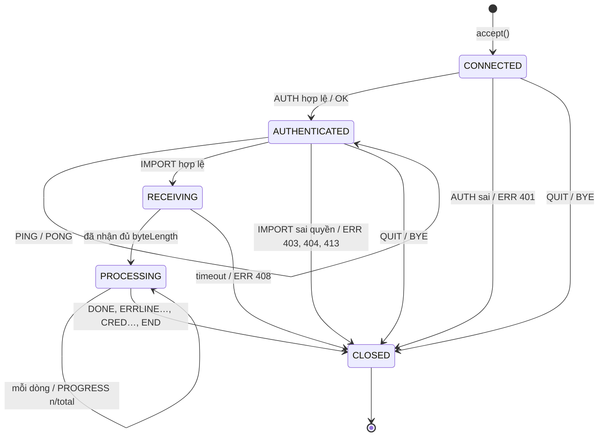

# 05. Đặc tả giao tiếp: REST API, WebSocket, giao thức TCP

> Ba kênh giao tiếp của hệ thống:
> 1. **REST API**: mọi thao tác nghiệp vụ.
> 2. **WebSocket (STOMP)**: đẩy realtime.
> 3. **Giao thức TCP tự định nghĩa**: import sinh viên bằng `admin-cli`.
>
> Luồng gọi chi tiết xem [03-sequence.md](03-sequence.md). Bảng và cột xem [04-erd.md](04-erd.md).
> Khi chạy backend, tài liệu tương tác (Swagger UI) có tại `/swagger-ui.html`.

---

## Phần A. REST API

### A.1 Quy ước chung

| Mục | Quy ước |
|---|---|
| Địa chỉ gốc | `/api`. Khi triển khai đi qua nginx: `https://<máy chủ>/api` |
| Định dạng | JSON, UTF-8. Upload file dùng `multipart/form-data` |
| Xác thực | Header `Authorization: Bearer <accessToken>`. Chỉ `/api/auth/login`, `/api/auth/refresh`, `/api/time` không cần token |
| Phân quyền theo đường dẫn | `/api/admin/**` → ADMIN · `/api/teacher/**` → TEACHER · `/api/student/**` → STUDENT. Các đường dẫn khác: mọi người đã đăng nhập |
| Thời gian | Chuỗi ISO 8601 UTC, ví dụ `"2026-11-05T16:59:00Z"` |
| Tên trường | `camelCase` |
| Phân trang | Query `page` (bắt đầu từ 0), `size` (mặc định 20, tối đa 100), `sort=field,asc\|desc`, `keyword` |

#### Response thành công
```json
{ "success": true, "data": { ... }, "message": null, "totalRecord": 125 }
```
`totalRecord` chỉ có ở API danh sách phân trang. Khi đó `data` là mảng của trang hiện tại.

#### Response lỗi
```json
{
  "success": false,
  "data": null,
  "message": "Đã quá hạn nộp",
  "code": "DEADLINE_PASSED",
  "status": 422,
  "path": "/api/student/parts/12/submit",
  "timestamp": "2026-11-05T17:00:03Z",
  "fieldErrors": { "content": "Nội dung không được để trống" }
}
```
`message` là câu tiếng Việt hiển thị thẳng cho người dùng. `fieldErrors` chỉ có khi lỗi validate.

#### Mã lỗi
| HTTP | `code` | Khi nào |
|---|---|---|
| 400 | `VALIDATION_ERROR` | Dữ liệu gửi lên không hợp lệ |
| 400 | `BAD_FILE` | File import sai định dạng hoặc thiếu cột; ảnh không phải PNG / JPG / WEBP |
| 400 | `NOT_READY` | Bài tập chưa đủ điều kiện phát hành (message liệt kê các vấn đề) |
| 401 | `UNAUTHORIZED` | Thiếu token, token sai hoặc hết hạn (client sẽ tự refresh) |
| 400 | `WRONG_PASSWORD` | Đổi mật khẩu: mật khẩu hiện tại sai |
| 400 | `SAME_PASSWORD` | Đổi mật khẩu: mật khẩu mới trùng mật khẩu cũ |
| 401 | `BAD_CREDENTIALS` | Sai tên đăng nhập hoặc mật khẩu |
| 401 | `REFRESH_TOKEN_ROTATED` | Refresh token cũ được gửi lại trong 30 giây sau khi xoay vòng (vd 2 tab cùng refresh). Client lấy token mới mà tab kia đã lưu rồi thử lại |
| 403 | `FORBIDDEN` | Không đủ quyền, hoặc không phải chủ của tài nguyên |
| 403 | `ACCOUNT_LOCKED` | Tài khoản bị khoá |
| 403 | `PASSWORD_CHANGE_REQUIRED` | Tài khoản đang bị bắt đổi mật khẩu: chỉ được gọi `/api/auth/*` |
| 405 | `METHOD_NOT_ALLOWED` | Sai method HTTP |
| 415 | `UNSUPPORTED_MEDIA_TYPE` | Sai `Content-Type` |
| 404 | `NOT_FOUND` | Không tồn tại, hoặc người dùng không được phép biết là nó tồn tại |
| 409 | `ALREADY_SUBMITTED` | Phần này đã nộp và không ở trạng thái yêu cầu sửa |
| 409 | `VERSION_CONFLICT` | `expectedVersion` lệch: đã nộp ở tab hoặc máy khác |
| 409 | `DRAFT_CONFLICT` | `draftVersion` lệch: có bản nháp mới hơn (Mức 2) |
| 409 | `DUPLICATE` | Trùng mã lớp, tên đăng nhập… |
| 409 | `INVALID_STATE` | Thao tác không hợp lệ với trạng thái hiện tại, ví dụ xoá bài đã phát hành |
| 413 | `FILE_TOO_LARGE` | File vượt giới hạn |
| 422 | `DEADLINE_PASSED` | Quá hạn và bài không cho nộp muộn |
| 422 | `REVISION_LIMIT` | Đã hết số lần được yêu cầu sửa |
| 422 | `SCORE_LIMITED` | Điểm tiêu chí vượt giới hạn do mục checklist "Giới hạn điểm" đang tick (BR-17) hoặc bài ≤ 20 từ (BR-18). Message nêu lý do |
| 429 | `RATE_LIMITED` | Đăng nhập sai quá nhiều lần (Mức 2) |
| 500 | `INTERNAL_ERROR` | Lỗi không mong muốn |

> Giáo viên truy cập lớp hoặc bài của người khác nhận **404** chứ không phải 403, để không lộ việc tài nguyên đó có tồn tại.

---

### A.2 Xác thực — `/api/auth`

| Method | Đường dẫn | Mô tả | Body → `data` |
|---|---|---|---|
| POST | `/api/auth/login` | Đăng nhập (UC-01, SD-01) | `{username, password}` → `LoginResponse` |
| POST | `/api/auth/refresh` | Làm mới token, có xoay vòng (SD-02) | `{refreshToken}` → `TokenPair` |
| POST | `/api/auth/logout` | Thu hồi phiên hiện tại | `{refreshToken}` → `null` |
| GET | `/api/auth/me` | Thông tin người dùng hiện tại | → `AccountInfo` |
| POST | `/api/auth/change-password` | Đổi mật khẩu (UC-02). Thu hồi các phiên khác, giữ phiên hiện tại | `{currentPassword, newPassword}` → `AccountInfo` |
| GET | `/api/time` | Giờ server, không cần token (SD-11) | → `{serverTime}` |

**Kiểm tra mỗi request có access token:** ngoài chữ ký và hạn của JWT, server kiểm tra **phiên (`sid`) chưa bị thu hồi** và **tài khoản còn hoạt động**. Nhờ vậy đăng xuất, đổi mật khẩu, khoá tài khoản có tác dụng ngay, không phải chờ access token hết hạn.

```jsonc
// LoginResponse
{
  "accessToken": "eyJhbGciOi...",          // JWT, hết hạn sau 30 phút; claim: sub, role, sid
  "refreshToken": "q8Zr...",               // chuỗi ngẫu nhiên 256 bit, hết hạn sau 7 ngày
  "accessTokenExpiresAt": "2026-11-05T09:30:00Z",
  "user": {
    "id": 42, "username": "2151234567", "fullName": "Nguyễn Văn A",
    "email": "a@sv.edu.vn", "role": "STUDENT", "studentCode": "2151234567",
    "mustChangePassword": true
  }
}
```

---

### A.3 Quản trị viên — `/api/admin`

| Method | Đường dẫn | Mô tả | Mức |
|---|---|---|---|
| GET | `/api/admin/teachers?keyword&active&page&size` | Danh sách giáo viên | 1 |
| POST | `/api/admin/teachers` | Tạo giáo viên `{username, fullName, email}` → `{teacher, temporaryPassword}` | 1 |
| PUT | `/api/admin/teachers/{id}` | Sửa `{fullName, email}` | 1 |
| GET | `/api/admin/users?keyword&role&active&page&size` | Tra cứu người dùng | 1 |
| GET | `/api/admin/users/{id}` | Chi tiết người dùng | 1 |
| POST | `/api/admin/users/{id}/lock` | Khoá tài khoản. Thu hồi mọi phiên và gửi `FORCE_LOGOUT` | 1 |
| POST | `/api/admin/users/{id}/unlock` | Mở khoá | 1 |
| POST | `/api/admin/users/{id}/reset-password` | Đặt lại mật khẩu → `{temporaryPassword}`; bắt đổi lần sau | 1 |
| GET | `/api/admin/stats` | Thống kê toàn hệ thống (UC-09) → `{usersByRole, lockedUsers, classrooms, assignmentsByStatus, submissionsToday, submissionsByDay[14], activeSessions}`. "Ngày" tính theo giờ Việt Nam (`app.zone`) | 1 |
| GET | `/api/admin/audit-logs?actorId&action&ip&from&to&page&size` | Nhật ký hệ thống (UC-07) | 2 |
| GET | `/api/admin/sessions?userId&page&size` | Phiên đang hoạt động (UC-08) | 3 |
| DELETE | `/api/admin/sessions/{id}` | Buộc đăng xuất một phiên | 3 |

**Quy tắc riêng:**
- Admin **không tự khoá được chính mình** → `409 INVALID_STATE`.
- Đặt lại mật khẩu sẽ thu hồi mọi phiên của tài khoản đó (`ADMIN_FORCED`).
- Danh sách chỉ cho sắp xếp theo `username`, `fullName`, `createdAt`, `lastLoginAt` (mặc định `createdAt,desc`). Trường khác → `400`.
- Tên đăng nhập của giáo viên: 3–50 ký tự, chỉ gồm chữ không dấu, số và `. _ -`.
- `UserSummary` = `{id, username, fullName, email, role, studentCode, active, mustChangePassword, lastLoginAt, createdAt}`. Cột "Số lớp" của giáo viên được thêm ở bước lớp học.

---

### A.4 Giáo viên — lớp học và import — `/api/teacher`

| Method | Đường dẫn | Mô tả |
|---|---|---|
| GET | `/api/teacher/classes?keyword&page&size` | Lớp của tôi, kèm số thành viên |
| POST | `/api/teacher/classes` | Tạo lớp `{code, name, description}` |
| GET | `/api/teacher/classes/{id}` | Chi tiết lớp |
| PUT | `/api/teacher/classes/{id}` | Sửa lớp |
| DELETE | `/api/teacher/classes/{id}` | Xoá lớp. Không xoá tài khoản sinh viên |
| GET | `/api/teacher/classes/{id}/members?keyword&page&size` | Thành viên lớp |
| POST | `/api/teacher/classes/{id}/members` | Thêm sinh viên đã có tài khoản `{studentCodes: [...]}` |
| DELETE | `/api/teacher/classes/{id}/members/{studentId}` | Xoá khỏi lớp |
| POST | `/api/teacher/classes/{id}/import` | **Import file** (multipart: `file`, `sendEmail`) → `ImportReport` (UC-11, SD-03) |
| GET | `/api/teacher/imports/{credentialsToken}/credentials` | Tải `.xlsx` tài khoản vừa tạo. **Chỉ tải được một lần**, hết hạn sau 15 phút |
| GET | `/api/teacher/import-template?format=xlsx\|csv` | Tải file mẫu |
| GET | `/api/teacher/students/search?keyword` | Tìm sinh viên theo mã hoặc tên, để giao bài cho từng cá nhân (tối đa 20 kết quả) → `[{id, studentCode, fullName}]` |

**Ghi chú:**
- **Mã lớp** 2–30 ký tự, chỉ gồm chữ không dấu, số và `. _ -`. Server **lưu viết hoa**, nên trùng mã không phân biệt hoa thường → `409 DUPLICATE`.
- `ClassroomSummary` = `{id, code, name, description, memberCount, createdAt}`. Danh sách lớp sắp xếp được theo `name` (mặc định), `code`, `createdAt`.
- `MemberDto` = `{studentId, studentCode, fullName, email, active, mustChangePassword, joinedAt}`. Sắp xếp theo `studentCode` (mặc định), `fullName`, `joinedAt`.
- Thêm thành viên trả `{added, alreadyMember, notFound: [mã SV]}`. Mã không tồn tại, hoặc thuộc tài khoản không phải sinh viên, nằm trong `notFound`.
- Lớp của giáo viên khác → `404` ở mọi endpoint, kể cả danh sách thành viên.

```jsonc
// ImportReport
{
  "totalRows": 45,
  "created": 40,          // tài khoản mới
  "existing": 3,          // đã có tài khoản, được thêm vào lớp
  "skipped": 1,           // đã là thành viên
  "errors": [ { "row": 17, "studentCode": "21A", "reason": "Mã sinh viên không hợp lệ" } ],
  "emailQueued": true,
  "credentialsToken": "c2b1f0e4-...",   // null nếu không có tài khoản mới
  "credentialsExpiresAt": "2026-11-05T09:45:00Z"
}
```

**Định dạng file import:**
- Dòng đầu tiên có dữ liệu là tiêu đề. Tên cột không phân biệt hoa thường, dấu hay khoảng trắng: `ma_sv` / `MSSV` / `Mã SV` / `Mã sinh viên`; `ho_ten` / `Họ tên` / `Họ và tên`; `email`.
- CSV: UTF-8 (có hoặc không BOM), tự nhận dấu phân cách `,` `;` hoặc tab.
- Tối đa **2000 dòng** và 10 MB mỗi file.
- Số dòng trong báo cáo lỗi tính như Excel (dòng tiêu đề = 1).
- Mã SV được **lưu viết hoa**. Mọi so khớp mã SV và **đăng nhập đều không phân biệt hoa thường**.
- Lỗi cả file (sai đuôi, file hỏng, thiếu cột, rỗng, quá số dòng) → `400 BAD_FILE`, không ghi gì.
- Lỗi từng dòng (mã sai, thiếu tên, email sai, trùng mã trong file, **mã trùng tên đăng nhập của tài khoản khác**) nằm trong `errors[]`; các dòng còn lại vẫn được xử lý (BR-03).
- Tài khoản đã có thì **không bị ghi đè** họ tên / email, chỉ được thêm vào lớp.
- File tài khoản chỉ chứa tài khoản **mới tạo**. Email chỉ gửi tới sinh viên mới có email.
| Cột | Bắt buộc | Quy tắc |
|---|---|---|
| `ma_sv` | ✔ | 4–30 ký tự, chỉ chữ và số |
| `ho_ten` | ✔ | 2–150 ký tự |
| `email` | | Đúng định dạng email |

---

### A.5 Giáo viên — bài tập

| Method | Đường dẫn | Mô tả |
|---|---|---|
| GET | `/api/teacher/rubric-templates?taskType` | Rubric mẫu: của hệ thống và của tôi, kèm tiêu chí (`code`, `step`…) và checklist (`kind`, `maxBand`) |
| GET | `/api/teacher/rubric-templates/descriptors?taskType` | Bảng mô tả band thu gọn tiếng Việt cho từng tiêu chí (mức 0–9) + link bản chính thức ielts.org (docs/08) |
| POST | `/api/files` | Upload ảnh đề bài (multipart `file`, png/jpg/webp ≤ 5 MB) → `{url}` |
| GET | `/api/teacher/assignments?status&keyword&page&size` | Danh sách bài tập, kèm số phần `partCount`, số người nhận `recipientCount`, số người đã nộp đủ mọi phần `completedCount`, số bài (phần) chờ chấm `pendingGradingCount` |
| POST | `/api/teacher/assignments` | Tạo bài ở trạng thái DRAFT, gồm các phần và rubric → `AssignmentDetail` |
| GET | `/api/teacher/assignments/{id}` | Chi tiết bài |
| PUT | `/api/teacher/assignments/{id}` | **Chỉ bài DRAFT**: thay toàn bộ (thông tin + các phần + rubric). Bài đã phát hành → `409 INVALID_STATE` |
| PATCH | `/api/teacher/assignments/{id}/settings` | Mọi trạng thái (BR-06): đổi `title`, `description`, `dueAt`, `allowLate`, `maxRevisions`, `showSuggestionsOnRevision`, `partDueAts: {partId: hạn \| null}`. Trường bỏ trống = giữ nguyên |
| DELETE | `/api/teacher/assignments/{id}` | Chỉ xoá được bài DRAFT; còn lại → `409 INVALID_STATE` (hãy đóng bài) |
| POST | `/api/teacher/assignments/{id}/publish` | Giao bài và phát hành `{classIds, studentIds}` → `{recipientCount}` (UC-14, SD-05) |
| GET | `/api/teacher/assignments/{id}/targets` | Đã giao cho ai → `{classes: [{id, code, name, memberCount}], students: [{id, studentCode, fullName}], recipientCount}` |
| PUT | `/api/teacher/assignments/{id}/targets` | Giao thêm (chỉ bài PUBLISHED) `{classIds, studentIds}` → `{newRecipients, recipientCount}`. Chỉ thêm, không gỡ người đã giao |
| POST | `/api/teacher/assignments/{id}/close` | PUBLISHED → CLOSED |
| POST | `/api/teacher/assignments/{id}/reopen` | CLOSED → PUBLISHED |
| POST | `/api/teacher/assignments/{id}/duplicate` | Nhân bản → `201` bài DRAFT mới "… (bản sao)": đủ phần và rubric; **không** chép người nhận, `openAt`, `dueAt`, hạn riêng |

**Phát hành (UC-14):**
- Điều kiện: bài nháp; có ≥ 1 phần; mỗi phần có ≥ 1 tiêu chí; có `dueAt` ở tương lai; hạn riêng (nếu có) ở tương lai; **có ≥ 1 người nhận**. Thiếu điều kiện → `400 NOT_READY`, message **liệt kê mọi vấn đề**. Phát hành lần 2 → `409 INVALID_STATE`.
- `classIds` phải là lớp của chính giáo viên; `studentIds` phải là tài khoản sinh viên. Sai → `400`.
- **Người nhận** = sinh viên giao trực tiếp ∪ thành viên các lớp được giao, đã loại trùng, **tính tại thời điểm truy vấn**. Sinh viên vào lớp sau khi phát hành vẫn thấy bài.
- Sau khi commit, backend phát sự kiện `AssignmentEvents.Published` / `RecipientsAdded` (có danh sách người nhận và cờ `opensNow`). Module thông báo (B7) dựa vào đó để gửi thông báo và email.
- `ClassroomSummary` có thêm `openAssignmentCount`: số bài đang mở được giao cho cả lớp.

**Upload ảnh đề:** `POST /api/files` (TEACHER, ADMIN), multipart `file`.
- Loại file nhận diện theo **chữ ký byte đầu file** (PNG / JPG / WEBP), không tin tên hay Content-Type. Tối đa 5 MB.
- Trả `201 {url: "/uploads/yyyy/MM/<uuid>.png"}`.
- `GET /uploads/**` **công khai** (thẻ `` không gửi được token), tên file là UUID nên không đoán được, cache 30 ngày.

```jsonc
// POST /api/teacher/assignments — body
{
  "title": "Tuần 5 – Writing practice",
  "description": "Làm đủ 2 phần, chú ý paraphrase.",
  "openAt": "2026-11-01T01:00:00Z",
  "dueAt": "2026-11-07T16:59:00Z",
  "allowLate": true,
  "maxRevisions": 2,
  "parts": [
    {
      "title": "Task 1 – Line graph",
      "taskType": "WRITING_TASK1",
      "prompt": "<p>The graph below shows ...</p>",
      "imageUrl": "/uploads/2026/11/abc.png",
      "minWords": 150,
      "suggestedMinutes": 20,
      "partDueAt": null,
      "weight": null,               // null → mặc định theo loại: WRITING_TASK2 = 2, còn lại = 1 (BR-12)
      "criteria": [
        {
          "code": "TA",             // TA | TR | CC | LR | GRA | null (tiêu chí tự định nghĩa); không lặp trong một phần
          "name": "Task Achievement", "description": "...",
          "maxScore": 9, "step": 1, "weight": 1,   // step: 1 (mặc định, đúng IELTS) hoặc 0.5
          "checklist": [
            { "content": "Câu mở bài diễn đạt lại (paraphrase) đề bài", "kind": "CHECK" },
            { "content": "Không có đoạn tổng quan (overview)", "kind": "LIMIT", "maxBand": 5 }
          ]
        }
      ]
    }
  ]
}
```

**Quy tắc kiểm tra khi lưu** (lỗi → `400 VALIDATION_ERROR`, message chỉ rõ phần / tiêu chí):
- `openAt` < `dueAt`.
- Ảnh đề chỉ nhận `/uploads/…` hoặc `http(s)://…`.
- Bước điểm chỉ là 1 hoặc 0.5; `maxScore` là bội số của bước.
- Mục `LIMIT` bắt buộc có `maxBand` trong `[0, maxScore]` và là bội số của bước. Mục `CHECK` thì `maxBand` bị bỏ qua.
- `prompt` được **lọc HTML** (chỉ giữ thẻ định dạng cơ bản); lọc xong mà rỗng → lỗi.
- Giới hạn: 10 phần / bài, 10 tiêu chí / phần, 30 mục checklist / tiêu chí.
- Bài nháp được phép chưa đủ phần hay tiêu chí. Điều kiện đủ chỉ kiểm tra khi **phát hành**.

---

### A.6 Giáo viên — tiến độ, thống kê

| Method | Đường dẫn | Mô tả |
|---|---|---|
| GET | `/api/teacher/assignments/{id}/progress?classId&status` | Ma trận tiến độ (UC-16) |
| POST | `/api/teacher/assignments/{id}/remind` | Nhắc nhở `{studentIds, partId?}` → `{sent}` (đã cài ở B7b): chỉ bài đang mở (khác → `409`); mọi `studentIds` phải là người nhận bài, `partId` phải thuộc bài (sai → `400`); bài của người khác → `404`. Mỗi sinh viên nhận thông báo `MANUAL_REMINDER` kèm email |
| GET | `/api/teacher/assignments/{id}/stats` | Thống kê một bài (UC-19) |
| GET | `/api/teacher/assignments/{id}/export` | Bảng điểm `.xlsx` |
| GET | `/api/teacher/stats/classes/{id}` | Thống kê lớp, bảng xếp hạng |
| GET | `/api/teacher/stats/students/{id}` | Thống kê một sinh viên |

```jsonc
// Ma trận tiến độ
{
  "parts": [ { "id": 11, "title": "Task 1" }, { "id": 12, "title": "Task 2" } ],
  "rows": [
    {
      "student": { "id": 42, "studentCode": "2151234567", "fullName": "Nguyễn Văn A" },
      "online": true,                       // Mức 2
      "cells": [
        { "partId": 11, "submissionId": 301, "status": "RETURNED", "isLate": false, "score": 6.5 },
        { "partId": 12, "submissionId": null, "status": "NOT_STARTED", "isLate": false, "score": null }
      ]
    }
  ],
  "summary": { "students": 45, "completedRate": 0.62, "lateCount": 4 }
}
```

```jsonc
// Thống kê một bài
{
  "perPart": [
    {
      "partId": 12,
      "submittedCount": 40, "onTimeRate": 0.9, "averageBand": 6.0,
      "criteria": [ { "criterionId": 51, "name": "Task Response", "average": 5.9 } ],
      "bandDistribution": [ { "band": 5.5, "count": 8 }, { "band": 6.0, "count": 12 } ]
    }
  ],
  "overallAverage": 6.0
}
```

---

### A.7 Giáo viên — chấm bài

| Method | Đường dẫn | Mô tả |
|---|---|---|
| GET | `/api/teacher/submissions?assignmentId&partId&classId&status&keyword&page&size` | Hàng đợi chấm → danh sách `QueueRow`. Mặc định `status=SUBMITTED`, bài nộp trước xếp trước |
| GET | `/api/teacher/submissions/{id}?versionNo` | Dữ liệu màn hình chấm (mặc định version mới nhất) |
| GET | `/api/teacher/submissions/{id}/versions` | Danh sách version (mới nhất trước), kèm trạng thái và band của từng version |
| PUT | `/api/teacher/submissions/{id}/grade` | Lưu nháp chấm → `GradeDto` (SD-08) |
| POST | `/api/teacher/submissions/{id}/return` | Trả bài → `GradingScreen`. Yêu cầu đã chấm đủ mọi tiêu chí |
| POST | `/api/teacher/submissions/{id}/request-revision` | Yêu cầu sửa `{note?, dueAt}` → `GradingScreen` |
| POST | `/api/teacher/submissions/{id}/ai-suggest` | Gợi ý AI (Mức 3, chỉ khi có API key) |
| GET | `/api/teacher/error-codes` | Mã lỗi dùng được: 22 mã của hệ thống (theo thứ tự) rồi tới mã riêng của tôi |
| POST | `/api/teacher/error-codes` | Thêm mã riêng `{code, name, criterion?, description?, positive?}` → `201 ErrorCodeDto` |
| PUT | `/api/teacher/error-codes/{id}` | Sửa mã riêng (cùng body) |
| DELETE | `/api/teacher/error-codes/{id}` | Xoá mã riêng. Nhận xét inline đã dùng mã vẫn giữ mã dạng chữ |
| GET | `/api/teacher/comment-bank?criterion&keyword` | Ngân hàng nhận xét: của tôi (hay dùng lên đầu) rồi tới nhận xét mẫu |
| POST | `/api/teacher/comment-bank` | Thêm `{criterion?, content}` → `201 CommentBankDto` |
| PUT | `/api/teacher/comment-bank/{id}` | Sửa (cùng body) |
| DELETE | `/api/teacher/comment-bank/{id}` | Xoá |
| POST | `/api/teacher/comment-bank/{id}/use` | Ghi nhận một lần chèn → `CommentBankDto` (đã tăng `useCount`) |

**Mã lỗi và ngân hàng nhận xét (đã cài ở B6a; BR-21, BR-22):**
- `criterion` là **nhóm tiêu chí**: `TASK` (= TA ở Task 1, TR ở Task 2), `CC`, `LR`, `GRA`; bỏ trống = không gắn / dùng chung.
- `ErrorCodeDto` = `{id, code, name, criterion, description, positive, system}`; `CommentBankDto` = `{id, criterion, content, useCount, lastUsedAt, system}`.
- Mục `system = true` (của hệ thống) ai cũng dùng được nhưng sửa / xoá → `403 FORBIDDEN`. Mục riêng của giáo viên khác → `404`.
- Mã lỗi: tối đa 20 ký tự, không có khoảng trắng, server chuyển thành chữ hoa. Trùng mã hệ thống hoặc mã khác của mình (không phân biệt hoa thường) → `409 DUPLICATE`. Giáo viên khác nhau được đặt cùng một mã riêng.
- Ngân hàng nhận xét: lọc `criterion=CC` thì trả mục CC **và** mục dùng chung. `keyword` tìm không phân biệt hoa thường, `%` và `_` hiểu theo nghĩa đen.
- `…/use` không đếm với nhận xét mẫu của hệ thống: mẫu dùng chung cho mọi giáo viên, nếu đếm thì thứ tự của người này sẽ phụ thuộc người khác.
- Giới hạn mỗi giáo viên: 100 mã riêng, 500 nhận xét (`app.grading.*`).

**Chấm bài, trả bài, yêu cầu sửa (đã cài ở B6b; UC-17, UC-18, SD-08):**
- Chỉ giáo viên tạo bài tập mới thấy và chấm được bài nộp (BR-15). Bài nộp của người khác → `404`.
- Hàng đợi: `status` là `SUBMITTED` (mặc định) / `GRADED` / `RETURNED` / `REVISION_REQUESTED`; `NOT_STARTED`, `DRAFT` → `400`. `classId` phải là lớp của mình, nếu không → `400`. `keyword` tìm theo mã SV hoặc họ tên. Luôn sắp theo thời điểm nộp, bỏ qua `sort`.
- `QueueRow` = `{submissionId, status, currentVersion, student{id, studentCode, fullName}, assignmentId, assignmentTitle, partId, partTitle, partOrderNo, taskType, submittedAt, late, wordCount, gradeStatus, band}` (thông tin của version mới nhất; `band` đã làm tròn, null nếu chưa chấm đủ).
- **Lưu chấm** (`PUT …/grade`) là **thay toàn bộ** kết quả chấm của version:
  - chỉ chấm được **version mới nhất** (`versionNo` khác → `409 INVALID_STATE`) và khi bài ở `SUBMITTED` / `GRADED` (đã trả → `409`);
  - tiêu chí không gửi = chưa chấm (vẫn lưu được, UC-17 E1); mục checklist không gửi = chưa tick; nhận xét inline không gửi = bị xoá;
  - điểm: trong `[0, maxScore]`, bội số của `step` (BR-11) → nếu sai `400`; vượt giới hạn của mục LIMIT đang tick (BR-17) hoặc bài ≤ 20 từ (BR-18) → `422 SCORE_LIMITED`;
  - `zeroReason` (`NO_ATTEMPT` / `NOT_ENGLISH` / `MEMORISED`, BR-19): server đặt mọi tiêu chí = 0. Gửi kèm điểm khác 0 → `400`;
  - nhận xét inline (BR-21): offset tính theo đơn vị UTF-16 (giống `String.length` của JavaScript), `0 ≤ start < end ≤ độ dài bài`; `quote` nếu gửi phải **khớp đúng** đoạn văn ở vị trí đó (phát hiện client lệch vị trí), không gửi thì server tự lấy; cần ít nhất một trong `errorCode` / `comment` / `suggestion`; `errorCode` phải là mã của hệ thống hoặc của chính mình (không phân biệt hoa thường, lưu chữ hoa); không gửi `criterionId` thì server tự gắn tiêu chí cùng nhóm với mã lỗi (`TASK` → TA/TR của phần);
  - giới hạn: 300 nhận xét inline, nhận xét tiêu chí / inline 2000 ký tự, gợi ý sửa 1000, nhận xét chung 5000;
  - band phần do **server** tính bằng `BandCalculator` (BR-12); bài chuyển `SUBMITTED → GRADED`.
- **Trả bài**: bài ở `GRADED` và kết quả của version mới nhất đã chấm đủ mọi tiêu chí; thiếu → `409 INVALID_STATE`, message liệt kê tiêu chí còn thiếu. Chưa chấm → `409` "Bài này chưa được chấm".
- **Yêu cầu sửa**: như trả bài, thêm: còn lượt sửa (`currentVersion − 1 < maxRevisions`, BR-10) → nếu hết `422 REVISION_LIMIT`; `dueAt` ở tương lai → nếu không `400`; bài tập chưa đóng → nếu đã đóng `409` (sinh viên không nộp lại được vào bài đã đóng). Bài tập đã đóng vẫn **chấm và trả bài** được.
- Trả bài và yêu cầu sửa đều đặt kết quả sang `RETURNED` (sinh viên thấy điểm, BR-13), rồi phát sự kiện `GradingEvents.Returned` / `RevisionRequested` sau khi commit để B7 gửi thông báo.
- Lưu chấm, trả bài, yêu cầu sửa đều **khoá dòng bài nộp** (`SELECT … FOR UPDATE`): hai lần bấm "Trả bài" đồng thời → đúng một lần thành công. Sinh viên nộp lại cũng khoá cùng dòng này.

```jsonc
// GET /api/teacher/submissions/{id}?versionNo — data (GradingScreen)
{
  "submission": { "id": 301, "status": "GRADED", "currentVersion": 2, "revisionsUsed": 1,
                  "student": { "id": 42, "studentCode": "2151234567", "fullName": "Nguyễn Văn A" },
                  "revisionNote": "Phát triển ý 2", "revisionDueAt": "2026-11-10T16:59:00Z" },
  "assignment": { "id": 77, "title": "Tuần 5", "status": "PUBLISHED", "maxRevisions": 2, "showSuggestionsOnRevision": false },
  "part": { "id": 12, "orderNo": 2, "title": "Task 2", "taskType": "WRITING_TASK2", "prompt": "<p>...</p>",
            "imageUrl": null, "minWords": 250, "weight": 2 },
  "version": { "versionNo": 2, "content": "Nowadays ...", "wordCount": 274,
               "submittedAt": "2026-11-07T16:40:12Z", "late": false },
  "warnings": [],                        // SHORT_ESSAY (≤ 20 từ) | UNDER_MIN_WORDS: [{code, message}]
  "criteria": [
    { "id": 51, "code": "TR", "group": "TASK", "name": "Task Response", "description": null,
      "maxScore": 9, "step": 1, "weight": 1,
      "checklist": [ { "id": 801, "content": "Trả lời đủ các phần của đề", "kind": "CHECK", "maxBand": null },
                     { "id": 802, "content": "Các phần chính chưa được trả lời đầy đủ", "kind": "LIMIT", "maxBand": 5 } ] }
  ],
  "grade": {                             // null nếu version này chưa chấm
    "id": 900, "versionNo": 2, "status": "DRAFT", "zeroReason": null, "generalComment": "Bài khá.",
    "rawBand": 6.375, "band": 6.5, "complete": true, "graderName": "ThS. Hạnh",
    "updatedAt": "…", "returnedAt": null,
    "scores": [ { "criterionId": 51, "score": 5.0, "comment": "Ý 2 chưa có ví dụ.",
                  "maxAllowed": 5.0, "limitReason": "Các phần chính chưa được trả lời đầy đủ" } ],
    "checklist": [ { "checklistItemId": 801, "checked": false }, { "checklistItemId": 802, "checked": true } ],
    "inlineComments": [ { "id": 5001, "startOffset": 120, "endOffset": 129, "quote": "people is",
                          "comment": null, "errorCode": "SV", "criterionId": 54, "suggestion": "people are" } ]
  },
  "versions": [ { "versionNo": 2, "submittedAt": "…", "wordCount": 274, "late": false, "gradeStatus": "DRAFT", "band": 6.5 },
                { "versionNo": 1, "submittedAt": "…", "wordCount": 231, "late": false, "gradeStatus": "RETURNED", "band": 5.5 } ],
  "editable": true,                      // version mới nhất và chưa trả bài
  "canReturn": true,                     // sửa được và đã chấm đủ
  "canRequestRevision": true             // trả được, còn lượt sửa, bài chưa đóng
}
```

```jsonc
// PUT /api/teacher/submissions/{id}/grade — body
{
  "versionNo": 2,
  "scores": [ { "criterionId": 51, "score": 5, "comment": "Ý 2 chưa có ví dụ." } ],
  "checklist": [ { "checklistItemId": 802, "checked": true } ],
  "inlineComments": [ { "startOffset": 120, "endOffset": 129, "quote": "people is",
                        "errorCode": "SV", "criterionId": null, "comment": null, "suggestion": "people are" } ],
  "generalComment": "Bài khá, cần phát triển ý sâu hơn.",
  "zeroReason": null
}
// → data: GradeDto (như "grade" ở trên)
```

---

### A.8 Sinh viên — `/api/student`

| Method | Đường dẫn | Mô tả |
|---|---|---|
| GET | `/api/student/assignments?tab=TODO\|DUE_SOON\|OVERDUE\|SUBMITTED\|REVISION&page&size` | Bài được giao, theo tab (UC-22) |
| GET | `/api/student/assignments/{id}` | Chi tiết bài + trạng thái từng phần của tôi |
| GET | `/api/student/parts/{partId}/draft` | Nạp bản nháp → `{content, draftVersion, savedAt}` |
| PUT | `/api/student/parts/{partId}/draft` | Lưu nháp `{content, draftVersion}` → `{draftVersion, savedAt}` (SD-06) |
| POST | `/api/student/parts/{partId}/submit` | Nộp `{content, expectedVersion}` → `201 {versionNo, submittedAt, isLate}` (SD-07) |
| GET | `/api/student/parts/{partId}/versions` | Lịch sử nộp, có band nếu đã trả bài |
| GET | `/api/student/parts/{partId}/versions/{versionNo}` | Nội dung một version + kết quả chấm (chỉ khi RETURNED, BR-13) |
| GET | `/api/student/assignments/{id}/result` | Band từng phần và band cả bài (BR-12) |
| GET | `/api/student/results` | Kết quả học tập của tôi (UC-28) |
| POST | `/api/student/parts/{partId}/exam/start` | Bắt đầu chế độ thi → `{sessionId, endsAt}` (Mức 3) |

**Làm bài và nộp bài (đã cài ở B5a):**
- Mọi endpoint `/api/student/parts/{partId}/…` đều kiểm tra "được giao và được thấy" (BR-04, BR-05). Không được giao hoặc chưa tới giờ mở → `404`.
- `GET …/draft` → `{content, source, savedAt, wordCount, status, currentVersion}`. `source`:
  - `DRAFT`: bản nháp đang lưu;
  - `LAST_VERSION`: đang "Cần sửa" mà chưa có nháp, nên nạp sẵn nội dung version mới nhất để sửa tiếp;
  - `EMPTY`: chưa có gì.
  - `status` phía sinh viên hiển thị `GRADED` thành `SUBMITTED` (BR-13).
- `PUT …/draft {content}` (tối đa 30 000 ký tự) → `{savedAt, wordCount}`. Lưu nháp cũng tuân theo hạn, như khi nộp.
- `POST …/submit {content, expectedVersion}` → `201 {versionNo, submittedAt, late, wordCount}`. Lỗi:

  | HTTP | `code` | Khi nào |
  |---|---|---|
  | 409 | `VERSION_CONFLICT` | `expectedVersion` ≠ version hiện tại, hoặc 2 request đầu tiên chạy đồng thời. Client tải lại trạng thái |
  | 409 | `ALREADY_SUBMITTED` | Phần đã nộp và không ở trạng thái "Cần sửa" |
  | 409 | `INVALID_STATE` | Bài tập đã đóng |
  | 422 | `DEADLINE_PASSED` | Quá hạn áp dụng (BR-07) và bài không cho nộp muộn (BR-08) |

- Server **khoá dòng bài làm** (`SELECT … FOR UPDATE`) rồi mới so `expectedVersion`. Đã có test bắn 2 request đồng thời: đúng 1 thành công.
- `wordCount` do **server đếm** (BR-20), cùng thuật toán với frontend (`shared/word-count-cases.json`).
- Thời gian trả về có độ chính xác **micro giây**, bằng độ chính xác lưu trong DB.

**Danh sách và chi tiết bài (đã cài ở B5b):**
- `GET /api/student/assignments?tab` → `{counts: {TODO, DUE_SOON, OVERDUE, SUBMITTED, REVISION}, items, serverTime}`.
  - `counts` luôn tính trên toàn bộ bài, để hiện badge.
  - Mỗi item: `{id, title, teacherName, status, openAt, dueAt, nextDueAt, tabs[], parts[]}`, trong đó mỗi phần là `{partId, orderNo, title, taskType, status, currentVersion, late, effectiveDueAt, canSubmit}`.
  - Sắp theo `nextDueAt` (hạn gần nhất của phần còn phải làm); bài không còn hạn xếp cuối.
- `GET /api/student/assignments/{id}` → thêm `description`, `allowLate`, `maxRevisions`, `serverTime`, và cho từng phần: `prompt`, `imageUrl`, `minWords`, `suggestedMinutes`, `revisionNote` / `revisionDueAt` (khi "Cần sửa"), `criteria[]` kèm `checklist[]` (`kind`, `maxBand`) để sinh viên biết tiêu chí chấm.
- `canSubmit` = bài đang mở, phần còn mở với sinh viên, và chưa quá hạn hoặc bài cho nộp muộn.

**Lịch sử nộp và kết quả chấm (đã cài ở B6c; BR-13, BR-21, docs/08 mục 4.5):**
- `GET …/versions` → `[{versionNo, submittedAt, wordCount, late, returned, band, returnedAt}]`, mới nhất trước. `band`, `returnedAt` chỉ có khi version đó đã được trả bài.
- `GET …/versions/{n}` → `{versionNo, submittedAt, wordCount, late, content, result}`. `result = null` khi chưa được trả (kể cả khi giáo viên đang chấm nháp, BR-13):
  ```jsonc
  "result": {
    "band": 6.0, "zeroReason": null, "generalComment": "Bài khá, cần chia đoạn.", "graderName": "ThS. Hạnh",
    "returnedAt": "…", "suggestionsHidden": false,
    "criteria": [ { "criterionId": 52, "code": "CC", "name": "Coherence and Cohesion", "maxScore": 9, "score": 5.0,
                    "comment": null, "limitedTo": 5.0, "limitReason": "Không chia đoạn",
                    "checklist": [ { "content": "Không chia đoạn", "kind": "LIMIT", "maxBand": 5, "checked": true } ] } ],
    "inlineComments": [ { "startOffset": 17, "endOffset": 26, "quote": "people is", "comment": null,
                          "errorCode": "SV", "errorName": "Hoà hợp chủ ngữ – động từ",
                          "criterionCode": "GRA", "criterionName": "Grammatical Range and Accuracy",
                          "suggestion": "people are" } ],
    "errorSummary": [ { "criterionCode": "GRA", "criterionName": "…", "errorCode": "SV", "errorName": "…", "count": 2 } ]
  }
  ```
  - `limitedTo` / `limitReason`: tiêu chí bị giới hạn bởi mục "Giới hạn điểm" đang tick hoặc bài ≤ 20 từ (để hiện "CC bị giới hạn ở 5 vì: …").
  - `errorSummary`: bảng "Lỗi trong bài", đếm theo tiêu chí (thứ tự trong rubric) rồi theo mã, nhiều nhất trước. Không tính mã khen (`GOOD`) và nhận xét không có mã. Tên mã lấy theo bộ mã của người chấm.
  - **Ẩn gợi ý sửa (BR-21)**: khi bài đang "Cần sửa", với version đang bị yêu cầu sửa, và bài tập không bật `showSuggestionsOnRevision` → `suggestion = null`, `suggestionsHidden = true`. Mã lỗi vẫn hiện để sinh viên tự sửa. Sinh viên nộp bản sửa xong thì gợi ý của bản cũ hiện lại.
- `GET /api/student/assignments/{id}/result` → `{assignmentId, title, parts: [{partId, orderNo, title, taskType, weight, versionNo, band}], complete, band, note}`:
  - band từng phần lấy từ **lần nộp gần nhất đã được trả bài** (đang "Cần sửa" thì vẫn là band của bản đã trả);
  - band cả bài = trung bình có trọng số band các phần (chưa làm tròn rồi mới làm tròn .25 / .75), **chỉ có khi mọi phần đã có kết quả**; nếu chưa thì `complete = false`, `band = null`, `note` = "Chưa đủ phần…";
  - khi đủ, `note` = "Band tổng được ước lượng theo quy ước Task 2 gấp đôi Task 1; IELTS không công bố công thức chính xác."

**Quy tắc tab** (một bài có thể thuộc nhiều tab):
- `TODO`: bài đang mở, có phần **chưa làm / đang làm** chưa quá hạn.
- `DUE_SOON`: là `TODO` và có phần như vậy hết hạn trong vòng 24 giờ.
- `OVERDUE`: có phần chưa làm / đang làm đã **quá hạn** (kể cả khi được nộp muộn), hoặc bài **đã đóng** mà còn phần chưa nộp.
- `REVISION`: có ít nhất một phần đang bị yêu cầu sửa.
- `SUBMITTED`: không còn phần nào phải làm (mọi phần đã nộp / đang chấm / đã trả).

---

### A.9 Dùng chung

| Method | Đường dẫn | Mô tả | Mức |
|---|---|---|---|
| GET | `/api/notifications?unreadOnly&after&page&size` | Danh sách thông báo. `after` = lấy thông báo tạo sau thời điểm này (SD-09) | 1 |
| GET | `/api/notifications/unread-count` | → `{count}` | 1 |
| POST | `/api/notifications/{id}/read` | Đánh dấu đã đọc | 1 |
| POST | `/api/notifications/read-all` | Đánh dấu tất cả | 1 |
| GET | `/api/chat/channels` | Các kênh chat của tôi, kèm số tin chưa đọc | 2 |
| GET | `/api/chat/{channelId}/messages?beforeId&size=50` | Lịch sử chat, tải ngược về trước | 2 |
| GET | `/api/teacher/parts/{partId}/exam-sessions` | Các phiên thi của một phần | 3 |
| GET | `/api/teacher/exam-sessions/{id}/events` | Dòng thời gian sự kiện (UC-21) | 3 |
| CRUD | `/api/teacher/question-bank` | Ngân hàng đề (UC-20) | 3 |

**Thông báo (đã cài ở B7a; UC-04, FR-50, FR-51, FR-53):**
- Mọi vai trò đều dùng được; chỉ thấy thông báo của chính mình (của người khác → `404`).
- `GET /api/notifications` → danh sách `NotificationDto`, **mới nhất trước**, có `totalRecord`. `after` là thời điểm ISO 8601 (sai định dạng → `400`). `POST …/{id}/read` → `NotificationDto` (đọc lại thì giữ thời điểm đọc đầu tiên). `POST …/read-all` → `{updated}`.
- Hệ thống tạo thông báo khi:

  | Sự kiện | Người nhận | `type` | Email | `link` |
  |---|---|---|---|---|
  | Phát hành / giao thêm (bài đã tới giờ mở) | Sinh viên được giao (giao thêm: chỉ người mới) | `ASSIGNMENT_PUBLISHED` | Có | `/sinh-vien/bai-tap/{assignmentId}` |
  | Sinh viên nộp / nộp bản sửa | Giáo viên chủ bài | `SUBMISSION_RECEIVED` | Không | `/giao-vien/cham-bai/{submissionId}` |
  | Trả bài | Sinh viên | `GRADE_RETURNED` (body: band) | Có | `/sinh-vien/bai-tap/{assignmentId}` |
  | Yêu cầu sửa | Sinh viên | `REVISION_REQUESTED` (body: hạn sửa, lời nhắn) | Có | `/sinh-vien/bai-tap/{assignmentId}` |
  | Bài hẹn giờ tới giờ mở (job) | Mọi người nhận lúc mở | `ASSIGNMENT_PUBLISHED` | Có | `/sinh-vien/bai-tap/{assignmentId}` |
  | Còn ≤ 24 giờ / ≤ 2 giờ tới hạn nộp hoặc hạn sửa, chưa nộp (job, BR-14) | Sinh viên | `DEADLINE_REMINDER` | Có | `/sinh-vien/bai-tap/{assignmentId}` |
  | Giáo viên bấm nhắc | Sinh viên được chọn | `MANUAL_REMINDER` | Có | `/sinh-vien/bai-tap/{assignmentId}` |

- Bài mở trong tương lai thì chưa thông báo lúc phát hành; job gửi khi tới giờ mở (`assignments.open_notified_at` đánh dấu đã gửi, B7b). Giờ trong nội dung hiển thị theo giờ Việt Nam (`app.zone`).
- **Thứ tự** (SD-05): thông báo được lưu **trong cùng transaction** với nghiệp vụ (listener `BEFORE_COMMIT`), rồi **sau khi commit** mới đẩy WebSocket và gửi email nền. Nghiệp vụ rollback thì không có thông báo; người đang offline vẫn thấy khi vào lại. Email lỗi chỉ ghi log.

```jsonc
// NotificationDto — dùng cả trong REST lẫn WebSocket
{
  "id": 9001, "type": "REVISION_REQUESTED",
  "title": "Cần sửa bài: Tuần 5 – Task 2",
  "body": "Hạn sửa: 10/11 23:59. Lời nhắn: Phát triển ý 2.",
  "link": "/sinh-vien/bai-tap/77",
  "readAt": null, "createdAt": "2026-11-08T03:12:00Z"
}
```

---

## Phần B. WebSocket (STOMP)

### B.1 Kết nối
| Mục | Giá trị |
|---|---|
| Endpoint | `ws://<host>:8080/ws` khi phát triển; `wss://<host>/ws` khi đi qua nginx. WebSocket thuần, không dùng SockJS |
| Giao thức | STOMP 1.2 (client `@stomp/stompjs`, server Spring simple broker) |
| Xác thực | Header `Authorization: Bearer <accessToken>` trong khung `CONNECT`. Sai thì server trả khung `ERROR` và đóng kết nối |
| Heartbeat | `heart-beat: 10000,10000` (10 giây mỗi chiều) |
| Tiền tố | Client gửi lên: `/app/...` · riêng từng người: `/user/queue/...` · phát nhiều người: `/topic/...` |
| Kết nối lại | Exponential backoff 1s → 2s → 4s … tối đa 30s. Sau khi kết nối lại thì SUBSCRIBE lại và gọi `GET /api/notifications?after=` (SD-09) |
| Token hết hạn | Client refresh token qua REST rồi kết nối lại với token mới |

### B.2 Các kênh

| Hướng | Destination | Ai dùng | Payload | Mức |
|---|---|---|---|---|
| SUBSCRIBE | `/user/queue/notifications` | Mọi người | `NotificationDto` | 1 |
| SUBSCRIBE | `/user/queue/session` | Mọi người | `{type: "FORCE_LOGOUT", reason}` | 2 |
| SUBSCRIBE | `/topic/assignments/{id}/progress` | Giáo viên chủ bài | `{studentId, partId, status, isLate, score, at}` | 2 |
| SUBSCRIBE | `/topic/assignments/{id}/presence` | Giáo viên chủ bài | `{studentId, online, viewingPartId, at}` | 2 |
| SEND | `/app/presence/viewing` | Sinh viên | `{assignmentId, partId}` khi mở / đổi phần; `partId = null` khi rời trang | 2 |
| SUBSCRIBE | `/topic/chat/{channelId}` | Thành viên kênh | `ChatEvent` | 2 |
| SEND | `/app/chat/{channelId}/send` | Thành viên kênh | `{content, clientMsgId}` | 2 |
| SEND | `/app/chat/{channelId}/typing` | Thành viên kênh | `{}` (gửi tối đa 1 lần / 3 giây) | 2 |
| SEND | `/app/chat/{channelId}/read` | Thành viên kênh | `{lastMessageId}` | 2 |
| SEND | `/app/exam/{sessionId}/event` | Sinh viên trong phiên thi | `{type: "TAB_HIDDEN" \| "TAB_VISIBLE" \| "PASTE"}` | 3 |

- `channelId` có dạng `submission-{submissionId}` hoặc `class-{classroomId}`.
- `ChatEvent` có dạng `{type: "MESSAGE" | "TYPING" | "READ", ...}`:
  - `MESSAGE`: `{id, senderId, senderName, content, clientMsgId, createdAt}`
  - `TYPING`: `{userId, userName}`
  - `READ`: `{userId, lastMessageId}`

**Phân quyền SUBSCRIBE / SEND:** `StompAuthInterceptor` kiểm tra mỗi khung tin.
- `CONNECT`: access token hợp lệ, phiên chưa bị thu hồi, tài khoản còn hoạt động và không đang bị bắt đổi mật khẩu (cùng cách kiểm tra với REST). Sai → khung `ERROR` có `message` tiếng Việt, không kết nối được.
- **Mức 1 (đã cài ở B7a):** chỉ cho SUBSCRIBE `/user/queue/notifications` và `/user/queue/session`; mọi `/topic/…` và mọi lệnh SEND → `ERROR`. Các kênh Mức 2 mở dần cùng quy tắc bên dưới.
- Quy tắc cho kênh Mức 2, ví dụ:
- chỉ giáo viên chủ bài mới SUBSCRIBE được `/topic/assignments/{id}/...`;
- chỉ chủ bài nộp và giáo viên của bài mới vào được kênh `submission-{id}`.

Sai quyền thì server trả khung `ERROR`.

### B.3 Ví dụ khung tin
```
CONNECT
accept-version:1.2
heart-beat:10000,10000
Authorization:Bearer eyJhbGciOi...

^@
```
```
MESSAGE
destination:/user/queue/notifications
content-type:application/json
subscription:sub-0
message-id:a1b2-17

{"id":9001,"type":"GRADE_RETURNED","title":"Đã có kết quả: Tuần 5 – Task 1",...}^@
```
(`^@` là ký tự NULL kết thúc khung STOMP.)

---

## Phần C. Giao thức TCP import sinh viên

### C.1 Thông số
| Mục | Giá trị |
|---|---|
| Vận chuyển | TCP. Cổng mặc định **9090** (cấu hình `app.tcp.port`, bật bằng `app.tcp.enabled`) |
| Mã hoá ký tự | UTF-8 |
| Khung lệnh | Một dòng text kết thúc bằng `\n` (LF). Tối đa 1024 byte mỗi dòng |
| Phần dữ liệu | Ngay sau dòng `IMPORT`, gửi **đúng** `<byteLength>` byte nội dung CSV (cùng định dạng mục A.4). Tối đa 5 MB |
| Timeout | Không nhận được byte nào trong 30 giây → `ERR 408` rồi đóng. Toàn phiên tối đa 5 phút |
| Đồng thời | Mỗi kết nối được một luồng của `ExecutorService` xử lý (mặc định 16 luồng). Pool đầy thì trả ngay `ERR 503` rồi đóng |
| Bảo mật | Bản cơ bản là **text không mã hoá**: chỉ nên dùng trong LAN. Bản Mức 3 có TLS (`SSLServerSocket`, cổng 9443) |

### C.2 Lệnh từ client
| Lệnh | Cú pháp | Trạng thái hợp lệ | Ý nghĩa |
|---|---|---|---|
| AUTH | `AUTH <accessToken>` | CONNECTED | Xác thực bằng access token lấy qua `/api/auth/login`. Chỉ ADMIN hoặc TEACHER |
| IMPORT | `IMPORT <classCode> <byteLength> [EMAIL]` | AUTHENTICATED | Bắt đầu import vào lớp. `EMAIL` = gửi email cho sinh viên mới |
| PING | `PING` | AUTHENTICATED | Giữ kết nối, server trả `PONG` |
| QUIT | `QUIT` | Mọi trạng thái | Server trả `BYE` rồi đóng |

### C.3 Phản hồi từ server
| Phản hồi | Cú pháp | Ý nghĩa |
|---|---|---|
| OK | `OK` | Lệnh AUTH thành công |
| PONG / BYE | `PONG` · `BYE` | |
| PROGRESS | `PROGRESS <n>/<total>` | Đã xử lý xong dòng thứ n |
| DONE | `DONE created=<a> existing=<b> skipped=<c> errors=<d>` | Kết thúc xử lý, theo sau là các dòng chi tiết |
| ERRLINE | `ERRLINE <row> <reason>` | Một dòng dữ liệu bị lỗi |
| CRED | `CRED <studentCode>\|<fullName>\|<temporaryPassword>` | Một tài khoản mới tạo |
| END | `END` | Hết dữ liệu trả về. Server đóng kết nối ngay sau đó |
| ERR | `ERR <code> <message>` | Lỗi. Server đóng kết nối, trừ lỗi `400` ở trạng thái AUTHENTICATED |

### C.4 Mã lỗi TCP
| Mã | Ý nghĩa |
|---|---|
| 400 | Sai cú pháp lệnh, hoặc lệnh không hợp lệ ở trạng thái hiện tại |
| 401 | Token sai hoặc hết hạn |
| 403 | Không có quyền với lớp, hoặc vai trò không được phép |
| 404 | Không tìm thấy lớp |
| 408 | Quá thời gian chờ dữ liệu |
| 413 | `byteLength` vượt 5 MB |
| 415 | Nội dung không phải CSV hợp lệ, hoặc thiếu cột bắt buộc |
| 500 | Lỗi server |
| 503 | Server bận (thread pool đầy) |

### C.5 Máy trạng thái của một phiên


### C.6 Ví dụ một phiên
`C:` là client gửi, `S:` là server trả.
```
C: AUTH eyJhbGciOiJIUzI1NiJ9.eyJzdWIiOiI3Ii...
S: OK
C: IMPORT IELTS-K15 128 EMAIL
C: ma_sv,ho_ten,email
C: 2151000001,Nguyễn Văn A,a@sv.edu.vn
C: 2151000002,Trần Thị B,
C: 21A,Lê C,c@sv
S: PROGRESS 1/3
S: PROGRESS 2/3
S: PROGRESS 3/3
S: DONE created=2 existing=0 skipped=0 errors=1
S: ERRLINE 4 Mã sinh viên không hợp lệ
S: CRED 2151000001|Nguyễn Văn A|k7Pq2xZm
S: CRED 2151000002|Trần Thị B|R4tn9WcE
S: END
(server đóng kết nối)
```

### C.7 Ghi chú cài đặt
- **Server** (`tcpgateway.TcpImportServer`):
  - khởi động cùng Spring (`SmartLifecycle`);
  - một luồng chạy vòng `accept()`, socket nhận được giao cho thread pool;
  - mỗi socket đặt `setSoTimeout(30_000)`;
  - đọc dòng bằng `BufferedInputStream` tự tách theo `\n` (không dùng `BufferedReader` vì cần đọc chính xác số byte của phần CSV);
  - khi Spring tắt thì đóng `ServerSocket` và `shutdown()` pool.
- **Tái sử dụng nghiệp vụ:** gọi đúng `StudentImportService` của luồng HTTP, nên kết quả hai cách import là như nhau.
- **Client** (`admin-cli`): Java thuần, dùng `Socket`, `DataOutputStream` và `BufferedInputStream`, in thanh tiến trình theo `PROGRESS`, lưu các dòng `CRED` ra file CSV.
- **Kiểm thử:**
  - unit test cho bộ phân tích khung tin (đúng cú pháp, sai cú pháp, dòng quá dài, thiếu byte);
  - test tích hợp mở socket thật tới cổng ngẫu nhiên.
