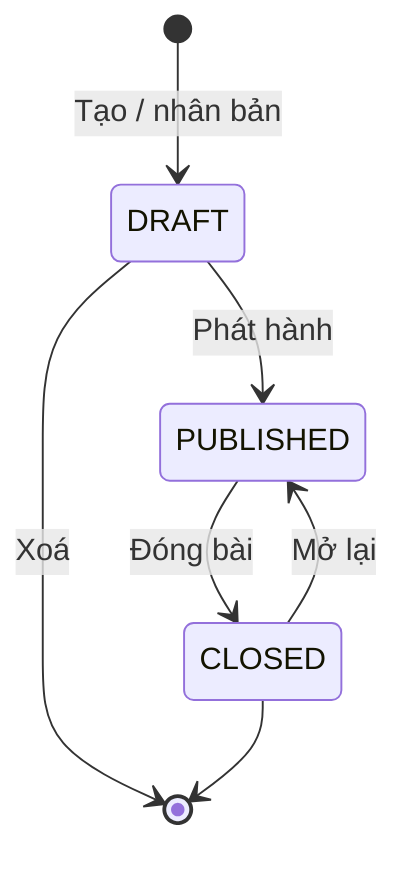
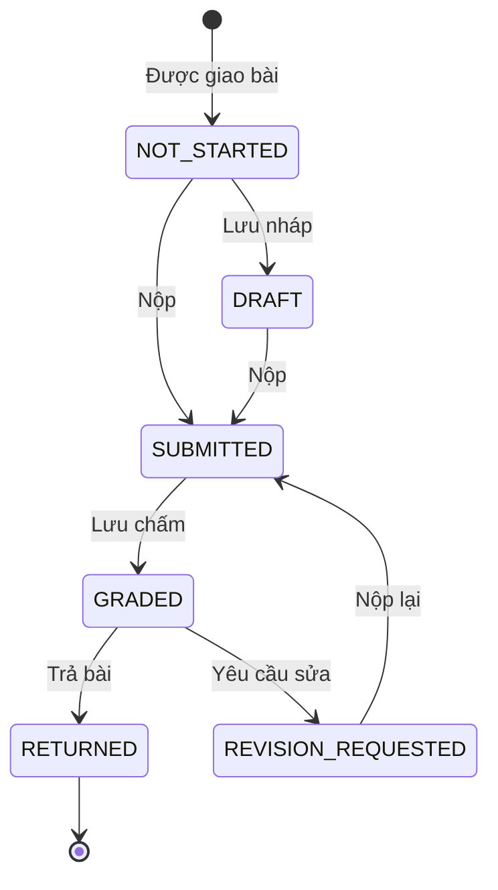
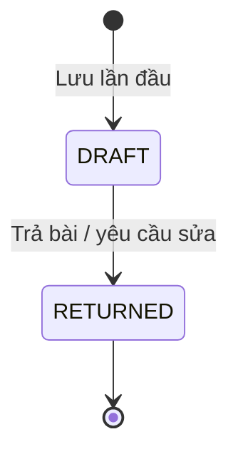
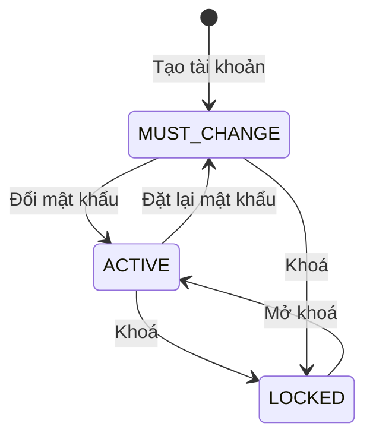
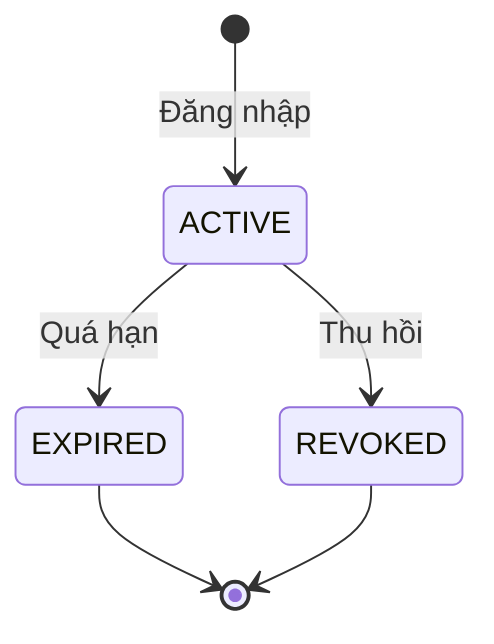
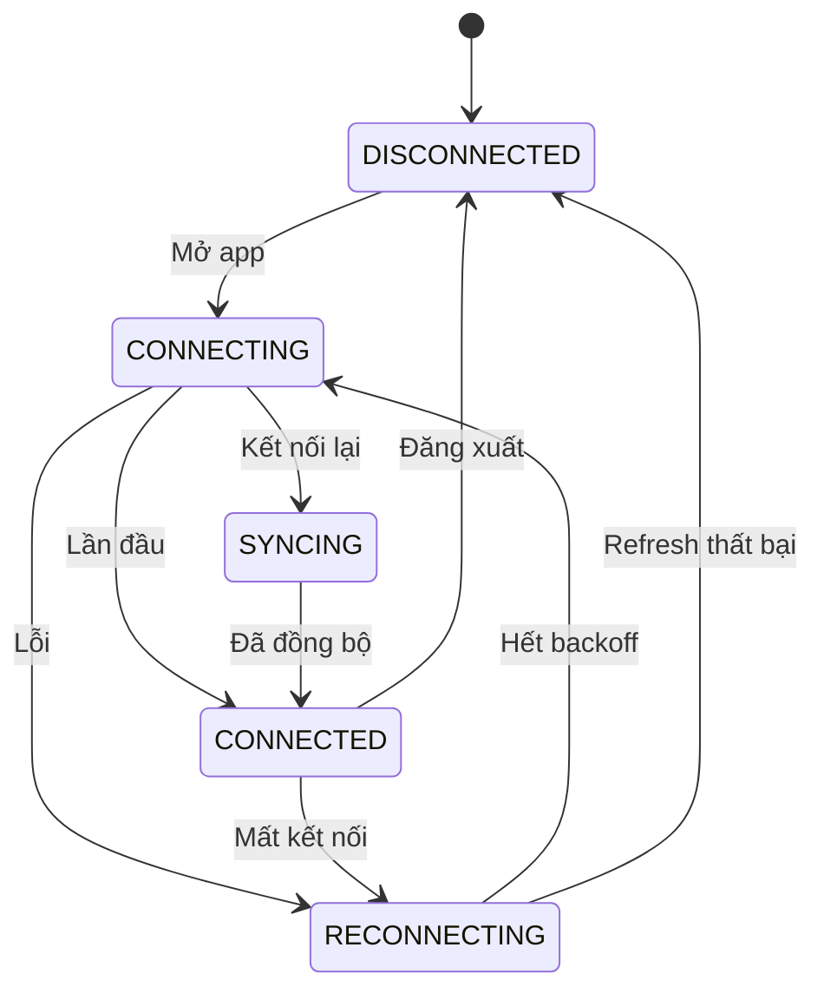
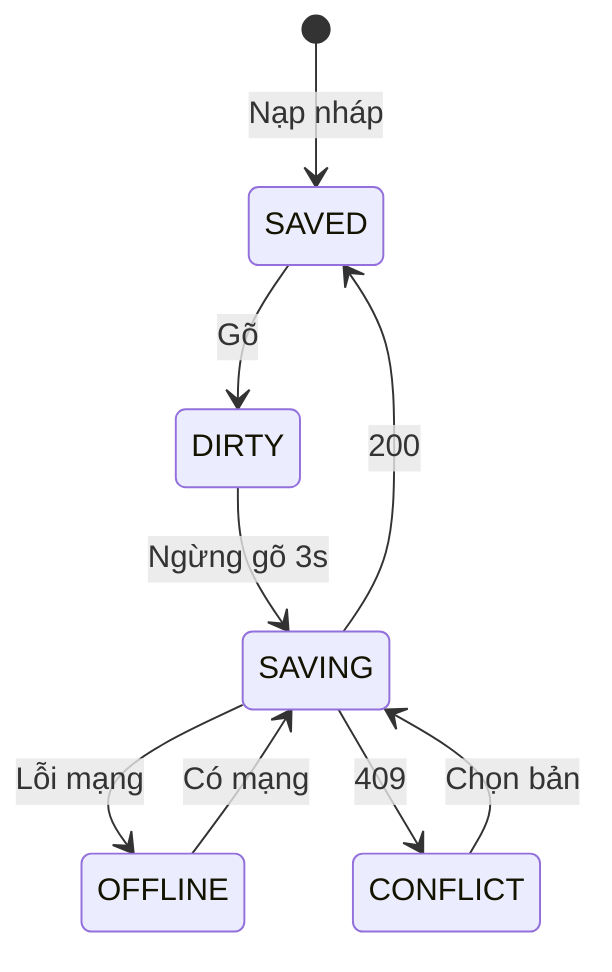
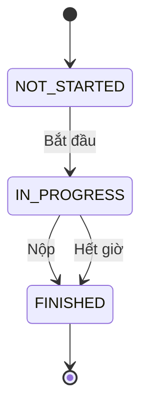

# 06. Sơ đồ trạng thái

> Vòng đời của các đối tượng có trạng thái. Mọi chuyển trạng thái đều **do server kiểm tra**: client gửi yêu cầu không hợp lệ thì nhận `409 INVALID_STATE` (xem [05-api.md](05-api.md)).
> Tên trạng thái khớp với giá trị lưu trong DB ([04-erd.md](04-erd.md)).

---

## 1. Bài tập (`assignments.status`)

Điều kiện **Phát hành**: có ít nhất 1 phần, mỗi phần có ít nhất 1 tiêu chí, và có người nhận.

| Trạng thái | Sinh viên thấy bài? | Sinh viên nộp được? | Giáo viên sửa được gì? |
|---|---|---|---|
| `DRAFT` | Không | Không | Mọi thứ |
| `PUBLISHED` | Có, từ `open_at` (BR-05) | Có, theo hạn và quy tắc nộp muộn (BR-08) | Mô tả, hạn, nộp muộn, số lần sửa, thêm người nhận (BR-06) |
| `CLOSED` | Có (chỉ xem) | Không | Không. Phải mở lại trước |

Chấm bài vẫn làm được ở cả `PUBLISHED` và `CLOSED`.

---

## 2. Bài nộp của một phần (`submissions.status`)

| Chuyển | Điều kiện / ghi chú |
|---|---|
| Nộp, Nộp lại | Trong hạn áp dụng, hoặc bài cho nộp muộn (BR-07, BR-08). Mỗi lần nộp tạo một version mới |
| Lưu chấm | Giáo viên lưu kết quả chấm (nháp). Sửa điểm nhiều lần thì trạng thái vẫn là `GRADED` |
| Trả bài | Đã chấm đủ mọi tiêu chí |
| Yêu cầu sửa | Đã chấm đủ mọi tiêu chí, còn lượt sửa (BR-10), có hạn sửa ở tương lai |
| (tự lặp) | `DRAFT` và `REVISION_REQUESTED`: sinh viên lưu nháp nhiều lần thì trạng thái không đổi |

| Trạng thái | Ý nghĩa | Sinh viên làm được | Màu trong ma trận tiến độ |
|---|---|---|---|
| `NOT_STARTED` | Chưa mở bài, hoặc chưa gõ gì | Soạn bài | Xám |
| `DRAFT` | Có bản nháp, chưa nộp lần nào | Soạn tiếp, nộp | Xanh nhạt |
| `SUBMITTED` | Đã nộp, chờ chấm | Chỉ xem bài đã nộp | Xanh dương (cam nếu `is_late`) |
| `GRADED` | Giáo viên đang chấm (nháp), sinh viên **chưa thấy điểm** | Chỉ xem bài đã nộp | Tím |
| `RETURNED` | Đã có kết quả | Xem điểm, nhận xét | Xanh lá |
| `REVISION_REQUESTED` | Phải viết lại trước `revision_due_at` | Xem nhận xét, soạn bản sửa, nộp lại | Đỏ |

**Ghi chú**
- Trả bài hay yêu cầu sửa đều phải qua `GRADED`, vì phải chấm đủ mọi tiêu chí trước. `PUT …/grade` chuyển `SUBMITTED` sang `GRADED`.
- Với sinh viên, `GRADED` hiển thị giống `SUBMITTED` ("Đã nộp – chờ kết quả"), vì điểm chưa được công bố (BR-13).
- Ở `REVISION_REQUESTED`, bản nháp đang sửa lưu ở `draft_content`; trạng thái giữ nguyên cho tới khi nộp.
- "Nộp muộn" không phải một trạng thái riêng. Đó là cờ `is_late` của từng version.
- Giáo viên chỉ yêu cầu sửa được khi bài ở `GRADED`, nghĩa là mọi lần yêu cầu sửa trước đó đều đã có version nộp lại. Vì thế, tại thời điểm yêu cầu, số lần đã yêu cầu sửa = `current_version − 1`, và điều kiện cho phép là `current_version − 1 < max_revisions` (BR-10).
- **Trạng thái của cả bài tập đối với một sinh viên** (dùng cho các tab ở UC-22) được suy ra từ trạng thái các phần. Ví dụ: có phần `REVISION_REQUESTED` → tab "Cần sửa"; mọi phần ≥ `SUBMITTED` → tab "Đã nộp".

---

## 3. Kết quả chấm (`grades.status`)

- Mỗi **version** có tối đa một kết quả chấm. Sinh viên nộp version mới thì giáo viên chấm một kết quả mới; kết quả cũ vẫn giữ để so sánh.
- Đã `RETURNED` thì không sửa nữa. Muốn đổi điểm thì yêu cầu sửa bài, hoặc admin can thiệp trực tiếp (ngoài phạm vi).

---

## 4. Tài khoản người dùng

Trạng thái này là tổ hợp của hai cột `users.active` và `users.must_change_password`:

| Trạng thái | `active` | `must_change_password` | Đăng nhập |
|---|---|---|---|
| `MUST_CHANGE` | true | true | Được, nhưng chỉ vào được trang đổi mật khẩu |
| `ACTIVE` | true | false | Bình thường |
| `LOCKED` | false | (bất kỳ) | Bị từ chối. Mọi phiên đang mở bị thu hồi, nhận `FORCE_LOGOUT` |

---

## 5. Phiên đăng nhập (`user_sessions`)

- Mỗi lần **refresh**, phiên vẫn ở `ACTIVE`: token được xoay vòng, `last_used_at` và `expires_at` được cập nhật.
- **Thu hồi** khi: đăng xuất, đăng nhập nơi khác (một phiên), đổi mật khẩu, bị khoá, admin buộc đăng xuất, hoặc phát hiện dùng lại token cũ. Ghi bằng `revoked_at` + `revoke_reason`.
- `EXPIRED` không cần lưu riêng, so `expires_at` với giờ hiện tại là biết.

---

## 6. Kết nối WebSocket phía client

| Chuyển | Ghi chú |
|---|---|
| Lần đầu / Kết nối lại | Nhận khung `CONNECTED`, SUBSCRIBE các kênh. Nếu là kết nối lại thì sang `SYNCING` |
| Đã đồng bộ | Đã gọi xong `GET /api/notifications?after=` để lấy thông báo bị lỡ |
| Mất kết nối | Không nhận heartbeat, hoặc socket đóng bất thường |
| Hết backoff | Chờ lần lượt 1s, 2s, 4s… tối đa 30s rồi thử lại |
| Refresh thất bại | Token hết hạn và không làm mới được → về trang đăng nhập |
| Đăng xuất | Người dùng đăng xuất, hoặc nhận `FORCE_LOGOUT` |

Giao diện hiển thị theo trạng thái:
- `RECONNECTING`: thanh vàng "Mất kết nối… đang thử lại (lần n)".
- `SYNCING`: ẩn thanh vàng, hiện các thông báo bị lỡ.
- `DISCONNECTED` do `FORCE_LOGOUT`: hộp thoại "Tài khoản vừa đăng nhập ở nơi khác", rồi chuyển về trang đăng nhập.

---

## 7. Bản nháp phía client (Mức 2)

| Chuyển | Ghi chú |
|---|---|
| Gõ | Mỗi lần thay đổi đều lưu ngay vào IndexedDB. Gõ tiếp ở `DIRTY` hay `OFFLINE` thì trạng thái giữ nguyên |
| Ngừng gõ 3s | Cũng kích hoạt khi đổi tab hoặc rời trang |
| 200 | Nhận `draftVersion` mới từ server |
| 409 | `DRAFT_CONFLICT`: tab hoặc máy khác đã lưu bản mới hơn |
| Có mạng | Trình duyệt phát sự kiện `online` |
| Chọn bản | Sinh viên chọn giữ bản trên máy hoặc bản trên server |

Chữ hiển thị cạnh ô soạn: `SAVED` "Đã lưu lúc hh:mm" · `SAVING` "Đang lưu…" · `OFFLINE` "Ngoại tuyến – đã lưu trên máy" · `CONFLICT` hộp thoại chọn bản.

---

## 8. Phiên thi (Mức 3, `exam_sessions`)

- **Bắt đầu**: `ends_at = now + thời lượng`. Các sự kiện chuyển tab, dán, mất kết nối được ghi lại, trạng thái không đổi.
- **Nộp**: `finish_reason = SUBMITTED`. **Hết giờ**: job tự nộp bản nháp mới nhất, `finish_reason = TIMEOUT`.

Phiên thi tách riêng với trạng thái bài nộp. Phiên kết thúc thì bài nộp chuyển sang `SUBMITTED` như luồng thường.

---

## 9. Phiên kết nối TCP

Xem máy trạng thái ở [05-api.md – mục C.5](05-api.md#c5-máy-trạng-thái-của-một-phiên).
