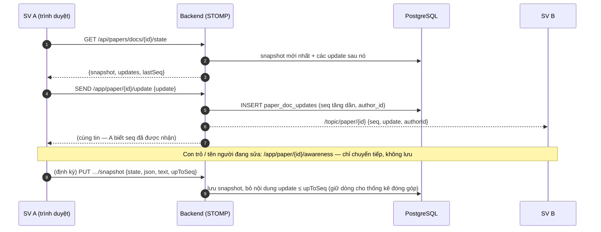

# 12. Thiết kế mở rộng: viết paper học thuật theo nhóm (Mức 4)

> **Trạng thái: đã duyệt (29/10).** Đang làm: B21a ✅ (loại bài PAPER, khung mục, nhóm) · B21b ✅ (bài làm theo nhóm, V17) · B22 ✅ (lưu tài liệu Yjs, V18). Phần đã làm được chuyển vào tài liệu chuẩn (01 FR-70/71, BR-27/29/31; 02 UC-33/34; 04 V16; 05 A.10). Duyệt xong thì nội dung được chuyển vào các tài liệu chuẩn
> (01 FR/BR, 02 use case, 03 tuần tự, 04 bảng, 05 API, 06 trạng thái) theo từng bước, như các mức trước.

Quyết định đã chốt (28/10):

| # | Câu hỏi | Chốt |
|---|---|---|
| 1 | Loại paper | Bài báo / báo cáo **học thuật ngành IT**: có bảng, hình, khối code, công thức, thuật toán |
| 2 | Cá nhân hay nhóm | **Nhóm**, cùng sửa một văn bản theo thời gian thực |
| 3 | Kiểu trích dẫn | **IEEE** mặc định (chuẩn của ngành IT), có thêm **APA**; giáo viên chọn khi tạo bài |
| 3b | Cách chấm | **Vẫn chấm theo rubric** — rubric phân tích: tiêu chí × mức đạt, mỗi ô có mô tả (xem 5.4) |
| 4 | Phản biện chéo giữa sinh viên | **Không** |
| 5 | Phạm vi | **Làm hết** P1 → P3 |

---

## 1. Khái niệm

| Khái niệm | Nghĩa |
|---|---|
| **Bài tập loại PAPER** | Bài tập có `kind = PAPER` (bài cũ là `ESSAY`). Dùng lại toàn bộ luồng giao bài, hạn nộp, thông báo, tiến độ |
| **Giai đoạn** | Một **phần** của bài PAPER, vd *Đề cương → Bản nháp → Bản cuối*; mỗi giai đoạn có hạn riêng (BR-07 đã có), nộp và chấm riêng |
| **Khung mục** | Danh sách mục giáo viên đặt cho một giai đoạn (vd Abstract, Introduction, Related Work, Method, Results, Discussion, Conclusion), mỗi mục có giới hạn số từ và có bắt buộc hay không |
| **Nhóm** | Các sinh viên cùng viết một paper trong một bài tập |
| **Tài liệu** | Văn bản dùng chung của một nhóm cho một giai đoạn, sửa đồng thời theo thời gian thực |
| **Lần nộp** | Ảnh chụp bất biến của tài liệu lúc bấm nộp (giống `submission_versions` hiện nay) — giáo viên chấm và nhận xét trên lần nộp |
| **Thư viện trích dẫn** | Danh sách tài liệu tham khảo dùng chung của nhóm, sinh danh mục tự động theo IEEE / APA |

## 2. Yêu cầu chức năng (dự kiến FR-70 → FR-81)

| Mã | Yêu cầu | Tác nhân | Giai đoạn |
|---|---|---|---|
| FR-70 | Tạo bài loại PAPER: các giai đoạn, khung mục mỗi giai đoạn (tiêu đề, bắt buộc, giới hạn từ), kiểu trích dẫn, cỡ nhóm tối đa | Giáo viên | P1 |
| FR-71 | Lập nhóm: giáo viên chia nhóm (tay hoặc ngẫu nhiên theo lớp), hoặc mở cho sinh viên tự tạo / tham gia nhóm tới hạn chốt nhóm | Giáo viên, Sinh viên | P1 |
| FR-72 | Trình soạn có định dạng: tiêu đề, đậm / nghiêng, danh sách, bảng, hình (có chú thích, đánh số tự động), khối code có tô màu cú pháp, công thức (LaTeX), chú thích cuối trang | Sinh viên | P1 |
| FR-73 | Đếm từ theo từng mục và cả bài, cảnh báo khi vượt / thiếu; mục lục bên trái để nhảy giữa các mục | Sinh viên | P1 |
| FR-74 | Thư viện trích dẫn: nhập tay, tra theo DOI, nhập BibTeX; chèn trích dẫn vào bài; danh mục tài liệu tham khảo sinh tự động theo IEEE / APA; cảnh báo tài liệu thiếu trường | Sinh viên | P1 |
| FR-75 | Chấm paper theo **rubric phân tích** (mỗi tiêu chí chọn một mức đạt có mô tả, rồi chỉnh điểm trong khoảng của mức), quy về thang 10; nhận xét theo đoạn trên lần nộp, yêu cầu sửa, trả bài — kết quả hiện cho mọi thành viên. Có rubric mẫu cho paper IT | Giáo viên | P1 |
| FR-76 | Cùng sửa theo thời gian thực: thấy con trỏ / vùng chọn và tên người đang sửa, tự gộp khi sửa trùng chỗ, sửa được khi mất mạng rồi tự đồng bộ | Sinh viên | P2 |
| FR-77 | Lịch sử chỉnh sửa và **thống kê đóng góp** của từng thành viên (số chữ thêm / xoá theo mục, theo ngày) | Giáo viên, Sinh viên | P2 |
| FR-78 | Giáo viên xem trực tiếp tài liệu nhóm đang viết (chỉ đọc) và góp ý qua chat của nhóm | Giáo viên | P2 |
| FR-79 | Xuất **DOCX**, **LaTeX** (mẫu IEEEtran, kèm `.bib` và hình, dạng `.zip`) và **PDF** (bản in từ trình duyệt) | Sinh viên, Giáo viên | P3 |
| FR-80 | Kiểm tra đạo văn trong lớp cho paper (dùng chung bước 16) | Giáo viên | P3 |
| FR-81 | Gợi ý bằng AI cho paper: cấu trúc, văn phong học thuật, trích dẫn thiếu (dùng chung bước 18; giáo viên bật / tắt) | Giáo viên, Sinh viên | P3 |

## 3. Quy tắc nghiệp vụ (dự kiến BR-27 → BR-32)

| Mã | Quy tắc |
|---|---|
| BR-27 | Bài PAPER làm theo nhóm. Mỗi sinh viên thuộc **tối đa một nhóm** trong một bài; nhóm không vượt cỡ tối đa. Sau hạn chốt nhóm, chỉ giáo viên đổi được thành viên. Sinh viên chưa có nhóm khi tới hạn chốt → giáo viên được báo |
| BR-28 | Mọi thành viên sửa chung **một tài liệu** cho mỗi giai đoạn; bất kỳ thành viên nào cũng nộp được. Lần nộp, kết quả chấm, yêu cầu sửa áp dụng cho **cả nhóm** và hiện cho mọi thành viên |
| BR-29 | Mục **bắt buộc** phải có nội dung mới nộp được (server kiểm tra). Giới hạn số từ của mục chỉ **cảnh báo**, không chặn nộp |
| BR-30 | Danh mục tài liệu tham khảo **sinh tự động** từ các trích dẫn có trong bài, theo kiểu của bài (IEEE: đánh số [1], [2]… theo thứ tự xuất hiện; APA: (Tác giả, năm), xếp theo ABC). Tài liệu thiếu trường bắt buộc (tác giả, tiêu đề, năm, nguồn) → cảnh báo |
| BR-31 | Bài PAPER chấm theo **rubric phân tích**: mỗi tiêu chí có các **mức đạt** (vd Xuất sắc / Tốt / Đạt / Chưa đạt), mỗi mức có mô tả và **khoảng điểm**; giáo viên chọn mức rồi chọn điểm trong khoảng đó (bước 0,25). Điểm cả bài = trung bình có trọng số các tiêu chí, quy về **thang 10**. Mục checklist "Giới hạn điểm" vẫn dùng được (giới hạn mức cao nhất chọn được). **Không** áp dụng quy tắc riêng của IELTS: làm tròn band (BR-12), bài ≤ 20 từ (BR-18) |
| BR-32 | Tài liệu nhóm chỉ thành viên nhóm và giáo viên chủ bài đọc được; giáo viên **chỉ đọc**. Mỗi thay đổi ghi người sửa để thống kê đóng góp; thống kê chỉ để tham khảo, không tự động đổi điểm |

## 4. Use case (dự kiến UC-33 → UC-40)

| Mã | Tên | Tác nhân |
|---|---|---|
| UC-33 | Tạo bài paper (giai đoạn, khung mục, kiểu trích dẫn, cỡ nhóm, hạn chốt nhóm) | Giáo viên |
| UC-34 | Lập / sửa nhóm | Giáo viên, Sinh viên |
| UC-35 | Viết paper cùng nhóm (soạn, cùng sửa realtime, mục lục, đếm từ theo mục) | Sinh viên |
| UC-36 | Quản lý trích dẫn (thêm, tra DOI, nhập BibTeX, chèn, sinh danh mục) | Sinh viên |
| UC-37 | Nộp giai đoạn | Sinh viên |
| UC-38 | Chấm paper (rubric thang 10, nhận xét theo đoạn, yêu cầu sửa, trả bài) | Giáo viên |
| UC-39 | Xem đóng góp và xem trực tiếp tài liệu nhóm | Giáo viên |
| UC-40 | Xuất DOCX / LaTeX / PDF | Sinh viên, Giáo viên |

---

## 5. Thiết kế kỹ thuật

### 5.1 Trình soạn

- **TipTap** (xây trên ProseMirror, MIT) — trình soạn có định dạng phổ biến nhất cho React, có sẵn: bảng, hình, khối code (tô màu bằng `lowlight`), cộng tác realtime (Yjs). Công thức hiển thị bằng **KaTeX**.
- Nội dung lưu dạng **JSON của ProseMirror**. Mỗi khối (đoạn, tiêu đề, bảng…) có `id` cố định để neo nhận xét.
- Khung mục = node `paperSection {sectionKey, title}` không xoá được, do giáo viên đặt; nội dung tự do bên trong.
- Bài luận IELTS **giữ nguyên chữ thuần** như hiện nay — không đụng tới phần đang chạy tốt.

### 5.2 Cùng sửa thời gian thực — không cần server riêng

Dùng **Yjs** (CRDT — tự gộp các chỉnh sửa đồng thời mà không cần khoá). Server Java **không cần hiểu Yjs**: chỉ chuyển tiếp và lưu các gói cập nhật dạng nhị phân, nên vẫn giữ **một ứng dụng Spring Boot, không Redis** như kiến trúc đã chốt.

- **Mất mạng**: Yjs giữ thay đổi trên máy (IndexedDB qua `y-indexeddb`), có mạng thì gửi lên và tự gộp. Kết nối lại thì lấy các update `> lastSeq` (giống cách lấy thông báo bị lỡ).
- **Bản chữ để server dùng**: kèm snapshot, client gửi JSON và chữ thuần đã trích. Server dùng để đếm từ theo mục, xem trực tiếp, đạo văn, xuất file. Lúc **nộp**, server lấy snapshot mới nhất làm lần nộp (bất biến).
- **Thống kê đóng góp**: mỗi update ghi `author_id` và số ký tự thêm / xoá (client tính, gửi kèm).
- **Quyền**: chỉ thành viên nhóm SEND được; giáo viên chủ bài SUBSCRIBE được (chỉ đọc).
- **Kích thước**: update thường < 1 KB; snapshot gửi qua REST (không qua STOMP) để tránh giới hạn khung tin.

### 5.3 Trích dẫn

- Thư viện lưu dạng **CSL-JSON** (chuẩn chung của Zotero / Mendeley).
- **citation-js** (MIT) ở frontend: nhập BibTeX / RIS, hiển thị trích dẫn và danh mục theo file style CSL của IEEE / APA (CC BY-SA, đóng gói kèm).
- **Tra DOI**: backend gọi `https://doi.org/{doi}` với header `Accept: application/vnd.citationstyles.csl+json` (Crossref). Đi qua backend để tránh CORS và có giới hạn tần suất.
- Trích dẫn trong bài là node `citation {refIds}`; danh mục ở cuối bài sinh tự động (BR-30), không sửa tay.

### 5.4 Chấm và nhận xét

- Dùng lại module chấm: rubric tiêu chí, checklist, lưu nháp chấm, trả bài, yêu cầu sửa. Thang điểm **suy ra từ loại bài** (ESSAY = band IELTS, PAPER = thang 10 — không cần cột riêng): thang 10 dùng công thức trung bình có trọng số, bỏ quy tắc riêng của IELTS (BR-31).
- **Rubric phân tích** (dạng phổ biến nhất khi chấm paper ở các trường): bảng *tiêu chí × mức đạt*, mỗi ô là một mô tả cụ thể "bài ở mức này trông như thế nào". Mô tả càng cụ thể thì các giáo viên chấm càng khớp nhau. Thường dùng 3–5 mức; mình chọn 4 mức. Thêm bảng `rubric_levels` (tiêu chí, nhãn, điểm thấp nhất, điểm cao nhất, mô tả, thứ tự). Màn chấm hiện bảng mức như hiện nay đang hiện bảng mô tả band IELTS: bấm một ô → điểm nhảy vào khoảng của mức đó, chỉnh lại trong khoảng nếu cần.
- **Rubric mẫu cho paper IT** (giáo viên sửa được, như rubric mẫu IELTS hiện có). Trọng số dồn vào nội dung khoa học; định dạng trích dẫn chỉ chiếm phần nhỏ:

  | Tiêu chí | Trọng số | Xuất sắc (9–10) | Tốt (7–8,75) | Đạt (5–6,75) | Chưa đạt (0–4,75) |
  |---|---|---|---|---|---|
  | Vấn đề & đóng góp (Abstract, Introduction) | 15% | Vấn đề rõ, có động lực; đóng góp nêu cụ thể, đo được | Vấn đề rõ, đóng góp còn chung chung | Vấn đề mơ hồ, đóng góp khó nhận ra | Không nêu được vấn đề / đóng góp |
  | Nghiên cứu liên quan (Related Work) | 15% | So sánh có phân tích với các hướng chính, chỉ ra khoảng trống mà bài lấp | Đủ nguồn, có so sánh nhưng nông | Liệt kê nguồn, không so sánh | Rất ít hoặc không có nguồn |
  | Phương pháp / thiết kế | 25% | Mô tả đủ để người khác làm lại được; lựa chọn có lý do | Đủ ý chính, thiếu vài chi tiết | Thiếu nhiều chi tiết, khó làm lại | Không mô tả được cách làm |
  | Kết quả & đánh giá | 20% | Thí nghiệm hợp lý, có so sánh với phương pháp khác, bảng / hình rõ, có phân tích hạn chế | Có thí nghiệm và số liệu, phân tích còn mỏng | Số liệu ít, không so sánh | Không có kết quả kiểm chứng |
  | Cấu trúc & văn phong học thuật | 15% | Mạch lạc, đúng khung, văn phong khách quan, gần như không lỗi | Mạch lạc, ít lỗi | Rời rạc ở vài chỗ, nhiều lỗi | Khó đọc, sai khung |
  | Trích dẫn & định dạng (IEEE / APA) | 10% | Mọi ý của người khác đều có trích dẫn, danh mục đúng chuẩn | Vài lỗi định dạng nhỏ | Thiếu trích dẫn ở vài chỗ | Không trích dẫn / có dấu hiệu đạo văn |

- **Điểm nhóm và đóng góp cá nhân:** mặc định cả nhóm cùng một điểm (BR-28). Giáo viên xem thống kê đóng góp (BR-32) và có thể **cộng / trừ điểm riêng** cho từng thành viên (tối đa ±2, bắt buộc ghi lý do) — các hướng dẫn dạy học đều khuyên có phần đánh giá cá nhân để công bằng với người làm nhiều. Thống kê đóng góp hiển thị **theo %** của từng thành viên (người chốt 29/10); hệ thống **gợi ý** mức cộng / trừ theo độ lệch so với phần chia đều (vd nhóm 4 người, người đóng góp 10% thay vì 25% → gợi ý −1), giáo viên bấm xác nhận — không tự động đổi điểm.
- Nhận xét theo đoạn neo theo **(id khối, vị trí trong khối, đoạn trích)** trên lần nộp. Lần nộp bất biến nên vị trí không lệch — giống nguyên tắc hiện nay.
- So sánh 2 lần nộp: so trên chữ thuần đã trích theo từng mục (dùng lại so sánh theo từ đang có).

### 5.5 Xuất file

| Định dạng | Cách làm | Thư viện |
|---|---|---|
| DOCX | Backend dựng từ JSON lần nộp: tiêu đề, đoạn, danh sách, bảng, hình, code (font đơn cách), công thức (giữ mã LaTeX), danh mục tham khảo | Apache POI (**đã có**) |
| LaTeX | Backend sinh `main.tex` theo lớp `IEEEtran` + `references.bib` + thư mục hình, nén `.zip` — mở thẳng trên Overleaf | Không cần thêm |
| PDF | Trang "Bản in" với CSS in ấn theo mẫu IEEE hai cột / APA, người dùng bấm In → Lưu PDF | Không cần thêm |

### 5.6 Thư viện mới (phải ghi lý do vào PROGRESS khi thêm)

| Thư viện | Ở đâu | Lý do |
|---|---|---|
| `@tiptap/*` 3.x (react, pm, starter-kit, extensions, extension-table, -image, -code-block-lowlight, -mathematics, -collaboration, y-tiptap), `lowlight` — **đã thêm ở B23b** | Frontend | Trình soạn có định dạng + cộng tác; tự viết là không khả thi. `y-tiptap` là cầu nối ProseMirror ↔ Yjs mà `collaboration` bản 3 cần; `extensions` cho chữ gợi ý trong mục |
| `yjs` — **đã thêm ở B23b**; `y-protocols`, `y-indexeddb`, con trỏ người khác (B26) | Frontend | CRDT cho cùng sửa + giữ thay đổi khi mất mạng |
| `katex` — **đã thêm ở B23b** | Frontend | Hiển thị công thức (`extension-mathematics` vẽ bằng KaTeX) |
| `@citation-js/core`, `plugin-bibtex`, `plugin-csl` 0.9 (MIT) — **đã thêm ở B24b-1**; style `ieee.csl` chính thức (CC BY-SA 3.0, đóng gói nguyên văn trong `lib/constants/ieeeCsl.ts` kèm ghi nguồn) | Frontend | Đọc BibTeX, định dạng trích dẫn IEEE / APA theo CSL (APA có sẵn trong plugin) |
| — | Backend | **Không thêm**: Yjs chỉ chuyển tiếp nhị phân; DOCX dùng POI có sẵn; LaTeX sinh bằng chuỗi |

---

## 6. Dữ liệu (dự kiến từ V16)

| Bảng / cột | Nội dung |
|---|---|
| `assignments.kind` | `ESSAY` (mặc định) \| `PAPER` |
| `assignments.citation_style`, `max_group_size`, `group_lock_at` | Kiểu trích dẫn, cỡ nhóm tối đa, hạn chốt nhóm (chỉ PAPER) |
| `paper_sections` | Khung mục của một giai đoạn: `part_id`, `section_key`, `title`, `required`, `min_words`, `max_words`, `order_no` |
| `paper_groups`, `paper_group_members` | Nhóm trong một bài; UK `(assignment_id, student_id)` ở bảng thành viên (BR-27) |
| `submissions.group_id` | Bài làm của bài PAPER thuộc **nhóm**: UK `(part_id, group_id)`; `student_id` = người nộp gần nhất. Bài ESSAY giữ nguyên UK `(part_id, student_id)` (dùng chỉ mục một phần theo `group_id IS NULL`) |
| `paper_documents` | Tài liệu của (nhóm, giai đoạn): snapshot Yjs (`bytea`), JSON, chữ thuần, `last_seq`, giờ cập nhật |
| `paper_doc_updates` | Log update Yjs: `document_id`, `seq`, `payload` (`bytea`, NULL sau khi gộp vào snapshot — dòng giữ lại cho thống kê đóng góp), `author_id`, `chars_added`, `chars_removed`, `created_at` |
| `submission_versions.content_json`, `references_json` | Lần nộp của bài PAPER: JSON tài liệu + thư viện trích dẫn lúc nộp (`content` vẫn giữ chữ thuần để tìm kiếm, đạo văn) |
| `paper_references` | Thư viện trích dẫn của nhóm: `group_id`, `csl` (`jsonb`), `doi`, `created_by` |
| `inline_comments.block_id` | Neo nhận xét vào khối của tài liệu (bài ESSAY để trống, vẫn dùng vị trí ký tự như cũ) |
| `rubric_levels` | Mức đạt của một tiêu chí: `criterion_id`, `label`, `min_score`, `max_score`, `descriptor`, `order_no` (rubric phân tích — BR-31). Có cả cho rubric mẫu |
| `grade_member_adjustments` | Điểm cộng / trừ riêng cho từng thành viên trên một kết quả chấm: `grade_id`, `student_id`, `delta` (−2…+2), `reason` |

## 7. API và kênh WebSocket (phác thảo)

| Hướng | Đường dẫn | Mô tả |
|---|---|---|
| REST | `POST/PUT /api/teacher/assignments` | Thêm `kind`, `gradingScale`, `citationStyle`, `maxGroupSize`, `groupLockAt`; mỗi phần thêm `sections[]` |
| REST | `/api/teacher/assignments/{id}/groups` (GET, POST, PUT, `…/auto`) | Xem / tạo / sửa nhóm, chia ngẫu nhiên theo lớp |
| REST | `/api/student/assignments/{id}/group` (GET, POST tạo, POST `…/join`, DELETE rời) | Sinh viên tự lập nhóm trước hạn chốt |
| REST | `GET /api/papers/docs/{docId}/state` · `PUT …/snapshot` | Trạng thái tài liệu, lưu snapshot |
| REST | `/api/papers/groups/{groupId}/references` (CRUD + `…/batch`), `GET /api/papers/doi?value=` | Thư viện trích dẫn, tra DOI (DOI có dấu `/` nên đi bằng tham số) — **đã cài ở B24a** |
| REST | `POST /api/student/parts/{partId}/submit` | Bài PAPER: nộp snapshot của tài liệu nhóm (kiểm tra mục bắt buộc — BR-29) |
| REST | `GET /api/papers/versions/{versionId}/export?format=docx\|latex` | Xuất file |
| REST | `GET /api/teacher/papers/docs/{docId}/contributions` | Thống kê đóng góp |
| STOMP SEND | `/app/paper/{docId}/update` · `/app/paper/{docId}/awareness` | Gửi update Yjs / con trỏ |
| STOMP SUB | `/topic/paper/{docId}` · `/topic/paper/{docId}/awareness` | Thành viên nhóm + giáo viên chủ bài (chỉ đọc) |

## 8. Ảnh hưởng tới phần đang có

| Phần | Thay đổi |
|---|---|
| Bài tập / trình soạn | Chọn loại bài; PAPER có thêm khung mục, kiểu trích dẫn, nhóm |
| Bài nộp (`submission`) | **Thay đổi lớn nhất**: quyền đọc / nộp phía sinh viên phải tính theo nhóm. Tách nhánh rõ ESSAY / PAPER, có test cho cả hai |
| Chấm bài | Thêm thang 10; tắt quy tắc IELTS cho PAPER; màn chấm hiển thị tài liệu có định dạng |
| Thông báo | Sự kiện của bài PAPER gửi tới **mọi thành viên nhóm** |
| Tiến độ / thống kê | Hàng = nhóm (mở ra xem thành viên) với bài PAPER. Thống kê tính cho từng thành viên theo điểm riêng thang 10 (điểm nhóm + cộng / trừ), phân bố theo nửa điểm; không gộp vào band trung bình / xếp hạng IELTS |
| Xem trực tiếp (B15b) | Bài PAPER: giáo viên tham gia tài liệu Yjs ở chế độ chỉ đọc, không cần kênh `/app/live` |
| Chat | Thêm kênh `group-{id}` cho nhóm |
| Đạo văn (bước 16), AI (bước 18) | Đọc chữ thuần đã trích của lần nộp |

---

## 9. Lộ trình — chia bước nhỏ, mỗi bước có test và cập nhật tài liệu

| Bước | Nội dung | Tiêu chí xong |
|---|---|---|
| **P1 — viết và chấm được** | | |
| B21a ✅ | Backend nền: `kind`, kiểu trích dẫn, cỡ nhóm, hạn chốt nhóm, khung mục, tiêu chí thang 10, nhóm (giáo viên chia + chia ngẫu nhiên + sinh viên tự lập, BR-27) |
| B21b ✅ | `submissions.group_id` + view `submission_members` + quyền đọc / nộp theo nhóm (BR-28), thông báo tới mọi thành viên, nhắc giáo viên khi tới hạn chốt nhóm mà còn người chưa có nhóm; khoá đổi nhóm khi nhóm đã có bài làm | Test: một sinh viên một nhóm; mọi thành viên thấy chung bài làm; bài ESSAY không đổi hành vi |
| B22 ✅ | Lưu tài liệu: `paper_documents`, `paper_doc_updates`, REST state / snapshot, kênh STOMP update (một người viết vẫn đi qua Yjs — để B25 không phải làm lại) | Test: update lưu theo seq; snapshot gộp; người ngoài nhóm bị từ chối |
| B23 ✅ | Frontend trình soạn: TipTap + Yjs, khung mục, bảng, hình, code, công thức, mục lục, đếm từ theo mục; giáo viên soạn bài PAPER + chia nhóm. **B23a ✅** giáo viên soạn bài PAPER + chia nhóm, sinh viên lập / vào nhóm · **B23b-1 ✅** `PaperEditor` + đồng bộ Yjs ở màn làm bài, snapshot định kỳ, nộp tạm bằng chữ thuần · **B23b-2 ✅** `PaperOutline`: mục lục + đếm từ theo mục, nhắc thiếu / vượt / mục bắt buộc trống. Chú thích + đánh số hình / bảng, chú thích cuối trang (FR-72) để sau | Lint / build / test; viết được một paper đủ mục và lưu lại được |
| B24 ✅ | Trích dẫn: thư viện nhóm, tra DOI, nhập BibTeX, chèn trích dẫn, danh mục IEEE / APA (BR-30). **B24a ✅** backend: `paper_references` (V19), API thư viện + nhập nhiều mục + tra DOI qua backend, lọc CSL, trường còn thiếu · **B24b-1 ✅** frontend thư viện trích dẫn: `ReferenceLibrary` (tra DOI, nhập tay, nhập BibTeX bằng citation-js, sửa / xoá, xem theo IEEE / APA, cảnh báo trường thiếu) · **B24b-2 ✅** node `citation` (`refIds` dạng chuỗi "3,7" trong Yjs, nhãn tính lại bằng decoration — IEEE đánh số theo thứ tự xuất hiện, gộp `[1]–[3]`; APA qua citeproc), hộp chọn tài liệu, danh mục **References** tự sinh cuối bài (ngoài tài liệu Yjs; lúc nộp server dựng lại ở B25) | Test định dạng IEEE / APA với bộ mẫu |
| B25 ✅ | Nộp + chấm: kiểm tra mục bắt buộc (BR-29), rubric phân tích + rubric mẫu paper IT, thang 10 (BR-31), điểm cộng / trừ riêng từng thành viên, nhận xét theo khối, so sánh lần nộp, màn chấm và màn kết quả cho tài liệu có định dạng. Tách: **B25a ✅** nộp snapshot phía server + chặn mục bắt buộc trống (BR-29) + lưu `content_json` / `references_json` (V20), xem bản nộp có định dạng · **B25b ✅** chấm thang 10 + mức đạt (`rubric_levels`, V21 — kèm sửa cột bước / điểm 2 chữ số thập phân) + cộng / trừ từng thành viên (`grade_member_adjustments`) · B25c FE (tách: **B25c-1 ✅** soạn mức đạt + rubric mẫu paper IT 4 mức · **B25c-2 ✅** màn chấm Paper (bài có định dạng, chọn mức → điểm, cộng / trừ thành viên) · **B25c-3 ✅** hàng đợi ghi tên nhóm + điểm thang 10) · **Mức 1 live comment ✅** backend nhận xét đoạn đang viết (V22, REST + STOMP); **B25d ✅** nhận xét trên bản có định dạng (neo offset trên chữ thuần của lần nộp, tô bằng decoration ProseMirror; không có lớp sửa chữ) + so sánh lần nộp / đánh giá "đã sửa" trên chữ thuần · **B25e ✅ (phần kết quả)** kết quả phía sinh viên: bản nộp có định dạng, điểm riêng / điểm nhóm thang 10, lý do cộng / trừ; thống kê bài / lớp / kết quả học tập + bảng điểm Excel tính bài PAPER cho từng thành viên theo điểm riêng thang 10, không gộp vào band trung bình / xếp hạng IELTS | Test: nộp thiếu mục bắt buộc → lỗi; điểm ngoài khoảng của mức → lỗi; điểm thang 10 đúng; mọi thành viên thấy kết quả |
| **P2 — viết nhóm thật sự** | | |
| B26 | Cùng sửa realtime: chuyển tiếp nhiều người, con trỏ + tên, mất mạng rồi đồng bộ, thống kê đóng góp (BR-32), giáo viên xem trực tiếp chỉ đọc, chat nhóm | 2 trình duyệt sửa cùng đoạn không mất chữ; tắt mạng một bên rồi bật lại tự gộp |
| **P3 — hoàn thiện** | | |
| B27 | Xuất DOCX / LaTeX (IEEEtran, `.zip`) / bản in PDF | Mở DOCX bằng Word; `.zip` biên dịch được trên Overleaf |
| B28 | Đạo văn + gợi ý AI cho paper (sau khi xong bước 16 và 18) | Như bước 16 / 18 |

Mỗi bước trên còn được tách nhỏ hơn khi bắt đầu làm (vd B23a giao diện giáo viên + nhóm, B23b trình soạn), như đã làm ở bước 15.

## 10. Rủi ro và cách giảm

| Rủi ro | Cách giảm |
|---|---|
| Bài nộp theo nhóm đụng vào phần lõi đang chạy tốt | Tách nhánh ESSAY / PAPER rõ ràng; chạy lại toàn bộ 515 test sau mỗi bước; bài ESSAY không đổi dữ liệu |
| Server không đọc được nội dung Yjs | Client gửi kèm JSON + chữ thuần ở mỗi snapshot; lúc nộp dùng snapshot mới nhất; chỉ thành viên nhóm được gửi |
| Log update phình to | Snapshot định kỳ (theo số update / khi rảnh) rồi xoá update cũ |
| Nhiều thư viện frontend mới, bundle nặng | Chỉ tải trình soạn ở màn viết paper (tách gói theo trang) |
| Tra DOI phụ thuộc mạng ngoài | Có giới hạn tần suất, thời gian chờ ngắn; lỗi thì cho nhập tay |
| Khối lượng lớn so với thời hạn đồ án | Làm theo thứ tự P1 → P3; xong P1 là đã dùng được để viết và chấm paper |
